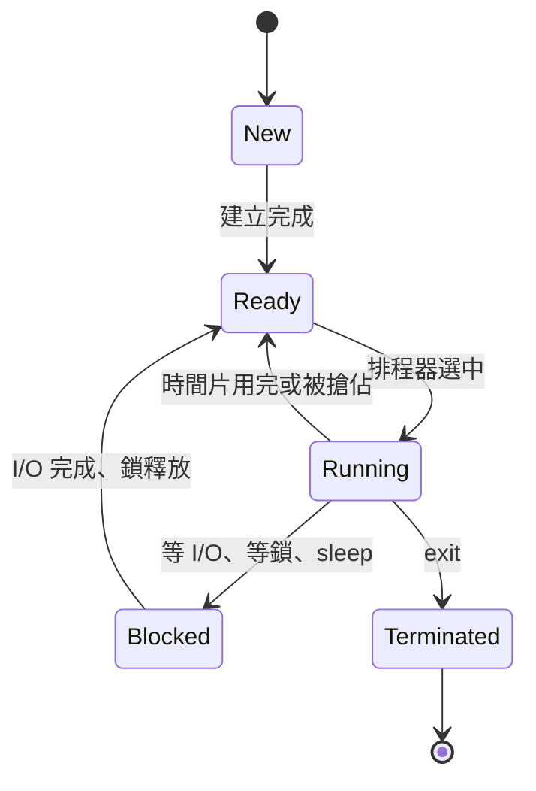

# 第 1 堂：程序 vs 執行緒、行程狀態

這是「作業系統」的第一堂，也是整套課的地基。後面的網路、資料庫、共識和平行運算，最後都要靠 OS 提供的程序和執行緒才跑得起來。

## 1. 程序（Process）是什麼
程序就是「正在執行的程式」。OS 會給每個程序這些東西：
- 獨立的**虛擬位址空間**，裡面有程式碼、全域資料、heap 和 stack
- 一張開啟中檔案和 socket 的清單（file descriptor table）
- PID、權限和環境變數
- 至少一個執行緒

重點是**程序之間彼此隔離**。A 程序不能直接讀 B 的記憶體，A 當掉通常也不會拖垮 B。Docker 容器、瀏覽器分頁、微服務能做到故障隔離，靠的就是這一點。

## 2. 執行緒（Thread）是什麼
執行緒是 CPU 排程的最小單位。同一個程序裡的執行緒：
- **共享** heap、全域變數和開啟的檔案
- **各自擁有** stack、暫存器和程式計數器（PC）

所以執行緒之間溝通很便宜，直接讀寫同一塊記憶體就好，但也因此會出現**競態條件（race condition）**。

| | 程序 | 執行緒 |
|---|---|---|
| 記憶體 | 各自獨立 | 共享 heap |
| 建立成本 | 高 | 低 |
| 切換成本 | 高（要換位址空間，TLB 失效） | 低 |
| 隔離性 | 強 | 弱，一個崩全部崩 |
| 溝通方式 | IPC（pipe、socket、共享記憶體） | 直接讀寫記憶體 |

在 Linux 裡，程序和執行緒其實都是 `task_struct`，差別只在呼叫 `clone()` 時共享了多少資源。`fork()` 幾乎什麼都不共享（搭配 copy-on-write），`pthread_create` 則共享整個位址空間。

## 3. 行程狀態

- **Ready**：可以跑了，正在排隊等 CPU
- **Running**：正在 CPU 上執行
- **Blocked / Waiting**：在等外部事件，不佔 CPU

你在 Linux 用 `ps` 看到的狀態就對應這些：`R` 是執行中或可執行，`S` 是可中斷的睡眠，`D` 是不可中斷的睡眠（常見於等磁碟），`Z` 是 zombie，也就是程序已經結束，但父程序還沒呼叫 `wait()` 回收它。

## 4. 小例子：共享記憶體的陷阱（Go）
```go
var counter int
var wg sync.WaitGroup
for i := 0; i < 1000; i++ {
    wg.Add(1)
    go func() { defer wg.Done(); counter++ }()
}
wg.Wait()
fmt.Println(counter) // 常常小於 1000
```
`counter++` 其實是「讀、加、寫」三個步驟。兩個執行緒可能同時讀到同一個舊值，結果就少加了一次。解法是用 `sync.Mutex` 或 `atomic.AddInt64`，第 8 堂和第 11 堂會深入講。

## 5. 跟你熟悉的東西連起來
- **C#**：`Process.Start` 會開一個新程序；`Thread` 和 `Task` 則跑在執行緒（池）上。ASP.NET 的一個請求通常由執行緒池裡的某個執行緒處理。
- **Go**：goroutine 不是 OS 執行緒，而是 Go runtime 在少數幾個 OS 執行緒上做多工（第 51 堂會講）。
- **Docker**：容器本質上就是一組被 namespace 和 cgroup 限制住的 Linux 程序（第 12 堂會講）。容器裡的 PID 1 一退出，容器就結束了；如果 PID 1 不回收子程序，zombie 就會越積越多。
- **雲端**：Azure 和 GCP 的一個 vCPU，通常對應一個硬體執行緒（hyperthread），也就是 OS 能拿來排程執行緒的一個「座位」。

## 6. 小測驗
1. 兩個程序，和同一個程序裡的兩個執行緒，在記憶體共享上有什麼差別？
2. 一個程序發出磁碟讀取之後，它的狀態會怎麼變化？請寫出狀態轉移的順序。
3. 為什麼多執行緒的 `counter++` 可能會出錯？你會怎麼修正？

<details><summary>參考答案</summary>

1. 不同程序各自擁有獨立的位址空間；同一個程序裡的執行緒共享位址空間（heap、全域變數），只有 stack 和暫存器是各自的。
2. Running 先變成 Blocked（等 I/O），I/O 完成後變成 Ready，等排程器選中再回到 Running。
3. 因為 `counter++` 是「讀、加、寫」三步，會產生競態條件。修正方法是用 mutex 保護這段臨界區，或改用原子操作。
</details>
