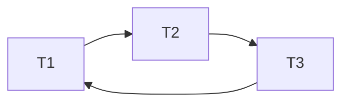

# 第 2 堂：CPU 排程（Round Robin、CFS）

這堂還在「作業系統」層。第 1 堂講了有哪些程序和執行緒，這堂要回答的是：CPU 核心數有限，誰先用、用多久？

## 1. 排程器要解決的問題
一台 8 核機器上，可能同時有幾百個 Ready 的執行緒。排程器得在三件事之間取捨：
- **吞吐量**：單位時間內能完成多少工作
- **延遲與回應性**：互動程式按下去要馬上有反應
- **公平性**：不能讓某個程序一直搶不到 CPU 而餓死

## 2. 搶佔與時間片
OS 靠**計時器中斷**，每隔一小段時間（叫時間片，大約幾毫秒）強制把 CPU 收回來，這就是**搶佔式排程**。換人時要做 **context switch**：存下目前執行緒的暫存器，再載入下一個的。這件事有成本，還會讓 CPU cache 變冷。

## 3. Round Robin（輪詢）
所有 Ready 的執行緒排成一列，每個輪流跑一個時間片，用完就回到隊尾。

- 時間片太短，context switch 的開銷占比就會變高。
- 時間片太長，就退化成先來先服務，互動延遲變差。
- 它的缺點是不分優先級，也不區分 I/O 型和 CPU 型的工作。

## 4. Linux CFS（完全公平排程器）
CFS 不用固定時間片，而是用 **vruntime（虛擬執行時間）**：
- 每個任務記錄自己已經用了多少 CPU，並依權重換算。
- 排程器永遠挑 **vruntime 最小**的任務先跑，也就是目前最吃虧的那個。
- 任務存放在**紅黑樹**裡，最左邊的節點就是下一個要跑的，取出是 O(log n)。
- **nice 值**決定權重：nice 越低權重越大，vruntime 增長越慢，所以能分到更多 CPU。
- 等 I/O 睡醒的任務 vruntime 通常很小，很快就會被排上，所以互動程式感覺很靈敏。

補充一下：Linux 6.6 之後，CFS 逐步被 EEVDF 取代，但核心思想一樣是在公平和延遲之間取得平衡。

## 5. 跟你的日常連起來
- **Docker 和 K8s**：`--cpus=2` 或 K8s 的 `limits.cpu`，是靠 cgroup 的 CFS bandwidth 機制實作的。配額一用完，整個容器會被 **throttle**，暫停到下個週期才能再跑，這常是 P99 延遲飆高的元兇。
- **Go**：舊版 Go 的 `GOMAXPROCS` 預設讀主機的核心數，不看容器限額。容器只給 2 核卻開了 64 個 P，就很容易被 throttle。以前的解法是用 `uber-go/automaxprocs`；Go 1.25 起 runtime 已經會自動參考 cgroup 的 CPU 限制。
- **C#**：.NET 的 ThreadPool 會依 CPU 數和阻塞情況調整執行緒數量。在 async 程式裡用 `.Result` 阻塞執行緒，會讓執行緒池不夠用，造成 thread starvation。
- **小實驗**：跑 `nice -n 19 yes > /dev/null &`，再開 `top`，就能看到低優先級的任務分到的 CPU 變少。

## 6. 小測驗
1. 為什麼 Round Robin 的時間片不能設得太短，也不能太長？
2. CFS 怎麼決定下一個要跑誰？nice 值會怎麼影響結果？
3. 一個 Go 服務放進限制 2 CPU 的容器後，出現延遲尖峰，可能是什麼原因？你會怎麼緩解？
