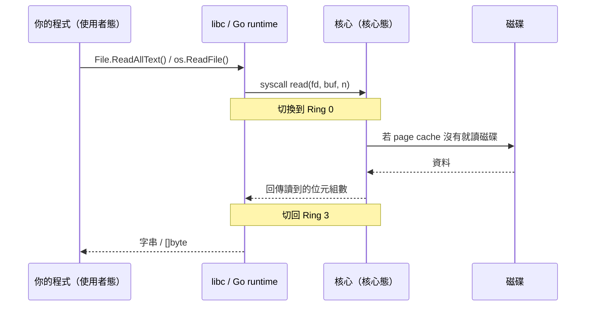

# 第 3 堂：系統呼叫與使用者態/核心態

這堂還在「作業系統」層，講的是應用程式和核心之間的那道門：你的 C#、Go 程式要讀檔、開 socket、建執行緒，全都得「敲門」請核心代勞。

## 1. 為什麼要分兩種模式？
CPU 硬體本身就支援**特權等級**。x86 有 Ring 0 到 Ring 3，實務上只用兩個：
- **核心態（kernel mode，Ring 0）**：可以執行任何指令、碰任何記憶體、直接操作硬體（磁碟、網卡、分頁表）。
- **使用者態（user mode，Ring 3）**：只能跑一般運算，碰不到硬體，也看不到別的程序的記憶體。

這樣設計是為了**隔離和保護**：一個寫壞的程式頂多讓自己 crash（segfault），不會把整台機器或別人的資料拖下水。如果每個程式都能直接寫磁碟、改分頁表，任何 bug 都可能是整台機器的災難。

## 2. 系統呼叫（syscall）怎麼運作
使用者態程式想做特權的事，就要發出**系統呼叫**，這是一個受控的入口：

1. 程式把 **syscall 編號**放進暫存器（例如 x86-64 的 `rax`，`read` 是 0、`write` 是 1），參數放進 `rdi`、`rsi`、`rdx`……
2. 執行 `syscall` 指令，CPU **切換到核心態**，跳到核心事先登記好的入口位址（程式不能自己選跳去哪）。
3. 核心依編號查 **syscall table**，執行對應的函式，例如 `sys_read`，並**檢查參數**（指標是否合法、有沒有權限）。
4. 做完把回傳值放進 `rax`，執行 `sysret` 回到使用者態，程式繼續往下跑。



重點：**核心入口是固定的**。程式不能說「幫我跳到核心某某位址」，只能說「我要第幾號服務」，核心決定怎麼做、做不做。

## 3. 常見的系統呼叫
| 類別 | 例子 |
|---|---|
| 程序管理 | `fork`、`clone`、`execve`、`exit`、`wait4` |
| 檔案 I/O | `open`、`read`、`write`、`close`、`fsync` |
| 記憶體 | `mmap`、`munmap`、`brk` |
| 網路 | `socket`、`bind`、`listen`、`accept`、`connect`、`sendto` |
| 等待事件 | `epoll_wait`、`futex`、`nanosleep` |

Linux 大約有 300 多個 syscall。你平常寫的 `Console.WriteLine`、`fmt.Println`，最後都會走到 `write(1, ...)`。

## 4. 進核心的三種方式
syscall 不是唯一會切到核心態的情況：
- **系統呼叫**：程式主動要求（同步、自願）。
- **例外（exception / trap）**：程式出錯，例如除以零、存取不存在的頁（page fault，第 5 堂會講），CPU 自動進核心處理。
- **硬體中斷（interrupt）**：網卡收到封包、計時器到期（上一堂講的搶佔就靠它），跟程式正在做什麼無關。

## 5. 切換的成本
一次 syscall 本身大約是**幾十到幾百奈秒**，比一般函式呼叫（約 1 奈秒）貴上百倍，原因包括：
- 保存與還原暫存器、切換堆疊。
- Spectre/Meltdown 之後的緩解措施（如 KPTI 要切換分頁表），會讓 TLB 和 cache 效果變差。
- 回到使用者態時，cache 裡可能已被核心的資料擠掉一些。

注意：syscall 的**模式切換**和上一堂的 **context switch（換執行緒）**不一樣。syscall 是同一個執行緒進出核心；只有當 syscall 會阻塞（例如等磁碟、等網路），核心才會順便把 CPU 讓給別的執行緒，那時才發生 context switch。

**減少 syscall 的常見技巧**：
- **緩衝**：C# 的 `BufferedStream`、Go 的 `bufio.Writer`，把很多小寫入合併成一次 `write`。
- **vDSO**：像 `clock_gettime`（`DateTime.Now`、`time.Now()`）這種常用又安全的呼叫，核心把它映射到使用者空間，根本不用進核心。
- **批次化**：`io_uring`、`sendmmsg`，一次送一堆請求（第 7 堂會講）。

## 6. 跟你的日常連起來
- **Go**：Go 不依賴 libc，自己用組合語言發 syscall（`syscall.Syscall`）。當 goroutine 進入可能阻塞的 syscall，runtime 會把它所在的 M（OS 執行緒）和 P 分開，讓別的 goroutine 繼續用這個 P 跑（第 51 堂 GMP 會細講）。網路 I/O 則走 netpoller（epoll），盡量不阻塞執行緒。
- **C#**：.NET 透過 PAL 呼叫 libc，再由 libc 發 syscall。`FileStream` 預設有 4KB 緩衝，就是為了減少 syscall 次數。
- **Docker**：容器跟主機**共用同一個核心**，容器裡的 syscall 直接打到主機核心。所以 Docker 預設用 **seccomp** 設定檔擋掉約 40 多個危險的 syscall（例如 `reboot`、`mount`、`kexec_load`）。這也是容器比 VM 輕量、但隔離較弱的根本原因。gVisor 之類的沙箱就是在中間攔截 syscall、自己實作一個使用者態核心。
- **小實驗**：在 Linux 上跑
  ```bash
  strace -c ls > /dev/null      # 統計 ls 用了哪些 syscall、各幾次
  strace -f -e trace=openat,read go run main.go   # 看 Go 程式打開了哪些檔案
  ```
  你會發現一個簡單的 `ls` 就呼叫了幾十次 syscall。

## 7. 小例子：緩衝的差別
```go
// 沒緩衝：每次 Fprintf 都是一次 write syscall，寫 10 萬行 = 10 萬次 syscall
f, _ := os.Create("a.txt")
for i := 0; i < 100000; i++ {
    fmt.Fprintf(f, "line %d\n", i)
}

// 有緩衝：攢滿 4KB 才 write 一次，syscall 次數少兩個數量級
w := bufio.NewWriter(f)
for i := 0; i < 100000; i++ {
    fmt.Fprintf(w, "line %d\n", i)
}
w.Flush()
```
用 `strace -c` 跑兩個版本，`write` 的次數差異一目了然，執行時間也常差好幾倍。

## 8. 小測驗
1. 為什麼作業系統要區分使用者態和核心態？如果沒有這個區分，會有什麼風險？
2. syscall 的「模式切換」和上一堂講的「context switch」有什麼不同？什麼情況下一次 syscall 會引發 context switch？
3. 容器裡的程式發出 syscall 時，是誰在處理？這和 VM 有什麼差別？Docker 用什麼機制限制容器能用的 syscall？

<details><summary>參考答案</summary>

1. 為了**隔離與保護**。使用者態程式碰不到硬體和別人的記憶體，寫壞了頂多自己 crash。如果沒有這個區分，任何程式都能直接寫磁碟、改分頁表、讀別的程序的記憶體，一個 bug 或惡意程式就能拖垮整台機器、偷走資料。
2. **模式切換**是同一個執行緒從使用者態進入核心態再回來，執行緒沒換；**context switch** 是 CPU 從一個執行緒換成另一個執行緒。當 syscall 需要等待（等磁碟、等網路資料、等鎖、`sleep`）而阻塞時，核心會把這個執行緒設為等待狀態，換別的執行緒上 CPU，這時才發生 context switch。
3. 由**主機的核心**直接處理，因為容器和主機共用同一個核心。VM 有自己的 guest 核心，syscall 由 guest 核心處理，VM 和主機之間再靠 hypervisor 隔離，所以隔離較強但較重。Docker 用 **seccomp** 設定檔擋掉危險的 syscall，另外還有 capabilities、AppArmor/SELinux 輔助限制。

</details>
