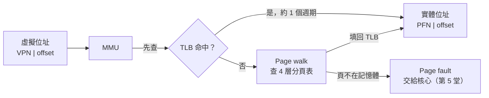

# 第 4 堂：虛擬記憶體、分頁、TLB

這堂仍在「作業系統」層，從 CPU 轉到記憶體：每個程序都以為自己獨佔一大片連續記憶體，這個「幻覺」就是虛擬記憶體。它也是之後 page fault、mmap、page cache、容器記憶體限制的基礎。

## 0. 上一堂測驗答案
1. 為了**隔離與保護**：使用者態程式碰不到硬體和別人的記憶體，寫壞頂多自己 crash；沒有這個區分，一個 bug 或惡意程式就能拖垮整台機器、偷資料。
2. **模式切換**是同一個執行緒進出核心；**context switch** 是換一個執行緒上 CPU。syscall 阻塞時（等磁碟、網路、鎖、sleep），核心才會換別的執行緒跑。
3. 由**主機核心**直接處理（容器共用核心）；VM 有自己的 guest 核心，靠 hypervisor 隔離。Docker 用 **seccomp** 擋危險 syscall，另有 capabilities、AppArmor。

## 1. 問題：大家都想用位址 0x400000
如果程式直接用實體記憶體位址：
- 兩個程式都想把程式碼放在同一個位址，就會撞在一起。
- 程式 A 可以隨便讀寫程式 B 的記憶體。
- 實體記憶體只有 16GB，程式卻想要更多，或想要一大塊連續空間。

解法是加一層間接：**程式看到的都是虛擬位址（virtual address）**，由 CPU 裡的 **MMU（Memory Management Unit）** 在每次存取時翻譯成**實體位址（physical address）**。每個程序有自己的一套翻譯表，所以兩個程序的 `0x400000` 會對到不同的實體記憶體。

## 2. 分頁（paging）：以 4KB 為單位翻譯
一個位元組一個位元組地記錄對應關係太浪費，所以把記憶體切成固定大小的塊：
- 虛擬空間切成 **page（頁）**，實體記憶體切成 **frame（頁框）**，常見大小 **4KB**。
- **分頁表（page table）** 記錄「第幾號虛擬頁 → 第幾號實體頁框」，加上權限位元（可讀、可寫、可執行、使用者可存取、是否在記憶體中）。

一個 64 位元位址（實際用 48 位元）被拆成兩部分：
- **頁號（VPN）**：高位，拿去查表。
- **頁內偏移（offset）**：低 12 位元（2^12 = 4096），直接沿用。



## 3. 多層分頁表：為什麼是 4 層
48 位元虛擬空間有 2^36 個頁，如果用單層陣列，每個程序光分頁表就要 2^36 × 8 bytes = 512GB，不可能。

x86-64 用 **4 層分頁表**（PML4 → PDPT → PD → PT），每層 9 位元、512 個項目，剛好佔一頁 4KB：
```
| 9 bit | 9 bit | 9 bit | 9 bit | 12 bit offset |
  PML4    PDPT     PD      PT
```
好處是**稀疏**：程式沒用到的區域，上層項目直接標「不存在」，下面整棵子樹都不用配置。一個小程式的分頁表可能只要幾十 KB。

`CR3` 暫存器存著目前程序最上層表的實體位址。**context switch 換程序時就是換 CR3**，這也是為什麼換程序比換同一程序內的執行緒貴（執行緒共用同一套分頁表）。

## 4. TLB：翻譯的快取
問題來了：每次讀一個變數，都要先讀 4 次記憶體查表，速度直接變成 1/5。

解法是 **TLB（Translation Lookaside Buffer）**：MMU 內的小快取，存最近用過的「VPN → PFN」對應。
- 很小：L1 dTLB 約 64 項，L2 TLB 約 1,000 到 2,000 項。
- 命中率通常 **99% 以上**，因為程式有**局部性**：同一頁 4KB 內的存取都用同一筆翻譯。
- 未命中時硬體自己做 **page walk**，大約幾十到上百個週期。

**換程序時 TLB 怎麼辦？** 舊程序的翻譯對新程序無效。早期做法是整個清掉（flush），代價很大；現代 CPU 有 **PCID/ASID**，給每筆 TLB 項目貼上程序標籤，換程序就不用全清。上一堂提到的 KPTI 會讓這部分更貴。

**TLB shootdown**：一個程序在多核心上跑，某核心改了分頁表（例如 `munmap`），就得發中斷叫其他核心也清掉對應的 TLB 項目，這在大量執行緒的服務上是可見的成本。

## 5. Huge pages：讓 TLB 涵蓋更多
64 筆 TLB × 4KB 只涵蓋 256KB。資料庫、JVM、大型快取動輒幾十 GB，TLB 不斷未命中。
- **Huge page**：2MB 或 1GB 一頁，一筆 TLB 涵蓋 2MB，少走一兩層分頁表。
- Linux 的 **THP（Transparent Huge Pages）** 會自動合併，但可能造成延遲抖動，所以 Redis、MongoDB 官方文件常建議關掉 THP；PostgreSQL、Oracle 則常建議手動設定 huge pages。

## 6. 虛擬記憶體帶來的額外好處
- **隔離**：每個程序只看得到自己的分頁表，看不到別人的記憶體。
- **權限**：程式碼頁設成唯讀加可執行，堆疊設成不可執行（NX bit），擋掉很多攻擊。
- **共享**：多個程序的 libc、.NET runtime 的唯讀頁可以對到同一份實體頁框，省記憶體。
- **Copy-on-Write**：`fork` 時不複製記憶體，只複製分頁表並標成唯讀，誰先寫才複製那一頁。
- **超額配置（overcommit）**：配置了不代表佔用，真正寫入時才給實體頁框（第 5 堂詳談）。

## 7. 跟你的日常連起來
- **VSZ vs RSS**：`ps` 或 `top` 裡的 VSZ（VIRT）是虛擬空間大小，RSS（RES）是真的佔用的實體記憶體。Go 程式或 .NET 程式 VIRT 好幾 GB 很正常，不用緊張，看 RSS 才準。
- **Go**：Go runtime 一開始就保留（reserve）一大片虛擬位址給 heap 和 arena，但沒寫入就不佔實體記憶體，所以 VIRT 很大。
- **C#**：.NET GC 也會先保留一段虛擬空間再逐步 commit；Server GC 在多核心機器上 VIRT 尤其大。`GCHeapHardLimit` 限制的是 commit 的量。
- **Docker / K8s**：容器的 `--memory` 或 `resources.limits.memory` 由 cgroup 計算的是實際使用的實體頁（加 page cache），不是虛擬大小。超過就被 OOM killer 殺掉（exit code 137）。第 12 堂講 cgroup 時再細談。
- **雲端**：AWS、GCP 的虛擬機底下還有一層：hypervisor 用 **EPT/NPT（二維分頁）** 把 guest 實體位址再翻成 host 實體位址，TLB 未命中時最壞要查 24 次記憶體，所以雲上資料庫特別愛用 huge pages。

## 8. 小例子：看自己程序的記憶體地圖
```bash
cat /proc/self/maps          # 每一段虛擬區域：位址範圍、權限、對應的檔案
grep -i huge /proc/meminfo   # 系統 huge page 設定
cat /sys/kernel/mm/transparent_hugepage/enabled
perf stat -e dTLB-loads,dTLB-load-misses ./your_app   # 量 TLB 未命中率
```
一個簡單的算術例子：虛擬位址 `0x0000_7f3a_1234_5678`
- 低 12 位元 offset = `0x678`
- 剩下的位元依序拆成 4 個 9 位元索引，逐層查表
- 若最後查到 PFN = `0x9abcd`，實體位址就是 `0x9abcd678`

## 9. 小測驗
1. 程序 A 和程序 B 都存取虛擬位址 `0x400000`，為什麼不會互相干擾？這和 CR3 暫存器有什麼關係？
2. 既然每次記憶體存取都要翻譯位址，為什麼程式沒有變慢好幾倍？什麼樣的程式容易讓這個機制失效？
3. 你在 `top` 看到一個 Go 服務 VIRT 是 3GB、RES 是 200MB，容器的 memory limit 設 512MB，這個服務會被 OOM kill 嗎？為什麼？

<details><summary>參考答案</summary>

1. 每個程序都有自己的分頁表，同一個虛擬位址 `0x400000` 在 A 和 B 的表裡對到不同的實體頁框。CR3 暫存器存的是目前程序最上層分頁表的實體位址，換程序時核心換掉 CR3，MMU 就改用新程序的表翻譯。
2. 因為 TLB 快取了翻譯結果，靠局部性命中率通常超過 99%。隨機存取大範圍記憶體的程式（大型 hash table、圖走訪、大型資料庫）會讓 TLB 不斷未命中，可以用 huge pages 緩解。
3. 目前不會。cgroup 算的是實際用到的實體記憶體（RSS 加 page cache 等），不是 VIRT；VIRT 大只是保留了虛擬位址。但如果 RES 長到超過 512MB，就會被 OOM kill（exit code 137）。

</details>
