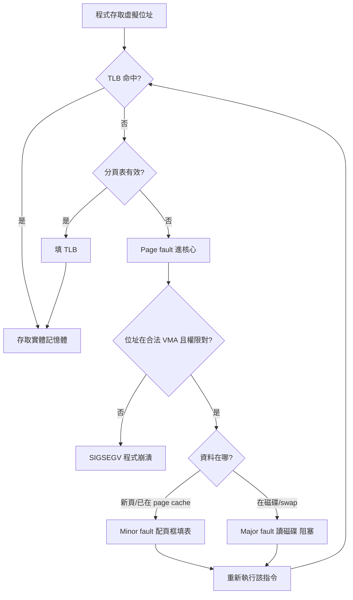

# 第 5 堂：Page fault、mmap、記憶體配置器

這堂還在「作業系統」層，接著上一堂的虛擬記憶體往下走：分頁表裡「還沒對到實體頁框」的那一格被碰到時會發生什麼（page fault），程式怎麼要到一大片位址空間（mmap），以及 `new`、`make`、`malloc` 背後的記憶體配置器怎麼把這些頁切成小塊給你用。

## 0. 上一堂測驗答案
1. 每個程序都有**自己的分頁表**，同一個虛擬位址 `0x400000` 在 A 和 B 的表裡對到不同的實體頁框。**CR3** 暫存器存的是「目前這個程序最上層分頁表的實體位址」，context switch 換程序時核心就換掉 CR3，MMU 從此用新程序的表翻譯。
2. 因為有 **TLB** 快取翻譯結果，靠著局部性，命中率通常超過 99%，大部分存取根本不用走分頁表。**隨機存取大範圍記憶體**的程式（大型 hash table、圖走訪、大型資料庫的 buffer）會讓 TLB 一直未命中，可以用 **huge pages** 緩解。
3. **目前不會**。cgroup 算的是實際用到的實體記憶體（RSS 加 page cache 等），不是 VIRT；VIRT 3GB 只是保留了虛擬位址。但如果 RES 一路長到超過 512MB，就會被 OOM kill（exit code 137）。

## 1. Page fault：不是錯誤，是「請核心來補」
上一堂說過：配置了記憶體不代表真的佔用實體頁框。那實體頁框什麼時候才給？答案是**第一次碰到的時候**。

當 MMU 翻譯位址時發現分頁表那一格是「不存在（present = 0）」或權限不符，CPU 就丟出一個 **page fault 例外**，跳進核心的 page fault handler。核心看這個位址屬於哪一段虛擬區域（VMA，就是 `/proc/self/maps` 裡的每一行），然後決定：

| 種類 | 情況 | 核心怎麼處理 | 代價 |
|---|---|---|---|
| **Minor fault**（軟） | 合法位址，資料已在記憶體裡或只需要一頁全零的新頁 | 拿一個頁框（或找到 page cache 裡現成的頁），填分頁表 | 約微秒等級 |
| **Major fault**（硬） | 資料在磁碟上（檔案內容、被 swap 出去的頁） | 發 I/O 讀進來，期間執行緒被阻塞 | 毫秒等級（SSD 也要幾十到幾百微秒） |
| **Invalid**（非法） | 位址不屬於任何 VMA，或寫唯讀頁 | 送 **SIGSEGV** 給程序 | 程式 crash |

處理完 minor/major fault 之後，CPU **重新執行剛剛那條指令**，這次翻譯就成功了。程式完全感覺不到，只是那一次存取比較慢。



### Copy-on-Write 也是靠 page fault
上一堂提到 `fork` 時把頁標成唯讀共用。誰先寫，就觸發一次「寫唯讀頁」的 page fault，核心發現這是 CoW 頁，就複製一份新頁給它、改成可寫。Redis 做 RDB 快照用 `fork`，若快照期間大量寫入，就會因 CoW 讓記憶體暴增，所以 Redis 文件提醒要預留記憶體。

## 2. mmap：跟核心要一段虛擬位址
`mmap` 是向核心「申請一段虛擬位址區域」的系統呼叫，分兩種：

- **匿名映射（anonymous）**：不對應任何檔案，內容初始為零。大塊記憶體配置、Go 和 .NET runtime 的 heap 都是用它（或類似的 `VirtualAlloc`）向核心要空間。
- **檔案映射（file-backed）**：把一個檔案的某一段直接映射到位址空間。之後讀這段記憶體就等於讀檔案，第一次碰到某頁時觸發 page fault，核心從 page cache（沒有就從磁碟）把那頁接上來。

`mmap` 本身很快，因為它**只建立 VMA，不配實體頁、不讀檔**，真正的工作延後到 page fault 時才做（lazy）。

```c
// 把檔案映射進來，像陣列一樣讀
int fd = open("data.bin", O_RDONLY);
char *p = mmap(NULL, size, PROT_READ, MAP_PRIVATE, fd, 0);
char x = p[4096 * 10];   // 第一次碰到第 10 頁 → page fault → 從 page cache/磁碟載入
munmap(p, size);
```

**誰在用 mmap？**
- 執行檔與共用函式庫（libc、`libcoreclr.so`）都是被 mmap 進來的，所以多個程序能共享同一份實體頁。
- 資料庫：LMDB、早期 MongoDB（MMAPv1）、SQLite（可選）、Kafka 的索引檔都用 mmap。
- C# 有 `MemoryMappedFile`，Go 有 `syscall.Mmap` / `golang.org/x/exp/mmap`。

**mmap 不是萬能**：讀檔時出錯不會回傳 error，而是變成 SIGBUS；major fault 會在你意想不到的地方阻塞執行緒；資料庫難以控制哪些頁先寫回磁碟。這也是很多資料庫（PostgreSQL、MySQL InnoDB）寧願自己管 buffer pool 的原因，第 27 堂會再談。

## 3. 記憶體配置器：把頁切成小塊
核心只會一頁一頁（4KB 起跳）給記憶體，而且每次都要 syscall，很貴。但程式需要的是「給我 24 bytes 放一個物件」。中間這層就是**使用者態的記憶體配置器**。

### 3.1 C 的 malloc（glibc ptmalloc）
- 小配置：從已經跟核心要來的 heap（用 `brk`/`sbrk` 擴張）裡切。
- 大配置（預設 ≥128KB）：直接 `mmap` 一塊，`free` 時直接 `munmap` 還給核心。
- 依大小分成 **bins**（free list），`free` 掉的塊放回對應的 bin 給下次重用。
- 多執行緒時用多個 **arena** 減少鎖競爭。

### 3.2 現代配置器：tcmalloc、jemalloc、mimalloc
共同想法：
- **Size class**：把請求大小捨入到固定等級（8、16、32、48…），同等級的塊放在同一頁，簡單又少碎片。
- **Thread-local cache**：每個執行緒有自己的小快取，大部分配置不用加鎖。
- 定期把空閒頁還給核心（`madvise(MADV_DONTNEED)`）。

### 3.3 碎片（fragmentation）
- **內部碎片**：要 33 bytes 給你 48 bytes，浪費 15。
- **外部碎片**：總空閒夠，但散成小塊，拿不出一塊大的連續空間。
長時間跑的服務 RSS 一直不降，常常不是洩漏，而是碎片加上配置器不急著把頁還給核心。

## 4. 跟你的日常連起來
- **Go**：Go 的配置器源自 tcmalloc 的設計：每個 P 有 `mcache`（無鎖），往上是 `mcentral`、`mheap`，mheap 再用 mmap 跟核心要 arena。小物件有約 68 種 size class。Go 釋放記憶體給 OS 用的是 `MADV_DONTNEED`（新版預設），閒置記憶體會由背景的 scavenger 逐步還回去，所以 GC 完 RSS 不一定馬上下降。容器裡建議設 `GOMEMLIMIT`（例如設成 limit 的 80–90%），讓 GC 在接近上限時更積極。
- **C#**：.NET GC 自己管 segment/region，用 `mmap`（Linux）或 `VirtualAlloc`（Windows）先保留、再 commit。在 Linux 容器裡，.NET 會讀 cgroup 的 memory limit，預設 GC heap 上限約為 limit 的 75%，可用 `DOTNET_GCHeapHardLimit` 或 `GCHeapHardLimitPercent` 調。`ArrayPool<T>`、`Span<T>`、`stackalloc` 本質上都是在減少向配置器/GC 要記憶體的次數。
- **Docker / K8s**：容器剛啟動 RSS 很小，流量一進來 page fault 大量發生，RSS 才慢慢長上去，所以「冷啟動」時延遲會比較高。cgroup v2 的 `memory.stat` 裡有 `pgfault`、`pgmajfault` 可以看。
- **雲端**：磁碟是網路磁碟（EBS、Persistent Disk）時，major fault 一次就是一次網路 I/O，延遲更明顯。這也是為什麼雲上通常建議**關掉 swap 或極少用 swap**，K8s 預設也要求節點關 swap。

## 5. 小例子：自己量 page fault
```bash
# 看一個程序累積的 minor / major fault 數
ps -o pid,min_flt,maj_flt,rss,vsz,cmd -p <PID>

# 跑一個指令並統計
/usr/bin/time -v ./your_app 2>&1 | grep -E "page faults|Maximum resident"

# perf 看 page fault 發生在哪段程式碼
perf stat -e page-faults,major-faults ./your_app
```

一個 Go 小實驗，感受「配置 ≠ 佔用」：
```go
package main

import ("fmt"; "os"; "time")

func main() {
    b := make([]byte, 1<<30) // 要 1GB
    fmt.Println("allocated, pid", os.Getpid()); time.Sleep(10 * time.Second) // 這時看 RSS：還很小
    for i := 0; i < len(b); i += 4096 { b[i] = 1 }                          // 每頁寫一次 → 約 26 萬次 minor fault
    fmt.Println("touched");  time.Sleep(10 * time.Second)                   // 這時 RSS 約 1GB
}
```
（Go 對大物件會直接向 heap 要新頁，第一次寫入時才觸發 page fault；在兩次 sleep 期間用 `ps -o rss` 比較即可看到差異。）

## 6. 小測驗
1. Minor fault 和 major fault 差在哪裡？為什麼一個服務在高峰期 major fault 突然變多，延遲會明顯上升？
2. 用 `mmap` 映射一個 10GB 的檔案，呼叫本身幾乎瞬間完成，為什麼？什麼時候才真的讀磁碟？
3. 你的 Go 服務在容器裡（limit 1GB），GC 之後 heap 只剩 300MB，但 RSS 還是 700MB 好一陣子才降下來。可能的原因是什麼？你可以調哪個設定讓它在接近上限時更守規矩？
