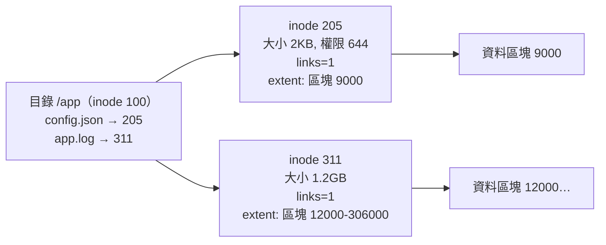
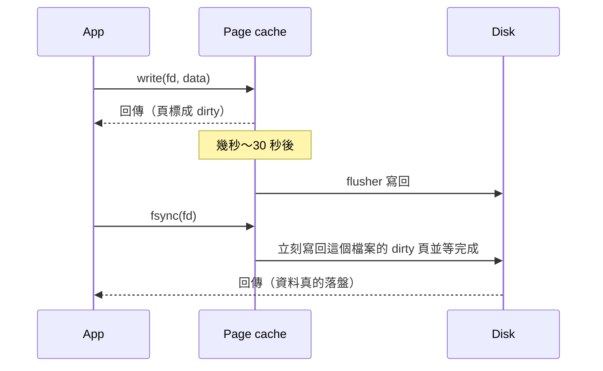

# 第 6 堂：檔案系統、inode、page cache

這堂仍在「作業系統」層，從記憶體走到儲存：檔案系統把一顆只會「讀寫第 N 個區塊」的磁碟，變成有目錄、有檔名、有權限的樹；page cache 則把上一堂的分頁機制拿來快取檔案，讓讀檔多半根本不碰磁碟。

## 0. 上一堂測驗答案
1. **Minor fault** 只需要配一個頁框，或把已經在記憶體（例如 page cache）裡的頁接上分頁表，大約微秒級；**major fault** 要從磁碟或 swap 把資料讀進來，執行緒會阻塞，毫秒級。高峰期 major fault 變多，通常代表記憶體不夠、page cache 被擠掉或開始用 swap，大量請求卡在磁碟 I/O 上，延遲就明顯上升。
2. `mmap` 只建立一段 VMA（虛擬記憶體區域的描述），不配實體頁、也不讀檔（lazy）。第一次存取某一頁觸發 page fault 時，核心才從 page cache 或磁碟把那一頁載入。
3. Go 把釋放的頁交給背景 scavenger 逐步還給 OS，配置器和碎片也會讓一些頁暫時留著，所以 RSS 降得慢。設 `GOMEMLIMIT`（例如 800–900MiB），讓 GC 和 scavenger 在接近上限時更積極。

## 1. 磁碟眼中只有區塊
SSD 或硬碟對 OS 來說只是一長串固定大小的**區塊**（通常 4KB）：「讀第 1,234,567 塊」「寫第 42 塊」。它不知道什麼是檔名或資料夾。**檔案系統**（ext4、XFS、NTFS、APFS）就是在這串區塊上，定義一套資料結構，記錄：
- 哪些區塊是空的（free bitmap）
- 每個檔案的資料放在哪些區塊
- 目錄樹長什麼樣子

## 2. inode：檔案的「身分證」
在 Unix 系的檔案系統裡，每個檔案都有一個 **inode**，存的是**中繼資料**：
| inode 裡有 | inode 裡沒有 |
|---|---|
| 檔案大小、擁有者、權限（rwx） | **檔名** |
| 建立/修改/存取時間 | 檔案內容本身 |
| 連結數（link count） | |
| 資料區塊的位置（extent 或區塊指標） | |

**檔名放在哪？放在目錄裡。** 目錄本身也是一種檔案，內容是一張表：「檔名 → inode 號碼」。



打開 `/app/config.json` 時，核心從根目錄 `/` 的 inode 開始，一層一層查目錄表找到 `app`、再找到 `config.json` → inode 205 → 讀它的區塊。這段「路徑 → inode」的查詢結果會快取在 **dentry cache**，所以第二次開同一個路徑很快。

### 幾個因此變得合理的現象
- **硬連結**（`ln a b`）：在目錄裡多加一筆「b → 同一個 inode」，link count +1。兩個名字、一份資料。
- **軟連結**（`ln -s`）：一個新檔案，內容只是一段路徑字串，目標刪掉就斷了。
- **`rm` 其實是 unlink**：刪掉目錄裡那一筆，link count -1。只有當 link count = 0 **而且沒有程序開著它**時，區塊才真的釋放。這就是經典問題：「log 檔 rm 掉了，磁碟空間卻沒回來」，因為服務還開著那個檔案。用 `lsof +L1` 可以找到這種「已刪但仍開著」的檔案。
- **inode 用完**：`df -h` 還有空間，卻寫不進新檔案，`df -i` 一看 inode 100%。大量小檔案（例如 session 檔、cache 碎片）會這樣。
- **`mv` 同一個檔案系統內幾乎瞬間完成**：只是改目錄表，資料不動；跨檔案系統才要真的複製。

## 3. 檔案描述符：程序和 inode 之間的那層
上一堂提過系統呼叫，`open()` 回傳的是一個整數 **fd**。從 fd 到資料有三層：
1. 程序自己的 **fd 表**：fd 3 → 某個「開啟檔案」物件
2. **開啟檔案物件**（open file description）：記錄目前讀寫的**位移量**、開啟模式
3. **inode**（在記憶體裡的副本）

所以兩個程序開同一個檔案，各自有自己的位移量；但 `fork` 出來的子程序共享父程序的開啟檔案物件，位移量也共用。

## 4. Page cache：讀檔為什麼常常不碰磁碟
上一堂講 mmap 時提到 page cache。它就是核心用**閒置的實體記憶體**快取檔案內容，以頁（4KB）為單位。

**讀**：`read()` 先查 page cache。命中就直接從記憶體複製給你（微秒級）；沒命中才發 I/O 讀磁碟，讀進來的頁留在 cache 裡，核心還會**預讀**（readahead）後面幾頁，因為循序讀很常見。

**寫**：`write()` 預設只寫進 page cache，把那一頁標成 **dirty** 就回傳了，很快。背景的 flusher 執行緒之後（大約 30 秒內，或 dirty 太多時）才把 dirty 頁寫回磁碟，這叫 **write-back**。



這帶來一個很重要的取捨：**`write()` 回傳 ≠ 資料安全**。斷電時還在 page cache 的 dirty 頁會遺失。要確定落盤得呼叫 **`fsync()`**（或 `fdatasync()`）。資料庫的 WAL（第 26 堂）每次 commit 都要 fsync，這正是資料庫寫入延遲的主要來源之一。

**free 指令裡的 buff/cache** 就是 page cache。Linux 會把空閒記憶體盡量拿來當 cache，所以「free 很少」通常不是問題，看 `available` 才準：記憶體吃緊時，乾淨的 cache 頁可以直接丟掉。

### 繞過 page cache
- **`O_DIRECT`**：直接在使用者緩衝區和磁碟之間搬資料。有自己 buffer pool 的資料庫（MySQL InnoDB、第 27 堂）常這樣做，避免資料被快取兩次。
- **mmap**：直接把 page cache 的頁映射到你的位址空間，省掉一次複製。
- **`sendfile()`**：檔案 → socket 直接在核心裡搬，不經使用者態，nginx 送靜態檔用的就是它（所謂 zero-copy）。

## 5. 日誌式檔案系統（journaling）
建立一個檔案要改好幾個地方：配 inode、改 bitmap、寫目錄項。寫到一半斷電，檔案系統就會不一致。ext4 和 XFS 的做法是**先把要改的中繼資料寫到 journal**，寫完才真的去改，開機時重播 journal 就能恢復一致。這和資料庫的 WAL 是同一個想法，到第 26 堂會再看到。

注意 ext4 預設（`data=ordered`）只保證**中繼資料**一致，不保證你的檔案內容完整，所以「安全地覆寫設定檔」的正確做法是：寫到暫存檔 → `fsync` → `rename` 到正式檔名（rename 是原子的）。

## 6. 跟你的日常連起來
- **C#**：`FileStream` 自己有一層使用者態 buffer（預設 4KB），`Flush()` 只是把它寫進核心的 page cache；要真的落盤得用 `Flush(flushToDisk: true)` 或開檔時加 `FileOptions.WriteThrough`。`File.Move` 在同一個檔案系統內是 rename，所以「寫暫存檔再 Move」是原子覆寫的慣用法。
- **Go**：`os.File.Write` 直接呼叫 `write()`，沒有使用者態 buffer（`bufio.Writer` 才有）；落盤要 `f.Sync()`。`io.Copy` 從檔案複製到 TCP 連線時，Go 會自動用 `sendfile`。
- **Docker**：image 的每一層是唯讀的，容器的檔案系統由 **overlayfs** 疊起來：讀檔從上往下找；第一次改某個底層檔案時，會先把**整個檔案**複製到上層的可寫層（copy-up）。所以在容器裡改大檔案很慢，要大量寫的資料應該放 volume。容器裡 `rm` 底層檔案只是在上層放一個 whiteout 標記，image 不會變小，這也是 Dockerfile 要在同一個 `RUN` 裡安裝完就清理的原因。
- **K8s / cgroup**：容器的 page cache 會**算進它的 memory 用量**。一個大量讀檔的容器 memory 看起來快滿了，其中很多是可回收的 cache；OOM 判斷前核心會先回收它，但監控上看 `working_set` 比看 usage 準。
- **雲端**：EBS、Persistent Disk 是網路磁碟，fsync 一次就是一趟網路來回，延遲比本機 NVMe 高很多。需要大量 fsync 的資料庫要選 IOPS/延遲較好的磁碟類型，或用 instance store 加複寫。

## 7. 小例子：自己看 inode 和 page cache
```bash
# 看 inode 號碼與 link count
ls -li /etc/hostname
stat /etc/hostname

# 硬連結共用 inode
echo hi > a.txt && ln a.txt b.txt && ls -li a.txt b.txt   # 同一個 inode，links=2

# inode 用量
df -i

# 感受 page cache：第一次慢、第二次快
sync; echo 3 | sudo tee /proc/sys/vm/drop_caches   # 清空 cache（測試機才做）
time cat big.file > /dev/null   # 從磁碟讀
time cat big.file > /dev/null   # 從 page cache 讀，快很多

# 已刪除但仍被開著的檔案
sudo lsof +L1
```

## 8. 小測驗
1. 線上主機磁碟快滿，你 `rm` 了一個 20GB 的 `app.log`，`df -h` 卻沒變。為什麼？不重啟服務的話可以怎麼處理？
2. 一個 Go 服務收到請求後呼叫 `f.Write()` 寫入訂單資料就回 200 給客戶端。主機此時斷電，這筆訂單可能遺失嗎？要怎麼改才能保證不遺失？代價是什麼？
3. 為什麼在 Docker 容器裡修改一個來自 image 的 2GB 檔案的 1 個 byte，第一次會特別慢？
