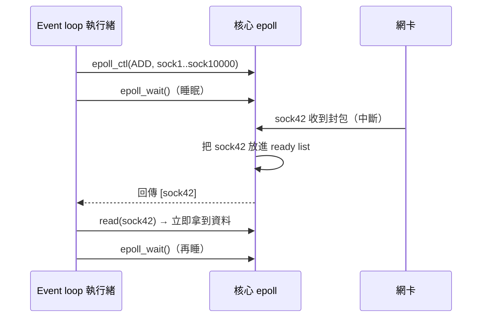
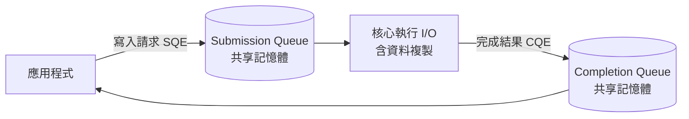

# 第 7 堂：I/O 模型：阻塞、非阻塞、epoll/io_uring

這堂屬於「作業系統」，是 OS 和「網路」之間的橋。上一堂講檔案怎麼存，這堂講程式怎麼**等待** I/O（檔案、socket）。Go 的 netpoller、C# 的 async/await、Nginx 的高並發，底下都是這堂的機制。

## 1. 問題：I/O 很慢，CPU 很快
從 socket 讀資料時，資料可能還沒到。差距大概是：
- CPU 一個指令：約 0.3 ns
- 記憶體存取：約 100 ns
- 同機房網路來回：約 0.5 ms，是 CPU 指令的**百萬倍**以上

所以重點在於：**資料還沒到的時候，執行緒要做什麼？** 答案不同，就是不同的 I/O 模型。

一次 `read()` 其實分兩個階段：
1. **等資料就緒**：等網卡收到封包、核心放進 socket buffer
2. **複製資料**：核心把資料從 kernel buffer 複製到你的 user buffer

## 2. 五種經典 I/O 模型

### (1) 阻塞 I/O（Blocking）
`read()` 在資料到之前不會回傳，執行緒被放進等待佇列（第 1 堂的 Blocked 狀態），CPU 先去跑別人。
- 優點：寫起來最直覺
- 缺點：**一條連線佔一條執行緒**。一萬個連線就要一萬條執行緒，每條有 stack（Linux 預設 8MB 虛擬空間），還有 context switch 成本（第 2 堂）

### (2) 非阻塞 I/O（Non-blocking）
用 `O_NONBLOCK` 開 socket，沒資料時 `read()` 會立刻回傳 `EAGAIN`。
- 缺點：你得自己一直輪詢（busy polling），浪費 CPU

### (3) I/O 多工（Multiplexing）：select / poll / epoll
「**一條執行緒同時看很多個 fd**，哪個好了再處理哪個。」這就是 **event loop**。
- `select`：每次把整個 fd 集合傳給核心，核心逐一檢查，O(n)，而且上限是 1024 個 fd
- `poll`：拿掉 1024 的上限，但每次還是 O(n) 掃描
- `epoll`（Linux）：**註冊一次**，核心維護「已就緒清單」，`epoll_wait` 只回傳真的好了的 fd，成本跟就緒數量成正比，不跟總連線數成正比

### (4) 訊號驅動 I/O
資料好了核心送 SIGIO。實務上很少用，知道有這種就好。

### (5) 非同步 I/O（AIO / io_uring）
前面四種在「複製資料」那一步都還是你自己呼叫 `read`。真正的非同步是：**你交代「讀到這個 buffer」，核心連複製都做完了才通知你。**

| 模型 | 等就緒時 | 複製資料時 | 一條執行緒能處理 |
|---|---|---|---|
| 阻塞 | 卡住 | 卡住 | 1 個連線 |
| 非阻塞 | 輪詢（燒 CPU） | 卡住 | 多個，但浪費 |
| epoll | 卡在 epoll_wait，可同時等很多 fd | 卡住（通常很短） | 上萬個 |
| io_uring | 不卡 | 不卡 | 上萬個，系統呼叫更少 |

## 3. epoll 怎麼運作
三個系統呼叫：
- `epoll_create1()`：建立一個 epoll 實例（它本身也是一個 fd）
- `epoll_ctl(ADD, fd, EPOLLIN)`：註冊「我想知道這個 fd 何時可讀」
- `epoll_wait()`：睡到至少一個 fd 就緒，然後回傳就緒清單



**水平觸發 vs 邊緣觸發：**
- **LT（Level-triggered，預設）**：只要 buffer 裡還有資料，每次 `epoll_wait` 都會再通知你。比較安全
- **ET（Edge-triggered）**：只有「從沒資料變成有資料」那一刻通知一次。你必須用非阻塞 fd **一直讀到 EAGAIN**，否則剩下的資料不會再通知你，連線看起來就像卡住了。Nginx 用的是 ET

注意：**epoll 對一般磁碟檔案沒用**。普通檔案永遠被當成「可讀」，因為 page cache 未命中時的等待不算 socket 那種就緒。所以以前 Node.js（libuv）是用執行緒池去做檔案 I/O。

## 4. io_uring：連系統呼叫都省掉
第 3 堂提過，系統呼叫要切換到核心態，有成本。epoll 模式下每個事件至少要 `epoll_wait` + `read` 兩次系統呼叫。

io_uring（Linux 5.1+）在使用者態和核心之間用 `mmap`（第 5 堂）共享兩個**環狀佇列**：
- **SQ（Submission Queue）**：你把「要讀 fd 5，放到 buffer X」寫進去
- **CQ（Completion Queue）**：核心做完後把結果放進來



一次 `io_uring_enter` 可以送出幾百個請求；開 SQPOLL 模式的話，由核心執行緒去輪詢 SQ，**連系統呼叫都不用**。它也支援磁碟檔案的真正非同步。代價是：API 複雜，也曾經出過不少安全漏洞，有些雲端和容器環境（例如 Docker 預設的 seccomp 設定、部分 Android/ChromeOS）會把它關掉。

## 5. Reactor vs Proactor
- **Reactor**（epoll 風格）：「告訴我**什麼時候可以讀**，我自己讀。」Nginx、Redis、Netty、Go netpoller 都是這種
- **Proactor**（io_uring、Windows IOCP 風格）：「幫我**讀好**，讀完再叫我。」

## 6. 跟你的日常連起來
- **Go**：你寫的 `conn.Read()` 看起來是阻塞的，但底層 socket 其實是非阻塞的。讀到 `EAGAIN` 時，runtime 把這個 **goroutine** 停下來（不是 OS 執行緒），把 fd 交給 **netpoller**（Linux 上就是 epoll）。fd 就緒後 goroutine 再被排回去執行。所以 Go 可以「用阻塞的寫法，拿到 epoll 的效能」，十萬個 goroutine 也只用到幾條 OS 執行緒。（第 51 堂講 GMP 時會再深入。）
- **C#**：Windows 上 `await socket.ReceiveAsync()` 走 **IOCP**（Proactor）；Linux 上 .NET 用 epoll 加上 `SocketAsyncEngine` 執行緒去分派。`await` 期間**不佔用執行緒**，完成後 continuation 丟回 ThreadPool。如果在 ASP.NET Core 裡寫 `.Result`、`.Wait()`（sync over async），就等於把 ThreadPool 執行緒拿去阻塞等 I/O，流量一大就會 thread pool starvation，回應時間暴增。
- **Docker / 雲端**：Nginx、Envoy、Redis 都是單執行緒（或每核一條）的 epoll event loop，所以一個 Redis 容器只吃得到一顆核心，CPU 限制給 4 核也沒用。Event loop 裡只要有一個慢動作（Redis 的 `KEYS *`、Node.js 的同步 CPU 運算），**所有連線都會一起卡住**。
- **ulimit**：每個連線都是一個 fd。容器或 systemd 預設的 `nofile` 限制（常見 1024）太低時會看到 `too many open files`，要調高 `ulimit -n` 或 Docker 的 `--ulimit nofile=65535:65535`。

## 7. 小例子：用 Go 感受 netpoller
```go
package main

import "net"

func main() {
	ln, _ := net.Listen("tcp", ":9000")
	go func() {
		for {
			conn, _ := ln.Accept()
			go func(c net.Conn) { // 每個連線一個 goroutine
				buf := make([]byte, 1024)
				for {
					n, err := c.Read(buf) // 看似阻塞，底下是 epoll
					if err != nil { c.Close(); return }
					c.Write(buf[:n])
				}
			}(conn)
		}
	}()
	select {} // 主 goroutine 永遠等待
}
```
開幾千個連線（例如用 `for i in $(seq 1000); do nc localhost 9000 & done`），再看：
```bash
ls /proc/$(pgrep main)/task | wc -l     # OS 執行緒數：只有個位數
ls /proc/$(pgrep main)/fd | wc -l       # fd 數：上千
strace -f -e trace=epoll_wait,epoll_ctl -p $(pgrep main)   # 看 epoll 呼叫
```

## 8. 小測驗
1. 你用 epoll 的 **ET（邊緣觸發）** 模式寫了一個伺服器，每次事件只呼叫一次 `read(fd, buf, 4096)`。客戶端一次送了 10KB，結果連線好像卡住了，後面的資料一直沒處理。為什麼？要怎麼改？
2. 一個 ASP.NET Core API 平常很正常，流量變成 3 倍後回應時間從 50ms 暴增到好幾秒，CPU 卻只有 20%。程式碼裡有很多 `httpClient.GetAsync(url).Result`。發生了什麼事？
3. 為什麼 Go 的 goroutine 可以「用阻塞的寫法」處理十萬個連線，而 Java 傳統的「一連線一執行緒」模型做不到？兩者在 OS 層面差在哪裡？
