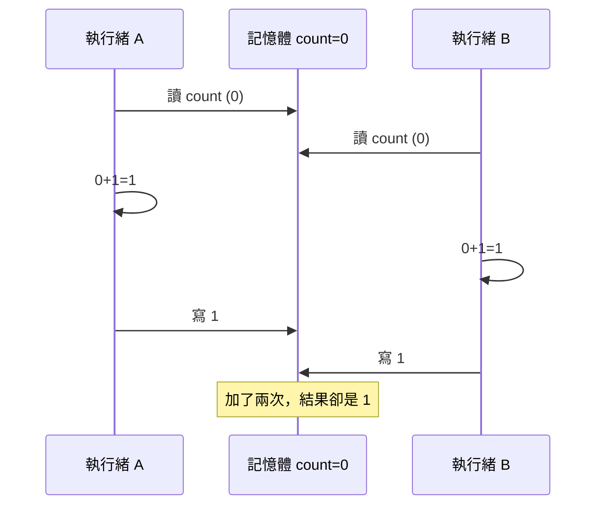
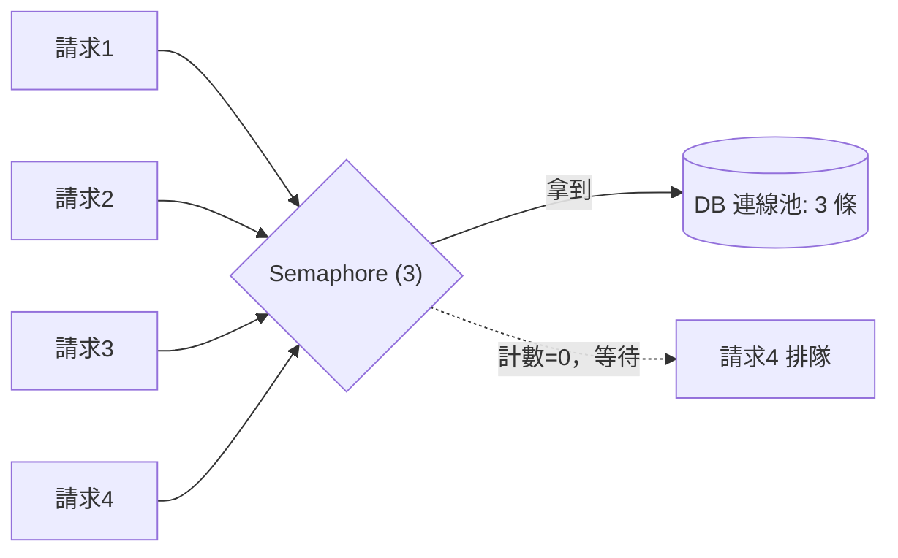

# 第 8 堂：同步：mutex、semaphore、spinlock

> 先公布第 7 堂測驗答案：
> 1. **ET 只在「沒資料 → 有資料」時通知一次**。你只讀了 4096 bytes，剩下約 6KB 還留在 socket buffer，但狀態沒有再從「無」變「有」，epoll 不會再叫你，連線就像卡住了。改法：把 fd 設成非阻塞，**迴圈 read 到回傳 `EAGAIN`** 為止；或者改用 LT（水平觸發）。
> 2. 這是 **sync over async**：`.Result` 讓 ThreadPool 執行緒卡在那裡等網路 I/O。流量一大，執行緒全被佔住，ThreadPool 每秒只會慢慢補新執行緒，請求就開始排隊（**thread pool starvation**），而 CPU 其實閒著。解法是整條呼叫鏈都改成 `await`。
> 3. goroutine 是**使用者態**的小 stack（起始約 2–8KB）。`Read` 遇到 `EAGAIN` 時，runtime 只把 goroutine 停下來，fd 交給 epoll netpoller，所以幾條 OS 執行緒就能服務大量 goroutine。Java 傳統模型是每個連線一條 **OS 執行緒**，每條約 1MB stack，還有核心排程和 context switch 的成本，十萬條撐不住。（Java 21 的 virtual threads 已經改成類似 Go 的做法。）

這堂還是「作業系統」，接在第 1 堂的執行緒、第 2 堂的排程、第 7 堂的等待之後。多條執行緒共用同一塊記憶體時，要怎麼**不互相踩到**？之後的資料庫鎖（第 30 堂 2PL）、共識（Raft 的 leader lease）、平行運算（第 53 堂 lock-free），都是從這裡長出來的。

## 1. 問題：競態條件（race condition）
`count++` 看起來是一行，CPU 其實分三步做：
1. **讀**：從記憶體把 count 載入暫存器
2. **改**：暫存器 +1
3. **寫**：寫回記憶體

兩條執行緒同時做的時候：



這種「多條執行緒存取共享資料、至少一條在寫、結果取決於誰先跑」的情況，就叫 **race condition**。會被同時進入、需要保護的那段程式碼叫 **臨界區（critical section）**。

同步要保證三件事：
- **互斥**：同一時間只有一個人在臨界區
- **進展**：沒人在臨界區時，想進去的人要能進去
- **有限等待**：不能有人永遠排不到

## 2. 地基：硬體原子指令
用一般變數自己做鎖（`if (!locked) locked = true;`）一樣會有 race，因為「檢查」和「設定」之間可以被插隊。所以要靠 CPU 提供**不可分割**的指令：
- **Test-and-Set / Exchange**：把值設成 1，同時回傳舊值
- **Compare-and-Swap（CAS）**：如果現在的值等於我預期的，就換成新值，否則失敗（x86 是 `LOCK CMPXCHG`）
- **Fetch-and-Add**：原子地加一個數（x86 是 `LOCK XADD`）

所有鎖（mutex、semaphore、channel）最底層都是這幾條指令。對應到你熟的 API：C# 的 `Interlocked.Increment` / `Interlocked.CompareExchange`，Go 的 `atomic.AddInt64` / `atomic.CompareAndSwapInt32`。

## 3. Spinlock：原地空轉等
```c
while (test_and_set(&lock) == 1) { /* 一直轉 */ }
// 臨界區
lock = 0;
```
拿不到鎖就**一直重試**，不睡覺、不進核心。
- **優點**：沒有 context switch（第 2 堂說過一次約幾微秒）。如果鎖只被持有幾十奈秒，空轉反而最快。
- **缺點**：等待時 CPU 100% 在空燒。持有鎖的執行緒如果被排程器換下去，其他人會白轉整個 time slice。**單核心上用純 spinlock 沒有意義**。
- **在哪裡用**：Linux 核心內部（中斷處理不能睡覺）、極短的臨界區。C# 有 `SpinLock` 和 `SpinWait`，但官方建議除非量測證明有效，不然別用。

## 4. Mutex：拿不到就睡
**Mutex（mutual exclusion）**：拿不到鎖時，執行緒進入 **Blocked** 狀態（第 1 堂），讓出 CPU；持有者 unlock 時，核心再叫醒一個等待者。

Linux 上實作得很聰明，叫 **futex（fast userspace mutex）**：
1. **沒人搶時**：只做一次使用者態的 CAS 就拿到鎖，**完全不進核心**（第 3 堂說過 syscall 有成本）。
2. **有人搶時**：先短暫 spin 一下（說不定對方馬上就放了），還拿不到才呼叫 `futex(FUTEX_WAIT)` 進核心睡覺。
3. **unlock 時**：如果有人在等，才呼叫 `futex(FUTEX_WAKE)`。

所以現代 mutex 是「**先轉一下，不行再睡**」的混合式做法。Go 的 `sync.Mutex`、C# 的 `lock`（`Monitor`）、pthread mutex 都是這個思路。

Mutex 有**擁有者**的概念：誰 lock 就該由誰 unlock。

## 5. Semaphore：計數器
**Semaphore** 是一個整數加兩個操作（Dijkstra 的命名）：
- **P / wait / acquire**：值 > 0 就減 1 然後進去；等於 0 就睡覺等待
- **V / signal / release**：值加 1，有人在等就叫醒一個

- 初始值 1 → **二元 semaphore**，用起來像 mutex（但沒有擁有者，誰都能 release）
- 初始值 N → **最多 N 個人同時進去**，用來限流、控制資源池



## 6. 再加一個：條件變數（condition variable）
Mutex 管「誰能進去」，但「**等某個條件成立**」（例如佇列不是空的）要靠條件變數：
```
lock(m)
while (queue.empty) wait(cond, m)   // 原子地：放鎖 + 睡覺；醒來時重新拿鎖
item = queue.pop()
unlock(m)
```
一定要用 **while** 而不是 if，因為可能**假喚醒（spurious wakeup）**，或者醒來時東西已經被別人拿走了。C# 的 `Monitor.Wait/Pulse`、Go 的 `sync.Cond` 就是這個。實務上 Go 的 channel、C# 的 `Channel<T>` / `BlockingCollection` 已經把這套包好了。

## 7. 比較表

| | Spinlock | Mutex | Semaphore |
|---|---|---|---|
| 拿不到時 | 空轉 | 睡覺（Blocked） | 睡覺 |
| 同時進入人數 | 1 | 1 | N |
| 有擁有者 | 通常有 | 有 | 沒有 |
| 適合 | 極短臨界區、核心 | 一般共享資料 | 限流、資源池 |
| C# | `SpinLock` | `lock` / `Monitor` | `SemaphoreSlim` |
| Go | 無（runtime 內部才有） | `sync.Mutex` / `RWMutex` | buffered channel、`x/sync/semaphore` |

讀多寫少時還有 **讀寫鎖（RWMutex / `ReaderWriterLockSlim`）**：可以多人同時讀，寫的時候獨佔。

## 8. 連結到你的實務
- **C# async 裡不能用 `lock`**：`lock` 區塊內不能 `await`（編譯器會擋），因為 Monitor 綁定執行緒，await 之後可能換了執行緒。要用 `SemaphoreSlim(1,1)` 加 `await sem.WaitAsync()`，它等待時**不佔執行緒**（接續第 7 堂）。
- **用 SemaphoreSlim 限流**：同時打外部 API（例如 Gemini、OCR）最多 5 個請求，避免被 rate limit：
```csharp
var sem = new SemaphoreSlim(5);
var tasks = files.Select(async f => {
    await sem.WaitAsync();
    try { return await ExtractWithGemini(f); }
    finally { sem.Release(); }
});
await Task.WhenAll(tasks);
```
- **Go 的哲學**：「Don't communicate by sharing memory; share memory by communicating.」能用 channel 傳遞擁有權就不要共享變數。但簡單計數器或 map 快取，`sync.Mutex` 或 `atomic` 更直接。Go 的 buffered channel `make(chan struct{}, 5)` 本身就是一個 semaphore。
- **Go race detector**：`go test -race`、`go run -race` 會在執行時抓 data race，強烈建議 CI 開著。
- **一台機器內的鎖管不到多台**：你的 API 在 Docker / Kubernetes 跑 3 個 replica，C# 的 `lock` 只管得到自己那個行程。跨機器要用**分散式鎖**（Redis `SET key val NX PX`、etcd lease、資料庫 `SELECT ... FOR UPDATE`），這會在共識篇（第 44 堂）細講，而且分散式鎖比你想的難（行程暫停、時鐘漂移）。

## 9. 小例子：親手做出 race
```go
package main

import (
	"fmt"
	"sync"
)

func main() {
	var count int
	var mu sync.Mutex
	var wg sync.WaitGroup
	for i := 0; i < 1000; i++ {
		wg.Add(1)
		go func() {
			defer wg.Done()
			for j := 0; j < 1000; j++ {
				// 拿掉下面兩行的註解前後各跑一次比較
				// mu.Lock()
				count++
				// mu.Unlock()
			}
		}()
	}
	wg.Wait()
	fmt.Println(count) // 沒鎖：每次都不一樣，小於 1000000；有鎖：一定是 1000000
	_ = &mu
}
```
用 `go run -race main.go` 跑沒鎖的版本，會直接印出 `WARNING: DATA RACE` 和兩邊的 stack。再試把 `count++` 換成 `atomic.AddInt64(&c, 1)`，會比 mutex 版本快很多，因為只是一條 `LOCK XADD` 指令。

## 10. 小測驗
1. 一台**單核心**的機器上，執行緒 A 拿著 spinlock，被排程器換下去；執行緒 B 開始等這把 spinlock。會發生什麼事？為什麼 mutex 不會有這個問題？
2. 你的 ASP.NET Core 服務要確保同一個訂單不會被同時處理兩次。同事在 controller 裡用了 `private static readonly object _lock` 加 `lock(_lock) { ... }`。本機測試正常，部署到有 3 個 replica 的 Kubernetes 後還是出現重複處理。為什麼？另外，如果處理過程中要 `await` 資料庫呼叫，`lock` 還有什麼問題？
3. 有人說：「初始值為 1 的 semaphore 就等於 mutex。」這句話哪裡不完全正確？

<details><summary>參考答案</summary>

1. 單核心上，B 在 spinlock 上空轉燒掉整個 time slice，而能放鎖的 A 沒在跑，要等 B 被換下來 A 才能跑完放鎖，中間 CPU 全浪費（若 A 在核心關中斷時拿鎖，甚至可能永遠卡住）。mutex 拿不到鎖就睡、讓出 CPU，A 能馬上跑完放鎖，B 再被叫醒。
2. `lock` 只在單一行程內有效；3 個 replica 是 3 個行程，各自一把鎖，互相看不到。要用分散式鎖或資料庫保證：Redis `SET key val NX PX`、`SELECT ... FOR UPDATE`、唯一約束、冪等鍵。另外 `lock` 區塊內不能 `await`（Monitor 綁在執行緒上，await 後可能換執行緒），要改用 `SemaphoreSlim(1,1)` 加 `await WaitAsync()`。
3. semaphore 沒有擁有者，任何執行緒都能 `Release`，可能被誤放，或多 release 一次讓計數變 2，互斥就破了。mutex 有擁有者，才能支援遞迴鎖、priority inheritance 和「非擁有者不能解鎖」的偵錯檢查。

</details>
