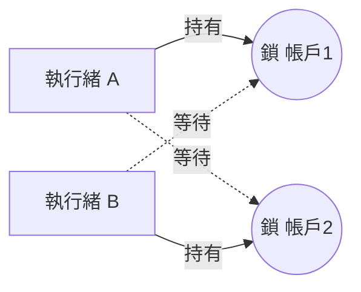

# 第 9 堂：死結與活結

> 先公布第 8 堂測驗答案：
> 1. 單核心上，B 在 spinlock 上**空轉燒掉整個 time slice**，而能放鎖的 A 根本沒在跑，要等 B 被換下來 A 才有機會跑完、放鎖，中間的 CPU 全浪費了（如果 A 是在核心關中斷時拿鎖，甚至可能永遠卡住）。mutex 拿不到鎖就**睡覺、讓出 CPU**，A 馬上能跑完放鎖，B 再被叫醒。
> 2. `lock` 只在**單一行程**裡有效。3 個 replica 是 3 個行程，各有一把自己的鎖，互相看不到。要用**分散式鎖或資料庫保證**：Redis `SET key val NX PX`、資料庫 `SELECT ... FOR UPDATE`、唯一約束、冪等鍵（idempotency key）。另外 `lock` 區塊裡不能 `await`（Monitor 綁在執行緒上，await 之後可能換執行緒，編譯器直接禁止），要改用 `SemaphoreSlim(1,1)` 加 `await WaitAsync()`。
> 3. semaphore **沒有擁有者**：任何執行緒都能 `Release`，可能被別人誤放，或多 release 一次讓計數變成 2，互斥就破了。mutex 有擁有者，所以能做遞迴鎖、priority inheritance（優先權繼承）和「不是你的鎖不能放」的偵錯檢查。

這堂還是「作業系統」，緊接第 8 堂：有了鎖之後，最常見的新災難就是**大家都在等，誰也動不了**。這個問題會一路跟著你：資料庫的交易死結（第 30 堂 2PL）、分散式系統的選主活結（第 42 堂 Raft 用隨機 timeout 解的就是它）、Go 的 `all goroutines are asleep - deadlock!`，本質都是同一件事。

## 1. 死結（deadlock）：大家都卡住不動

經典場景：兩個人轉帳。

- 執行緒 A：轉帳 帳戶1 → 帳戶2，先鎖 1，再鎖 2
- 執行緒 B：轉帳 帳戶2 → 帳戶1，先鎖 2，再鎖 1



A 拿著 1 等 2，B 拿著 2 等 1。兩邊都在 mutex 上睡覺，**CPU 使用率 0%**，服務卻完全不回應。這是死結最典型的樣子：不是當機、不是爆 CPU，而是「安靜地掛著」。

## 2. 死結的四個必要條件（Coffman 條件）

四個**同時成立**才會死結：

| 條件 | 意思 | 轉帳例子 |
|---|---|---|
| 互斥 | 資源一次只能一人用 | 帳戶鎖是 mutex |
| 持有並等待 | 拿著一個，還在等另一個 | A 拿 1 等 2 |
| 不可搶奪 | 不能把別人的鎖搶過來 | mutex 只能自己放 |
| 循環等待 | 等待關係形成一個環 | A→2→B→1→A |

重點：**打破任何一個，就不會死結**。所有解法都是在挑一個條件來破。

## 3. 處理死結的四種策略

### (1) 預防：從設計上破掉一個條件
- **破循環等待（最實用）**：規定**全域鎖順序**。轉帳一律先鎖 ID 小的帳戶，再鎖 ID 大的。A 和 B 都先鎖 1，就不可能成環。
- **破持有並等待**：一次把需要的鎖全拿到，拿不全就全部放掉。
- **破不可搶奪**：用 `TryLock` 加 timeout，拿不到就把手上的也放掉、退後重試。
- **破互斥**：改成不需要鎖的設計（不可變資料、單一擁有者、channel 傳遞擁有權、lock-free）。

### (2) 避免：每次配置前先算安不安全
**銀行家演算法（Banker's algorithm）**：每個執行緒事先宣告最多要多少資源，系統每次分配前模擬「分了之後，是否還存在一個順序讓大家都能做完」。理論漂亮，但實務上很少用，因為沒人能事先知道自己最多要多少。

### (3) 偵測與恢復：讓它發生，再抓出來
建一張 **wait-for graph（等待圖）**，定期找環，找到就挑一個「犧牲者」殺掉或 rollback。**資料庫就是這樣做的**：
- PostgreSQL：等鎖超過 `deadlock_timeout`（預設 1 秒）就檢查等待圖，發現環就讓其中一個交易失敗：`ERROR: deadlock detected`。
- SQL Server：背景 lock monitor 找環，挑犧牲者，回傳錯誤 **1205**（你在 C# 裡會看到 `SqlException.Number == 1205`）。
- MySQL InnoDB：即時偵測，rollback 改動比較少的那個交易。

所以應用程式碰到 deadlock 錯誤時，正確反應是**重試整個交易**。

### (4) 鴕鳥演算法：當作沒看到
Linux、Windows 核心對使用者程式之間的鎖死結**不處理**，因為偵測成本高、發生機率低。你的程式死結了，就自己掛在那裡，靠你自己找。

## 4. 活結（livelock）：大家都在動，但沒有進展

死結是「都在睡」；活結是「都很忙，但一事無成」。

生活例子：走廊上兩人面對面，你往左讓，他也往左讓；你往右，他也往右……一直讓、一直撞。

程式例子：用「拿不到就全部放掉再重試」來破死結：

```text
A: 鎖 1 → 試鎖 2 失敗 → 放 1 → 重試
B: 鎖 2 → 試鎖 1 失敗 → 放 2 → 重試
（如果兩邊節奏剛好一樣，就永遠重複）
```

CPU 是 100%，但吞吐量是 0。**解法：加隨機性**。重試前等一段**隨機退避（randomized backoff）**時間，兩邊錯開就過了。這個招式到處都是：
- Ethernet 碰撞後的 exponential backoff（第 14 堂）
- Raft 選主用**隨機選舉 timeout**，避免大家同時當候選人、一直平票（第 42 堂）
- 雲端 SDK（Azure、AWS、Polly）的 **exponential backoff + jitter**，避免大量客戶端同時重試把服務再打掛（thundering herd）

## 5. 飢餓（starvation）：有進展，但某人永遠輪不到

系統整體有在動，但某個執行緒一直被插隊。例如讀寫鎖偏向讀者時，讀者源源不絕，寫者永遠拿不到鎖；或第 2 堂的優先權排程，低優先權工作一直被高優先權壓著。解法是**公平性**：排隊（FIFO / ticket lock）、aging（等越久優先權越高）。

另一個相關問題是**優先權反轉（priority inversion）**：低優先權 L 拿著鎖，高優先權 H 在等，中優先權 M 卻一直搶走 L 的 CPU，結果 H 被 M 間接卡住。1997 年 NASA 火星探路者號就因為這個一直重開機，最後遠端開啟 **priority inheritance**（L 拿鎖期間暫時繼承 H 的優先權）修好。這也呼應第 8 堂第 3 題：mutex 有擁有者才做得到優先權繼承。

| | 執行緒狀態 | CPU | 進展 |
|---|---|---|---|
| 死結 | 都在睡/等 | 約 0% | 全部沒有 |
| 活結 | 都在跑 | 很高 | 全部沒有 |
| 飢餓 | 有人跑、有人等 | 不一定 | 部分有，某人沒有 |

## 6. 連結你的實務

### C#
- **全域鎖順序**：
```csharp
void Transfer(Account from, Account to, decimal amount)
{
    var first  = from.Id < to.Id ? from : to;
    var second = from.Id < to.Id ? to : from;
    lock (first.Sync)
    lock (second.Sync)
    {
        from.Balance -= amount;
        to.Balance   += amount;
    }
}
```
- **加 timeout，不要無限等**：`Monitor.TryEnter(obj, TimeSpan.FromSeconds(2))`、`await sem.WaitAsync(TimeSpan.FromSeconds(2))`，拿不到就記 log、放掉、退避重試，至少不會無聲地掛住。
- **async 死結（.NET 最常見）**：在有 SynchronizationContext 的環境（WinForms、WPF、Blazor、舊 ASP.NET）呼叫 `.Result` / `.Wait()`：UI 執行緒卡著等 Task，而 Task 的後半段要回到 UI 執行緒才能跑。兩邊互等，就是單一執行緒自己跟自己的死結。解法：整條都 `await`，函式庫裡用 `ConfigureAwait(false)`。
- **資料庫死結重試**：用 Polly 或 EF Core 的 `EnableRetryOnFailure()` 處理 SQL Server 1205 / PostgreSQL `40P01`。

### Go
- Go runtime 有**內建死結偵測**，但只在「**所有** goroutine 都睡著」時才觸發：
```go
func main() {
	ch := make(chan int)
	ch <- 1 // 沒人接收
}
// fatal error: all goroutines are asleep - deadlock!
```
- 但只要還有一個 goroutine 活著（例如 HTTP server 的 listener），**部分死結就偵測不到**，請求一直卡著不回。這時用 `curl localhost:6060/debug/pprof/goroutine?debug=2`（要 import `net/http/pprof`）看所有 goroutine 的 stack，找一堆卡在 `sync.(*Mutex).Lock` 或 `chan send` 的。
- 常見地雷：Go 的 `sync.Mutex` **不可重入**，同一個 goroutine 鎖兩次就自己死結；unbuffered channel 送和收在同一個 goroutine；忘了 `close(ch)` 讓 `for range ch` 永遠等。

### 資料庫與雲端
- 兩個 API 請求用相反順序更新同兩列（先 orders 再 inventory vs 先 inventory 再 orders），高併發時就會死結。規則一樣：**固定更新順序**、交易盡量短、不要在交易中間呼叫外部 API。
- 分散式鎖要設 **TTL（過期時間）**，否則拿鎖的 Pod 被 OOM kill 後，鎖永遠不會被放掉，所有 replica 都卡住。這是「不可搶奪」條件在分散式世界的版本：TTL 等於允許搶奪。

## 7. 小例子：親手做出死結，再修好

```go
package main

import (
	"fmt"
	"sync"
	"time"
)

type Account struct {
	ID      int
	mu      sync.Mutex
	Balance int
}

func transfer(from, to *Account, amt int, wg *sync.WaitGroup) {
	defer wg.Done()
	from.mu.Lock()
	time.Sleep(10 * time.Millisecond) // 放大時間窗，讓死結必定發生
	to.mu.Lock()
	from.Balance -= amt
	to.Balance += amt
	to.mu.Unlock()
	from.mu.Unlock()
}

func main() {
	a, b := &Account{ID: 1, Balance: 100}, &Account{ID: 2, Balance: 100}
	var wg sync.WaitGroup
	wg.Add(2)
	go transfer(a, b, 10, &wg)
	go transfer(b, a, 20, &wg)
	wg.Wait()
	fmt.Println(a.Balance, b.Balance)
}
```

執行後會看到 `fatal error: all goroutines are asleep - deadlock!`（因為 main 也在 `wg.Wait()` 睡著）。修法：在 `transfer` 開頭依 ID 排序，永遠先鎖 ID 小的：

```go
first, second := from, to
if to.ID < from.ID {
	first, second = to, from
}
first.mu.Lock()
time.Sleep(10 * time.Millisecond)
second.mu.Lock()
// ...
second.mu.Unlock()
first.mu.Unlock()
```

再跑一次，印出 `110 90`，不會再卡住。

## 8. 小測驗
1. 線上的 Go 服務突然所有 `/checkout` 請求都逾時，但 CPU 只有 2%，而且 runtime **沒有**印出 `all goroutines are asleep - deadlock!`。為什麼 runtime 沒抓到？你會用什麼工具、看什麼東西來確認是死結？
2. 一個 Blazor Server 頁面的按鈕事件裡寫了 `var data = LoadAsync().Result;`，按下去整個頁面就凍住了。請用 Coffman 四條件中的「循環等待」解釋這是誰在等誰，並說出兩種修法。
3. 你寫了一個用 Redis 分散式鎖搶任務的 worker，拿不到鎖時固定 `sleep 100ms` 再試。上線 50 個 worker 後，發現 Redis QPS 很高、任務卻很少被成功處理。這比較像死結、活結還是飢餓？要怎麼改？

<details><summary>參考答案</summary>

1. Go runtime 只在「所有」goroutine 都睡著時才報 deadlock。線上服務還有 HTTP listener 等 goroutine 活著，所以部分死結抓不到。用 `net/http/pprof` 的 `/debug/pprof/goroutine?debug=2` 看 stack，找大量卡在 `sync.(*Mutex).Lock` 或 chan send/recv、已經等了好幾分鐘的 goroutine，再檢查拿鎖的順序。
2. 有 SynchronizationContext 時，UI／電路執行緒卡在 `.Result` 等 Task，而 Task 在 await 之後的後半段要排回同一個執行緒才能完成，兩邊互等成環。修法：事件處理改成 async 並 `await LoadAsync()`；或在函式庫內部用 `ConfigureAwait(false)`（治標）。
3. 比較像活結（再加上飢餓）：50 個 worker 用同樣的節奏一起重試、一起撞，很忙地打 Redis 卻沒有進展。改成指數退避加隨機 jitter、鎖設 TTL，或改用佇列（Redis Streams／BLPOP、Kafka consumer group），讓系統分派任務，不要靠搶鎖。

</details>
