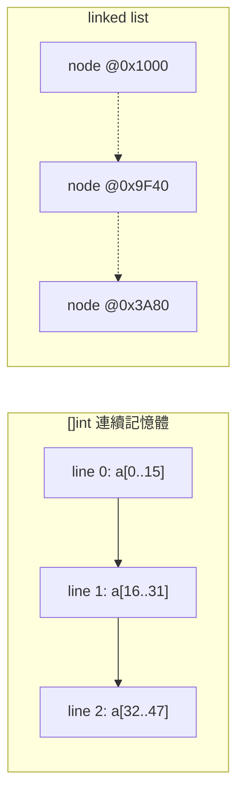
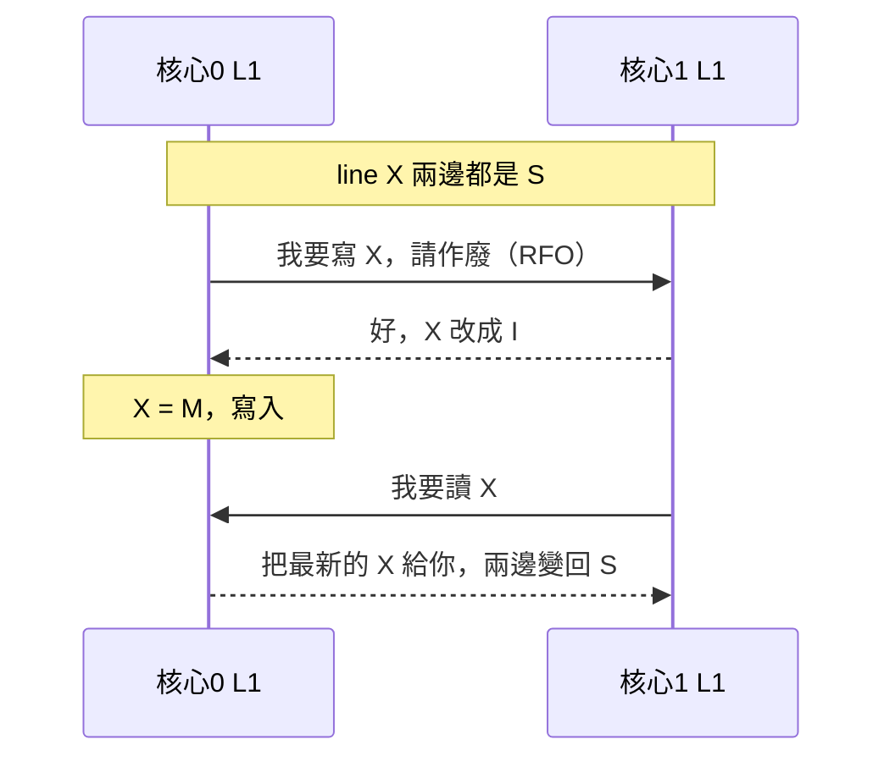

# 第 10 堂：CPU cache、cache line、false sharing

> 先公布第 9 堂測驗答案：
> 1. Go runtime 只在**所有** goroutine 都睡著時才會報 `all goroutines are asleep - deadlock!`。線上服務還有 HTTP listener、背景 ticker 等 goroutine 活著，所以「部分死結」它抓不到。確認方法：開 `net/http/pprof`，看 `/debug/pprof/goroutine?debug=2` 的 stack，找出大量卡在 `sync.(*Mutex).Lock` 或 chan send/recv、而且已經等了好幾分鐘的 goroutine，再對照它們拿鎖的順序，看有沒有形成環。
> 2. 有 SynchronizationContext 的時候，UI／電路執行緒卡在 `.Result` 等 Task 完成；而 Task 在 `await` 之後的後半段，必須排回**同一個**執行緒才能跑完。執行緒等 Task、Task 也等執行緒，兩邊互等就成了環。修法：(a) 事件處理改成 `async`，用 `await LoadAsync()`（正解）；(b) 函式庫內部加 `ConfigureAwait(false)`（治標）。
> 3. 比較像**活結**，再加上飢餓：50 個 worker 用同樣的節奏一起重試、一起撞，大家都很忙地打 Redis，卻沒有進展。改法：用指數退避加隨機 jitter、鎖要設 TTL，或者乾脆改成佇列（Redis Streams／`BLPOP`、Kafka consumer group），讓系統把任務分派下去，不要靠搶鎖。

這堂還在「作業系統」這一層，不過往下挖到硬體了：前兩堂講的鎖和同步，效能好不好其實是 **CPU cache** 決定的。弄懂這堂，下一堂的記憶體模型、atomic 和 memory barrier 會好懂很多。

## 1. 為什麼需要 cache：記憶體太慢了

CPU 一個 cycle 大約 0.3 ns，讀一次 DRAM 卻要 60–100 ns，等於讓 CPU 空等好幾百個 cycle。所以 CPU 和記憶體之間塞了好幾層又小又快的 SRAM：

| 層級 | 典型大小 | 延遲（約） | 誰共用 |
|---|---|---|---|
| 暫存器 | 幾百 bytes | 0 cycle | 單一核心 |
| L1d / L1i | 32–48 KB | ~4 cycles（~1 ns） | 單一核心 |
| L2 | 256 KB–2 MB | ~12 cycles（~4 ns） | 單一核心 |
| L3（LLC） | 數 MB–數百 MB | ~40 cycles（~10–15 ns） | 整顆 CPU 共用 |
| DRAM | GB 級 | ~200+ cycles（~80 ns） | 全部 |
| NVMe SSD | TB 級 | ~100 µs | 全部 |

把 1 ns 想成 1 秒：L1 是 1 秒、L3 大概 10 秒、DRAM 是 1 分半，SSD 則要一天多。

cache 有用，是因為程式有**區域性（locality）**：
- **時間區域性**：剛用過的資料很快會再用（迴圈變數、熱門的 map entry）。
- **空間區域性**：用了某個位址，旁邊的位址很快也會用到（依序走訪陣列）。

## 2. Cache line：搬資料的最小單位

cache 不會一次只搬 1 個 byte，而是一次搬一整塊 **cache line**，在 x86 和多數 ARM 上是 **64 bytes**（Apple M 系列的 L2 是 128 bytes）。你讀一個 `int`，CPU 會把它所在那 64 bytes 整塊載入。

所以：
- **依序走訪陣列很快**：讀一次 DRAM 就拿到 16 個 int，硬體 prefetcher 還會猜你要下一塊，提前去抓。
- **到處跳的指標結構很慢**：linked list、樹，以及 Go 的 `[]*Item`、C# 的 `List<SomeClass>`，每個節點都散在 heap 各處，幾乎每走一步就 cache miss 一次。



經典例子：二維陣列用「列優先」和「行優先」兩種順序走訪，算的東西完全一樣，速度卻可以差 5–10 倍。

```go
// 快：記憶體連續
for i := 0; i < N; i++ { for j := 0; j < N; j++ { sum += m[i][j] } }
// 慢：每一步跨一整列，幾乎每次都 miss
for j := 0; j < N; j++ { for i := 0; i < N; i++ { sum += m[i][j] } }
```

這跟你熟悉的東西是同一個道理：C# 的 `struct` 陣列（值型別連續擺放）走訪起來比 `class` 陣列（一堆參考）快，Go 的 `[]Item` 也通常比 `[]*Item` 快。效能好的程式常講「data-oriented design」，說的就是這件事。

## 3. 多核心的難題：cache 一致性（MESI）

每顆核心都有自己的 L1/L2。如果核心 0 和核心 1 都快取了同一條 line，而核心 0 改了它，核心 1 手上那份就過期了。硬體用**一致性協定**解決這個問題，最常見的是 **MESI**，每條 line 會處在四種狀態之一：

- **M**odified：只有我有，而且我改過了，跟 DRAM 不一樣。
- **E**xclusive：只有我有，內容跟 DRAM 一樣。
- **S**hared：好幾顆核心都有，大家都只讀。
- **I**nvalid：這份已經作廢，不能用。

規則白話講：**想寫，就得先獨佔**。核心 0 要寫一條 Shared 的 line 時，會先在匯流排上廣播「其他人把這條作廢」（RFO，Read For Ownership），等大家都改成 I，自己才變成 M 再寫。之後核心 1 要讀，就得從核心 0 那邊把最新的資料拉過來。



這種 line 在核心之間丟來丟去的現象叫做 **cache line ping-pong**，每丟一次大約要幾十到上百 ns，跟去讀 DRAM 差不多慢。

這也說明了上一堂的事：一把被很多核心搶的 mutex，或是 `atomic.AddInt64` 打在同一個計數器上，就算沒有誰在等鎖，光是那條 line 一直搬家就很貴。

## 4. False sharing：沒共用變數，卻還是在搶

**False sharing（偽共享）**：兩個執行緒各自改**不同**的變數，邏輯上完全不相干，可是這兩個變數剛好落在**同一條 cache line** 上。結果每次寫入都會讓對方那份作廢，line 在兩顆核心之間 ping-pong，效能直接掉好幾倍，而且程式碼看起來一點問題都沒有。

```text
一條 64-byte cache line
┌────────┬────────┬────────┬─────────────────────┐
│ cnt[0] │ cnt[1] │ cnt[2] │ ...                 │
└────────┴────────┴────────┴─────────────────────┘
  核心0寫    核心1寫   核心2寫   → 每次寫入都讓別人的副本作廢
```

常見會踩到的地方：
- 「每個 worker 一個計數器」放在同一個陣列裡：`counters [8]int64`。
- struct 裡兩個熱欄位，被不同 goroutine 寫：例如 queue 的 `head` 和 `tail`。
- C# 裡 `long[] perThreadCount`，一個執行緒用一格。

### 修法：padding／對齊，讓熱資料各佔一條 line

**Go**：
```go
type paddedCounter struct {
    n int64
    _ [56]byte // 8 + 56 = 64 bytes，一個計數器獨佔一條 line
}
var counters [8]paddedCounter
```
Go 標準函式庫自己也這樣做：runtime 裡有 `cpu.CacheLinePad`，`sync.Pool` 的 per-P 資料也有 pad，就是為了避開 false sharing。

**C#**：
```csharp
[StructLayout(LayoutKind.Explicit, Size = 128)]
struct PaddedLong { [FieldOffset(64)] public long Value; }
```
.NET 的 `ConcurrentQueue`、`System.Threading.Channels` 內部也有類似的 `PaddedHeadAndTail`。用 128 bytes 是因為 Intel 的 spatial prefetcher 會一次抓相鄰的兩條 line。

**更好的做法**：讓每個執行緒在自己的區域變數裡累加，最後只合併一次。例如 `Parallel.For` 的 `localInit/localFinally` 多載，或 Go 每個 goroutine 自己算完再丟進 channel。這樣根本就不會共用。

## 5. 小例子：親手量出 false sharing

```go
package main

import (
	"fmt"
	"sync"
	"time"
)

const N = 100_000_000

type plain struct{ a, b int64 }                 // a、b 在同一條 line
type padded struct{ a int64; _ [56]byte; b int64 } // a、b 分開

func run(pa, pb *int64) time.Duration {
	var wg sync.WaitGroup
	wg.Add(2)
	start := time.Now()
	go func() { defer wg.Done(); for i := 0; i < N; i++ { *pa++ } }()
	go func() { defer wg.Done(); for i := 0; i < N; i++ { *pb++ } }()
	wg.Wait()
	return time.Since(start)
}

func main() {
	var p plain
	var q padded
	fmt.Println("同一條 line：", run(&p.a, &p.b))
	fmt.Println("padding 後：", run(&q.a, &q.b))
}
```
在一般多核心筆電上，padding 後的版本常常快 **3–6 倍**（實際數字依 CPU 而定，Apple M 系列因為 line 是 128 bytes，可能要 pad 到 128 才看得出差別）。兩個 goroutine 改的是不同欄位，沒有 data race，`-race` 也不會報任何東西。這就是 false sharing 難抓的原因：程式是對的，只是很慢。

Linux 上可以用 `perf c2c` 找出哪條 cache line 在核心之間 ping-pong；`perf stat -e cache-misses` 可以先看個大概。

## 6. 連到你的日常

- **Docker／K8s 的 CPU limit**：容器只拿到「時間配額」，cache 還是跟同一台主機上的鄰居共用。吵鬧的鄰居把 L3 洗掉，你的 p99 延遲就會變差（noisy neighbor）。所以延遲敏感的服務會用 CPU pinning（`cpuset`、K8s 的 static CPU manager policy）。
- **雲端機型**：同樣是 vCPU，L3 大小不一樣，效能就不一樣；AMD 的 X3D 和一些大 L3 機型，對資料庫和遊戲伺服器特別有利。
- **JSON 序列化、ORM**：一大堆小物件散在 heap 上，對 cache 不友善。這是 `Span<T>`、`ArrayPool`、Go 的 `[]byte` 重複使用，以及 struct-of-arrays 這類寫法會比較快的原因之一。
- **Go 的 GMP 排程器**：每個 P 有自己的本地 run queue，也盡量讓 goroutine 留在同一個 P 上跑，一部分原因就是 cache 還是熱的（cache affinity）。

## 7. 一句話總結

記憶體很慢，CPU 靠 cache 撐著；cache 一次搬 64 bytes；多核心靠 MESI 保持一致，代價是「寫」要先獨佔。所以**連續存放的資料讀得快，被多核心寫的資料要分開放**。

## 8. 小測驗
1. 你有一個 `[]*Order`（一百萬筆），要算總金額。同事改成 `[]Order`（值型別），什麼邏輯都沒動，速度就快了好幾倍。請用 cache line 和 prefetcher 解釋為什麼。
2. 一個 Go 服務用 `var stats [16]int64`，每個 worker goroutine 用 `atomic.AddInt64(&stats[workerID], 1)` 累加自己的計數。改成 16 個 worker 之後，吞吐量反而比 4 個 worker 還低。最可能的原因是什麼？請給兩種修法。
3. MESI 裡，為什麼兩個核心同時「讀」同一條 line 很便宜，但其中一個開始「寫」就變貴了？這跟上一堂的「讀多寫少用 `RWMutex`／`ReaderWriterLockSlim`，有時反而比較慢」有什麼關係？


<details><summary>參考答案</summary>

1. `[]*Order` 裡每筆都是指標，實際物件散在 heap 各處，每走一筆幾乎都是 cache miss，位址跳來跳去 prefetcher 也猜不到。`[]Order` 連續存放，一條 64 bytes 的 line 一次載入好幾筆，prefetcher 看得出你在循序讀，會提前搬下一段進來。
2. false sharing：16 個 int64 只佔 2 條 cache line，各 worker 寫不同格卻搶同一條 line（MESI ping-pong），worker 越多越糟。修法：每格 pad 到 64／128 bytes；或每個 worker 用區域變數累加，最後再合併。
3. 多核同時讀時 line 可處於 S 狀態，各留副本、不用通訊；寫入要先 RFO 讓別的核心作廢、自己拿到 M 獨佔，line 就開始 ping-pong。`RWMutex` 的讀者計數本身是被所有讀者 atomic 寫入的共享欄位，讀鎖也會讓那條 line ping-pong，所以臨界區很短時 `RWMutex` 可能比 `Mutex` 還慢。

</details>
