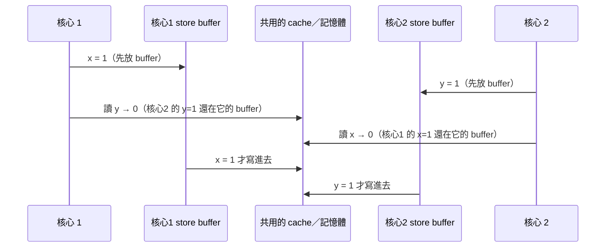
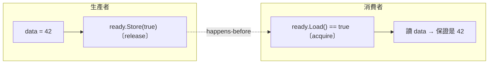

# 第 11 堂：記憶體模型與原子操作、memory barrier

這堂還在「作業系統」這一部分，接著上一堂的 CPU cache 往下講。上一堂講多核心怎麼讓**同一個位址**的資料保持一致（MESI）；這堂講**不同位址**之間的讀寫「順序」別的核心看不看得到、看到的是什麼順序。後面的 lock-free 資料結構、Go／C# 的並行程式，還有資料庫的 WAL 和分散式共識的「happens-before」，觀念都從這裡開始。

## 0. 上一堂測驗答案（第 10 堂）

1. `[]*Order` 裡每一筆都是一個指標，實際的 Order 分散在 heap 各處，每往下走一筆幾乎都是一次 cache miss，而且位址跳來跳去，prefetcher 猜不到下一筆在哪。`[]Order` 是連續存放的，一條 64 bytes 的 line 一次就載入好幾筆，prefetcher 也看得出你在循序往下讀，會提前幫你把下一段搬進來。
2. 這是 false sharing：16 個 int64 只佔 128 bytes，也就是 2 條 cache line。每個 worker 寫的是不同格，搶的卻是同一條 line（MESI ping-pong），worker 越多越糟。修法：(a) 每一格 pad 到 64／128 bytes（例如 `struct { n int64; _ [56]byte }`）；(b) 每個 worker 用自己的區域變數累加，最後再合併一次。
3. 多個核心同時讀時，line 可以處在 S（Shared）狀態，每個核心各留一份副本，不需要互相通訊。要寫入就得先發 RFO，讓其他核心把副本作廢、自己拿到 M（獨佔），之後別人一讀一寫，line 就開始來回搬。`RWMutex` 的讀者計數本身就是一個被所有讀者用 atomic 寫入的共享欄位，所以連「讀鎖」都會讓那條 line ping-pong。臨界區很短時，`RWMutex` 可能比一般 `Mutex` 還慢。

---

## 1. 問題：你寫的順序，不一定是別人看到的順序

先看一段很常見的「發布資料」寫法（虛擬碼）：

```go
var data int
var ready bool

// goroutine A（生產者）
data = 42
ready = true

// goroutine B（消費者）
for !ready { }
fmt.Println(data) // 一定印 42 嗎？
```

直覺上一定是 42，但**不保證**。可能印出 0，也可能 `for !ready` 永遠跑不完。有三層東西都可以重新排列你的讀寫：

1. **編譯器**：`data` 和 `ready` 互不相關，編譯器可以把兩行對調；也可以把 `ready` 讀進暫存器後就不再重讀，於是變成無窮迴圈。
2. **CPU 亂序執行**：CPU 為了不要停下來等記憶體，後面的指令可以先做。
3. **Store buffer**：核心寫入時，資料先放進自己的 store buffer，晚一點才進 cache。在這之前，**只有自己看得到**，別的核心看不到。

單執行緒的程式不會察覺這些事，因為編譯器和 CPU 都保證「從自己這條執行緒看，結果跟照順序執行一樣」。問題只會出現在**另一條執行緒在偷看**的時候。

## 2. 經典實驗：store buffering

```text
初始 x = 0, y = 0

核心 1            核心 2
x = 1             y = 1
r1 = y            r2 = x
```

照順序想，不可能 r1 == 0 而且 r2 == 0（總有一邊先寫）。但在**真的 x86 機器**上，`r1 = 0, r2 = 0` 是會發生的：



兩邊的寫入都還卡在自己的 store buffer，讀到的就都是舊值。

## 3. 硬體的記憶體模型：x86 和 ARM 不一樣

| 架構 | 模型 | 會重排什麼 |
|---|---|---|
| x86／x64（Intel、AMD） | TSO（Total Store Order），比較「強」 | 基本上只有「寫 → 之後的讀（不同位址）」會被重排，就是上面那個實驗 |
| ARM64（Apple M 系列、AWS Graviton、手機） | 弱記憶體模型 | 讀讀、讀寫、寫寫、寫讀，各種組合都可能被重排 |

這在實務上很重要：**有 data race 的程式在 Intel 的開發機上跑得好好的，搬到 MacBook（M 晶片）或 Graviton 機器上才開始壞**。你的 MacBook 是 ARM，雲端換 Graviton 省錢也是 ARM，所以「我這邊跑起來沒事」不能證明程式是對的。

## 4. Memory barrier（fence）：告訴 CPU 不准跨過這條線

Barrier 是一道指令，意思是「線前面的記憶體操作，要在線後面的操作之前讓大家看到」。

- **Full fence**：前後的讀寫都不准跨過。x86 上是 `MFENCE`，或任何帶 `LOCK` 前綴的指令；ARM 上是 `DMB`。
- **Acquire（讀的那一邊）**：這個讀之**後**的操作，不能被搬到它**前面**。
- **Release（寫的那一邊）**：這個寫之**前**的操作，不能被搬到它**後面**。

Acquire／release 一配對就能解決第 1 節的問題：



Release 保證 `data = 42` 不會被排到 `ready = true` 後面；acquire 保證讀 `data` 不會被排到讀 `ready` 前面。一旦 B 看到 `ready == true`，A 在 release 之前寫的東西，B 都看得到。這就叫 **happens-before** 關係。

其實你每天都在用這個：**`mutex.Unlock()` 是 release，`mutex.Lock()` 是 acquire。** 第 8 堂的鎖之所以能保護資料，不只是因為「同時只有一人進去」，也因為鎖幫你插了 barrier，讓上一個人寫的東西，下一個人一定看得到。

## 5. 原子操作：不可分割的讀改寫

`count++` 其實是三步：讀、加一、寫回。兩個核心同時做，就可能各讀到 5、各寫回 6，少算一次。原子操作讓「讀改寫」變成一步：

- **Fetch-and-add**：x86 是 `LOCK XADD`。`LOCK` 前綴讓核心在 MESI 裡獨佔那條 cache line，做完才放手（所以上一堂說 atomic 也會 ping-pong）。
- **CAS（Compare-And-Swap）**：「如果現在的值是 old，就改成 new，並告訴我成功沒」。所有 lock-free 結構（第 53 堂）都是建在 CAS 上。ARM 用 LL/SC（`LDXR`／`STXR`），或 ARMv8.1 之後的 `CAS` 指令。

CAS 迴圈的樣子：

```go
for {
    old := atomic.LoadInt64(&balance)
    if old < amount {
        return errors.New("餘額不足")
    }
    if atomic.CompareAndSwapInt64(&balance, old, old-amount) {
        return nil // 成功
    }
    // 失敗代表別人搶先改了，重讀再試
}
```

注意 **ABA 問題**：值從 A 變成 B 又變回 A，CAS 會以為沒人動過。對指標型的 lock-free 結構這可能出事，常見的解法是加版本號（tagged pointer）。

## 6. 連到你熟的語言

**Go**
- Go 的記憶體模型（2022 年 Go 1.19 修訂）說：`sync/atomic` 的操作是**sequentially consistent**（最強的順序），而且會建立 happens-before。
- 推薦用型別化的 `atomic.Int64`、`atomic.Bool`、`atomic.Pointer[T]`，比 `atomic.AddInt64(&x, 1)` 不容易誤用（不會有人不小心直接讀 `x`）。
- channel 傳送 happens-before 對應的接收完成；`sync.Once`、`WaitGroup` 也都有定義好的 happens-before。
- `go test -race` 抓的就是「兩個 goroutine 存取同一個變數，至少一個是寫，而且中間沒有 happens-before」。

**C#／.NET**
- `Interlocked.Increment`、`Interlocked.CompareExchange`：原子操作，含 full fence。
- `Volatile.Read` 是 acquire，`Volatile.Write` 是 release；`volatile` 欄位等於每次存取都這樣做。
- C# 的 `volatile` **不是** Java 的 `volatile`：它擋不住第 2 節那種「寫 → 讀」的重排。需要 full fence 時用 `Interlocked` 或 `Thread.MemoryBarrier()`。
- 經典的 double-checked locking，現在直接用 `Lazy<T>` 就好，不要自己寫。

修好第 1 節的 Go 版本：

```go
var data int
var ready atomic.Bool

// 生產者
data = 42
ready.Store(true) // release（Go 裡其實是更強的 seq-cst）

// 消費者
for !ready.Load() {
    runtime.Gosched()
}
fmt.Println(data) // 保證 42
```

## 7. 什麼時候該用 atomic，什麼時候用鎖

- **單一個計數器、旗標、指標替換**（例如設定熱更新：`atomic.Pointer[Config]` 整份換掉）→ atomic 很適合。
- **要同時維持兩個以上變數的一致**（例如「餘額減掉、交易紀錄加一筆」）→ 用鎖。用多個 atomic 拼起來，中間的狀態別人還是看得到。
- 不確定時就用鎖。鎖在沒人搶的時候其實很快（就是一次 CAS），而且不容易寫錯。

## 8. 一句話總結

編譯器和 CPU 都會為了速度重排你的讀寫，單執行緒看不出來，多執行緒就會出事；**barrier 和 acquire／release 規定順序，atomic 讓讀改寫不可分割，鎖兩者都幫你做好**。在 ARM（你的 MacBook、Graviton）上，這些錯誤更容易冒出來。

## 9. 小測驗
1. 同事說：「我的程式在 CI（Intel x64）跑了一萬次都沒問題，所以沒有 race。」程式部署到 AWS Graviton 之後偶爾讀到舊資料。請用 x86 TSO 和 ARM 弱記憶體模型的差別解釋，並說要用什麼工具在 CI 就抓出來。
2. 一個 Go 服務用 `var cfg *Config` 做設定熱更新：背景 goroutine 每分鐘 `cfg = loadConfig()`，請求處理時直接讀 `cfg.Timeout`。這有什麼問題？請給一個不需要鎖的修法。
3. 你有兩個 atomic 變數：`balance` 和 `txCount`，扣款時先 `balance.Add(-amt)` 再 `txCount.Add(1)`。報表程式讀這兩個值算「平均每筆金額」，偶爾算出怪數字。為什麼兩個操作各自都是原子的，結果還是不一致？要怎麼修？


<details><summary>參考答案</summary>

1. x86 是 TSO，只會把「寫 → 之後的讀」重排，很多少了 barrier 的程式剛好能跑；ARM 是弱模型，寫寫、讀讀也可能重排，同一份有 race 的程式就會讀到舊值。「跑一萬次沒事」不能證明沒有 race。在 CI 加 `go test -race`（.NET 可用並行壓力測試，並在 ARM runner 上跑），race detector 檢查的是 happens-before，跟 CPU 架構無關。
2. 一個 goroutine 寫 `cfg`、別的 goroutine 讀，中間沒有 happens-before，是 data race：讀的人可能一直看到舊指標，也可能看到新指標卻讀到還沒寫完的 Config 欄位（ARM 上更容易）。修法：`var cfg atomic.Pointer[Config]`，背景用 `cfg.Store(loadConfig())` 整份替換，請求用 `cfg.Load().Timeout` 讀；新的 Config 建好後就不要再改它（immutable）。
3. 每個操作各自原子，但「兩個一起」不是原子的：報表可能剛好在 `balance` 扣完、`txCount` 還沒加之間讀，看到一半的狀態。修法：用一把鎖同時保護兩個欄位；或把兩個值放進同一個不可變的 struct，用 `atomic.Pointer` 整份替換（CAS 迴圈）；或讓報表從交易紀錄重新算。

</details>
