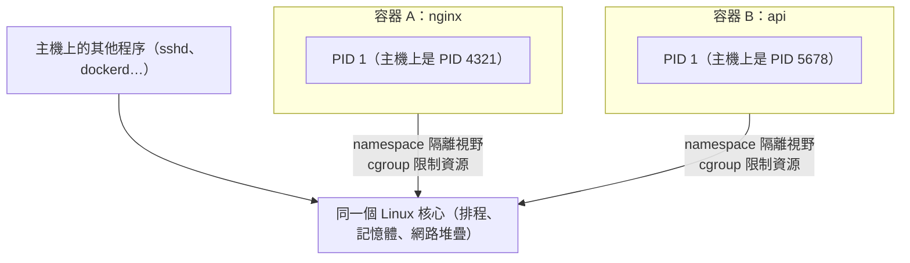
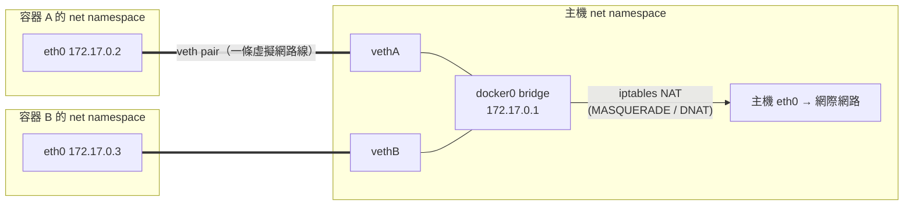
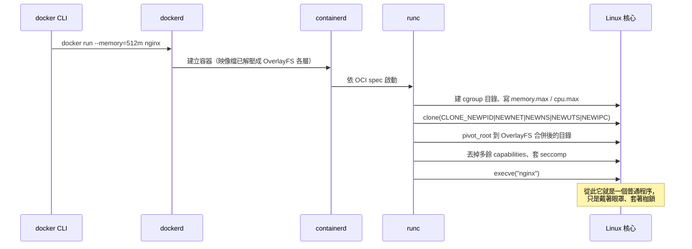

# 第 12 堂：容器底層：namespace、cgroup

這是「作業系統」部分的最後一堂，把前面學的程序、排程、虛擬記憶體、檔案系統串起來：你每天用的 Docker 容器，其實**不是虛擬機**，只是一個被 Linux 核心「蒙上眼睛（namespace）」又「套上枷鎖（cgroup）」的普通程序。下一堂開始進入「網路」部分，這堂講的 network namespace 和 veth 正好當橋樑。

## 0. 上一堂測驗答案（第 11 堂）

1. x86 是 TSO，只會把「寫 → 之後的讀」重排，很多少了 barrier 的程式剛好能跑；ARM 是弱模型，寫寫、讀讀也可能重排，同一份有 race 的程式就會讀到舊值。「跑一萬次沒事」不能證明沒有 race。在 CI 加 `go test -race`（.NET 可用並行壓力測試，並在 ARM runner 上跑），race detector 檢查的是 happens-before，跟 CPU 架構無關。
2. 一個 goroutine 寫 `cfg`、別的 goroutine 讀，中間沒有 happens-before，是 data race：讀的人可能一直看到舊指標，也可能看到新指標卻讀到還沒寫完的 Config 欄位（ARM 上更容易）。修法：`var cfg atomic.Pointer[Config]`，背景用 `cfg.Store(loadConfig())` 整份替換，請求用 `cfg.Load().Timeout` 讀；新的 Config 建好後就不要再改它（immutable）。
3. 每個操作各自原子，但「兩個一起」不是原子的：報表可能剛好在 `balance` 扣完、`txCount` 還沒加之間讀，看到一半的狀態。修法：用一把鎖同時保護兩個欄位；或把兩個值放進同一個不可變的 struct，用 `atomic.Pointer` 整份替換（CAS 迴圈）；或讓報表從交易紀錄重新算。

---

## 1. 容器 = 普通程序 + 三件事

在主機上跑 `docker run -d nginx`，然後在**主機**上執行 `ps aux | grep nginx`，你會直接看到 nginx 的程序，有自己的主機 PID。它沒有跑在另一個作業系統裡，它跟你的 shell 共用**同一個核心**，由同一個 CFS 排程器排程（第 2 堂）、用同一套分頁機制（第 4 堂）。

讓它「看起來像一台獨立機器」的是三樣東西：

| 機制 | 負責 | 白話 |
|---|---|---|
| **namespace** | 隔離「看得到什麼」 | 蒙眼：只看得到自己的 PID、網卡、掛載點 |
| **cgroup** | 限制「能用多少」 | 枷鎖：CPU、記憶體、I/O、程序數量上限 |
| **rootfs（OverlayFS）** | 提供「自己的檔案系統」 | 換一個根目錄，看到映像檔裡的 `/` |

再加上 capabilities、seccomp 這些安全過濾，就是一個容器。



這也解釋了：
- 為什麼容器啟動是**毫秒級**：只是 `clone()` 一個程序，不用開機。
- 為什麼 Linux 容器不能直接在 macOS 核心上跑：Docker Desktop 在你的 MacBook 上其實偷偷開了一台 Linux VM，容器跑在那台 VM 的核心上。
- 為什麼容器隔離比 VM 弱：大家共用一個核心，核心有洞就可能逃逸。

## 2. namespace：每個程序戴一副「有色眼鏡」

namespace 是核心給程序的一層對照表：同一種資源（PID、網路、掛載點…），不同 namespace 裡的程序看到不同的版本。Linux 目前有 8 種：

| namespace | 隔離什麼 | 容器裡的效果 |
|---|---|---|
| **PID** | 程序編號 | 容器內第一個程序是 PID 1，看不到主機上其他程序 |
| **NET** | 網卡、IP、路由表、iptables、port | 每個容器有自己的 `eth0` 和 `localhost`，大家都能 listen 80 |
| **MNT** | 掛載點 | 看到的 `/` 是映像檔，不是主機的根目錄 |
| **UTS** | hostname | `hostname` 顯示容器 ID |
| **IPC** | System V IPC、POSIX 訊息佇列 | 共享記憶體不會跨容器 |
| **USER** | UID/GID 對照 | 容器內的 root 可以對應到主機上的普通使用者（rootless） |
| **CGROUP** | 看到的 cgroup 樹 | 容器裡看 `/sys/fs/cgroup` 只看到自己那段 |
| **TIME** | 開機時間時鐘 | 少用，可讓容器有不同的 uptime |

建立 namespace 的系統呼叫（第 3 堂的 syscall）只有三個：
- `clone(flags)`：建立新程序時順便放進新的 namespace（`CLONE_NEWPID | CLONE_NEWNET | ...`）。
- `unshare(flags)`：讓**目前的**程序離開原本的 namespace，進新的。
- `setns(fd)`：加入一個已經存在的 namespace。`docker exec` 就是用這個「鑽進」正在跑的容器。

每個程序屬於哪些 namespace，可以在 `/proc/<pid>/ns/` 看到：

```bash
$ ls -l /proc/self/ns/
lrwxrwxrwx ... net -> 'net:[4026531840]'
lrwxrwxrwx ... pid -> 'pid:[4026531836]'
...
```

方括號裡的數字是 namespace 的 inode 編號（第 6 堂的 inode）；兩個程序數字一樣，就在同一個 namespace。

### 自己動手做一個「陽春容器」

不用 Docker，一行指令就能體驗 PID + MNT namespace（需要 root）：

```bash
sudo unshare --pid --fork --mount-proc --uts bash
hostname my-box     # 只改到新的 UTS namespace，主機 hostname 不變
ps aux              # 只看到 bash 和 ps，bash 是 PID 1
```

### PID 1 的特殊責任

容器裡的主程序是 PID 1，這有兩個實務陷阱：
1. **訊號**：核心不會對 PID 1 套用預設的訊號處理。若程式沒有自己處理 `SIGTERM`，`docker stop` 會等 10 秒逾時後才用 `SIGKILL` 硬殺。Go 要用 `signal.Notify` 接 SIGTERM 做 graceful shutdown；ASP.NET Core 的 Generic Host 預設就處理了。
2. **收殭屍**：第 1 堂講過，子程序結束後要父程序 `wait()` 才會被清掉。孤兒程序會被交給 PID 1；如果你的 PID 1 是一個不會 `wait` 的 Node/Python 程式，殭屍就會越積越多。解法：`docker run --init`（用 tini 當 PID 1）。

另外，Dockerfile 用 **exec 形式** `CMD ["./app"]`，不要用 shell 形式 `CMD ./app`；後者 PID 1 會是 `/bin/sh`，SIGTERM 送到 sh，傳不到你的程式。

### network namespace 怎麼連出去

新的 NET namespace 一開始只有一張沒啟用的 `lo`。Docker 預設的 bridge 網路這樣接：



- **veth pair** 像一條網路線的兩端，一端放容器裡叫 `eth0`，另一端留在主機插到 `docker0` 橋接器上。
- `-p 8080:80` 其實是在主機的 iptables 加一條 DNAT 規則：打到主機 8080 的封包改送到 `172.17.0.2:80`。
- Kubernetes 的 Pod 就是「多個容器**共用同一個** net namespace」，所以同一個 Pod 裡的 sidecar 可以用 `localhost` 互連。

橋接器、ARP、路由、NAT 這些東西，接下來的網路課會一層一層講。

## 3. cgroup：資源的「預算帳本」

namespace 只管「看得到什麼」，不管「用多少」。一個沒限制的容器照樣可以吃光主機所有 CPU 和記憶體。**cgroup（control group）** 負責把程序分組，然後對每組設上限並記帳。

現代發行版（Ubuntu 22.04+、Amazon Linux 2023、新版 Docker／K8s）都用 **cgroup v2**：一棵掛在 `/sys/fs/cgroup` 的單一樹，每個目錄是一個群組，**設定就是寫檔案**（所以又是「一切皆檔案」）：

```text
/sys/fs/cgroup/
└── system.slice/
    └── docker-<容器ID>.scope/
        ├── cgroup.procs      ← 屬於這組的 PID
        ├── cpu.max           ← "50000 100000" = 每 100ms 最多用 50ms（0.5 核）
        ├── memory.max        ← 536870912 = 512MiB 硬上限
        ├── memory.current    ← 目前用量
        ├── pids.max          ← 最多幾個程序／執行緒（防 fork bomb）
        └── io.max            ← 磁碟讀寫頻寬／IOPS 上限
```

`docker run --cpus=0.5 --memory=512m --pids-limit=100 myapp` 做的事，就是建一個目錄、寫這幾個檔案、把容器的 PID 寫進 `cgroup.procs`。

### CPU 限制：配額，不是「給你半顆核心」

`cpu.max = 50000 100000` 的意思是：每 100ms 的週期裡，這組**所有執行緒加起來**最多跑 50ms。用完就被 **throttle**（暫停）到下一個週期。

陷阱：你的 Go 服務有 8 個執行緒同時在跑，它們 **6.25ms 就把 50ms 用完**，接下來 93.75ms 全部卡住。平均 CPU 使用率看起來不高，**p99 延遲卻很難看**。看 `cpu.stat` 裡的 `nr_throttled`、`throttled_usec` 就能確認。

另一種是 `cpu.weight`（對應 K8s 的 requests）：只在搶 CPU 時按比例分配，有空閒就能多用，不會被 throttle。

### 記憶體限制：超過就 OOM kill

`memory.max` 是硬上限。用量超過、又回收不了 page cache（第 6 堂）時，核心的 **OOM killer** 會在**這個 cgroup 裡**挑一個程序殺掉。這就是你在 K8s 看到的 `OOMKilled`、exit code **137**（128 + 9，SIGKILL）。

注意：page cache 也算進容器的記憶體用量，但可以被回收；真正會害你被殺的是 heap 這類「匿名記憶體」。

## 4. 連到你熟的 Go、C#、雲端

**Go 的 GOMAXPROCS 陷阱**
Go 1.25 之前，`runtime` 看的是**主機**的 CPU 數。在 64 核的節點上跑一個 `--cpus=2` 的容器，Go 會開 64 個 P 去搶 2 核的配額，throttle 嚴重。舊版本用 `go.uber.org/automaxprocs`；Go 1.25 起 runtime 會讀 cgroup 的 CPU 上限自動設定。記憶體則用 `GOMEMLIMIT` 設在 `memory.max` 的 80–90%，讓 GC 在被 OOM kill 之前更積極回收。

**.NET**
.NET Core 3.0 起就會讀 cgroup：`Environment.ProcessorCount` 回傳容器的 CPU 上限，GC 的 heap 上限預設是容器記憶體的 75%（可用 `DOTNET_GCHeapHardLimitPercent` 調整）。容器裡建議用 Server GC 時要注意它會依 CPU 數建立 heap 數量。

**Kubernetes／雲端**
- `resources.limits.cpu` → `cpu.max`（會 throttle）；`requests.cpu` → `cpu.weight`（排程與搶占比例）。很多團隊對延遲敏感的服務**只設 requests、不設 CPU limit**，就是為了避開 throttle。
- `limits.memory` → `memory.max`（超過就 OOMKilled）。記憶體 limit 一定要設。
- AWS ECS 的 task CPU/記憶體、Cloud Run 的實例規格、Lambda 的記憶體設定，底層都是同樣的 cgroup（Lambda／Fargate 外面還多包一層 Firecracker microVM，提供比 namespace 更強的隔離）。

## 5. Docker 整個流程串起來



**OverlayFS** 把映像檔的多個唯讀層疊起來，最上面加一層可寫層。容器裡改檔案時，先把原檔複製到可寫層再改（copy-on-write，跟第 5 堂 fork 的 COW 同一個概念）。這也是為什麼 Dockerfile 裡每個 `RUN` 都是一層、刪掉前一層的檔案映像檔不會變小。

## 6. 一句話總結

**容器 = 普通 Linux 程序 + namespace（看不到別人）+ cgroup（用不超過）+ OverlayFS（自己的根目錄）**。它啟動快、密度高，代價是共用核心、隔離比 VM 弱。實務上最常踩的坑是：PID 1 不處理 SIGTERM、CPU limit 造成 throttle、runtime 沒讀到 cgroup 上限，以及記憶體超限的 OOMKilled（137）。

## 7. 小測驗

1. 你的 Go API 部署在 K8s，`limits.cpu: "1"`，節點有 32 核，Go 版本 1.22。監控顯示平均 CPU 只有 40%，但 p99 延遲常飆到 100ms 以上。請用 cgroup 的 CPU 配額機制解釋原因，並提出兩種修法。
2. `docker stop` 你的容器時，每次都要等 10 秒才結束，日誌顯示程式沒有跑 graceful shutdown。Dockerfile 最後一行是 `CMD dotnet MyApi.dll`。問題可能出在哪裡？怎麼改？
3. 兩個容器都在自己的 3000 port listen，為什麼不會衝突？如果要讓它們用 `localhost:3000` 和 `localhost:4000` 互相呼叫，在 K8s 裡要怎麼安排？


<details><summary>參考答案</summary>

1. `limits.cpu: "1"` 會寫成 `cpu.max = 100000 100000`：每 100ms 週期全部執行緒加起來最多跑 100ms。Go 1.22 看的是節點的 32 核，GOMAXPROCS=32，突發請求時很多執行緒同時跑，幾 ms 內就用完配額，剩下的時間整組被 throttle，平均使用率不高但 p99 很差（看 `cpu.stat` 的 `nr_throttled` 可確認）。修法：(a) 用 `automaxprocs` 或設 `GOMAXPROCS=1`，或升級到 Go 1.25+ 讓 runtime 自動讀 cgroup；(b) 拿掉 CPU limit 只留 requests，或把 limit 調高；(c) 減少單一請求的平行度。
2. `CMD dotnet MyApi.dll` 是 shell 形式，實際執行的是 `/bin/sh -c "dotnet MyApi.dll"`，PID 1 是 sh。`docker stop` 送的 SIGTERM 給了 sh，sh 不轉送給 dotnet，10 秒逾時後被 SIGKILL。改成 exec 形式 `CMD ["dotnet", "MyApi.dll"]`（或 `ENTRYPOINT`），讓 dotnet 直接當 PID 1；需要時再加 `--init`／tini 幫忙轉送訊號和收殭屍。
3. 每個容器有自己的 network namespace，各自有獨立的網卡、IP 和 port 表，所以兩個 3000 互不相干，從外面要靠不同 IP 或 `-p` 對應不同主機 port。若要用 localhost 互連，就讓兩個容器共用同一個 net namespace：在 K8s 把它們放進**同一個 Pod**（例如主程式加 sidecar），但同一個 Pod 裡 port 不能重複，所以一個要改成 listen 4000。Docker 上對應的做法是 `--network container:<另一個>`。

</details>
