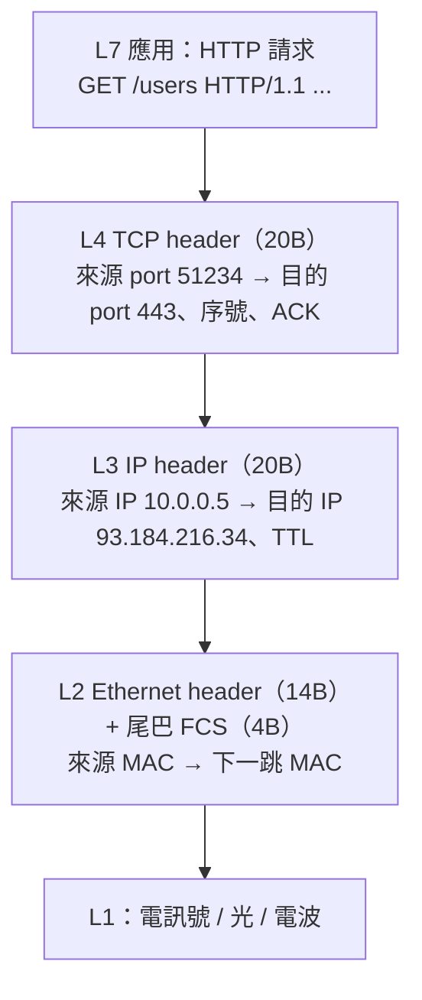
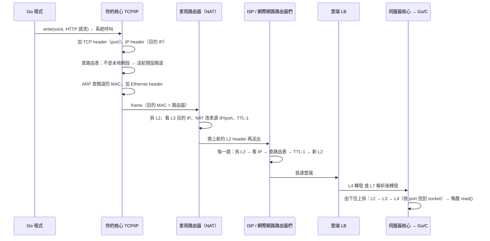

# 第 13 堂：OSI/TCP-IP 分層、封包旅程

從這堂開始進入第二部分「網路通訊」。上一堂我們看到容器有自己的 network namespace，這堂往下挖：你在 Go 裡寫一行 `http.Get("https://api.example.com")`，那些位元到底怎麼一層層包裝、離開網卡、穿過路由器、到對方再被拆開？先建立「分層」這張地圖，後面十堂（ARP、TCP、QUIC、DNS、TLS、負載平衡、gRPC）都是在這張地圖上放大某一層。

## 0. 上一堂測驗答案（第 12 堂）

1. `limits.cpu: "1"` 會寫成 `cpu.max = 100000 100000`：每 100ms 週期，整組執行緒加起來最多只能跑 100ms CPU 時間。Go 1.22 看到的是節點 32 核，GOMAXPROCS=32，突發請求時幾十條執行緒同時跑，幾毫秒就把配額燒完，剩下的時間整組被 throttle 到下個週期，所以平均 CPU 不高、p99 卻很差（`cpu.stat` 的 `nr_throttled` 會一直漲）。修法：(a) 用 `go.uber.org/automaxprocs` 或設 `GOMAXPROCS=1`，或升級到會自動讀 cgroup 的新版 Go；(b) 拿掉 CPU limit 只留 requests，或調高 limit；(c) 降低單一請求的平行度。
2. `CMD dotnet MyApi.dll` 是 shell 形式，實際跑的是 `/bin/sh -c "dotnet MyApi.dll"`，PID 1 是 sh。`docker stop` 的 SIGTERM 送給 sh，sh 不轉送給 dotnet，10 秒逾時後被 SIGKILL，graceful shutdown 根本沒機會跑。改成 exec 形式 `CMD ["dotnet", "MyApi.dll"]`，讓 dotnet 直接當 PID 1；需要時加 `docker run --init`（tini）幫忙轉送訊號和收殭屍程序。
3. 每個容器有自己的 network namespace：獨立的網卡、IP、路由表和 port 表，兩個 3000 各在各的世界裡，互不衝突（從外面靠不同容器 IP 或 `-p` 對到不同主機 port）。要用 localhost 互叫，就讓它們**共用同一個 net namespace**：在 K8s 放進同一個 Pod（主程式 + sidecar），但同一個 Pod 內 port 不能重複，所以一個改 listen 4000。Docker 的對應寫法是 `--network container:<另一個容器>`。

---

## 1. 為什麼要分層？

網路要解決的問題太多：電訊號怎麼表示 0/1、同一條線上誰先講話、跨城市怎麼找路、封包掉了怎麼補、資料怎麼加密、HTTP 怎麼表達 GET。如果全部寫在一個程式裡，換一種網卡（Wi-Fi → 光纖）就要整個重寫。

分層的想法跟你寫後端的分層架構一模一樣：**每層只跟上下層講話，透過固定介面**。Controller 不管 Repository 用 MongoDB 還是 SQL Server；HTTP 也不管底下是 Wi-Fi 還是 5G。

## 2. 兩個模型：OSI 七層 vs TCP/IP 四層

OSI 是教科書的理想模型，TCP/IP 是真正在跑的。面試和文件常講「L4 負載平衡」「L7 防火牆」，這些編號來自 OSI，所以兩個都要認得。

| OSI 層 | 名稱 | TCP/IP 對應 | 資料單位 | 代表協定 / 東西 | 在哪裡處理 |
|---|---|---|---|---|---|
| L7 | 應用層 | 應用層 | 訊息 | HTTP、gRPC、DNS、SMTP | 你的程式（Go/C#） |
| L6 | 表示層 | （併入應用層） | | TLS、JSON/Protobuf 編碼 | 函式庫 |
| L5 | 會談層 | （併入應用層） | | session、連線管理 | 函式庫 |
| L4 | 傳輸層 | 傳輸層 | **Segment**（TCP）/ Datagram（UDP） | TCP、UDP、QUIC | **核心** |
| L3 | 網路層 | 網際網路層 | **Packet** | IP、ICMP | **核心** |
| L2 | 資料鏈結層 | 網路存取層 | **Frame** | Ethernet、Wi-Fi、ARP | 核心 + 網卡驅動 |
| L1 | 實體層 | 網路存取層 | 位元 | 網路線、光纖、電波 | 網卡硬體 |

關鍵觀察：**L4 以下在核心裡，L5 以上在使用者空間**。分界線就是第 3 堂講的系統呼叫：你呼叫 `write(sockfd, ...)`，從那一刻起資料交給核心的 TCP/IP 堆疊。這也是為什麼 L7 負載平衡（Nginx、ALB）比 L4（NLB、LVS）貴：它得把資料拉回使用者空間解析 HTTP。

> 口訣：一個位址代表一層。**port 是 L4、IP 是 L3、MAC 是 L2。**

## 3. 封裝：一層包一層的信封

往下傳時每層加上自己的 header（像把信裝進一個又一個信封），往上收時每層拆掉自己那層。



一個完整的 Ethernet frame 長這樣：

```
| Ethernet hdr | IP hdr | TCP hdr | TLS record（裡面是加密的 HTTP）| FCS |
|   14 bytes   |  20B   |  20B+   |          最多約 1448B          | 4B  |
```

這裡出現一個你在雲端一定碰過的數字：**MTU = 1500**。Ethernet 一個 frame 的 payload 最多 1500 bytes，扣掉 IP 20 + TCP 20，每個 TCP segment 最多帶約 1460 bytes 資料（稱為 MSS）。如果中間又包了一層隧道（VPN、VXLAN、WireGuard、K8s 的 overlay network），header 變多，能裝的資料就變少；MTU 設錯會出現「小請求正常、大回應卡住」的詭異問題。

## 4. 封包旅程：從你的筆電到伺服器

假設你在 MacBook 上的 Go 程式呼叫 `https://api.example.com/users`（第 18 堂講 DNS，這裡先假設已經查到 IP）。



這張圖最重要的幾個觀念：

1. **IP 位址從頭到尾不變（除了 NAT），MAC 位址每一跳都換。** IP 是「最終目的地」，MAC 是「下一站是誰」。就像寄國際包裹：收件地址不變，但每個轉運站都會貼新的「下一站」標籤。
2. **路由器只看到 L3。** 它拆掉 L2、看 IP 決定往哪送、再包新的 L2。它不需要懂 TCP 或 HTTP（NAT 例外，它會偷看並改 L4 的 port）。
3. **TTL 每過一個路由器減 1**，到 0 就丟棄並回一個 ICMP 錯誤，避免封包在迴圈裡永遠繞。`traceroute` 就是故意送 TTL=1、2、3… 的封包，看每一跳是誰回錯誤。
4. **對方核心靠 port 找到 socket。** 核心收到 TCP segment 後，用 (來源 IP, 來源 port, 目的 IP, 目的 port) 這個四元組找到對應的連線，把資料放進 socket 接收緩衝區，喚醒正在 `read()` 或 epoll 等待的執行緒（第 7 堂）。

## 5. 收封包時核心在做什麼？

把第一部分學的東西串起來：

1. 網卡用 DMA 把 frame 直接寫進記憶體的 ring buffer，然後發一個**硬體中斷**。
2. 核心中斷處理很短，只排一個軟中斷（NAPI），之後批次輪詢拿封包，避免高流量時中斷風暴。
3. 依序經過 L2（檢查 MAC、VLAN）→ L3（檢查 IP、iptables/netfilter 規則、路由決策）→ L4（TCP 狀態機、重組、ACK）。
4. 資料進 socket buffer，等你的程式用系統呼叫拷貝到使用者空間。

這也解釋了幾個實務現象：Docker 的 `-p 8080:80` 其實是 iptables 在 L3/L4 做 DNAT；K8s 的 kube-proxy（iptables/IPVS 模式）是在核心裡做 L4 轉發；而 eBPF/XDP（Cilium 用的）能在第 2 步就處理封包，所以特別快。

## 6. 連到你熟悉的工具

| 你看到的 | 屬於哪層 |
|---|---|
| Go `net/http`、C# `HttpClient`、gRPC | L7 |
| Go `net.Dial("tcp", ...)`、C# `Socket`/`TcpClient` | L4 的 API（socket） |
| `curl -v` 看到的 HTTP header | L7 |
| AWS Security Group（IP + port 規則） | L3/L4 |
| AWS ALB / Azure Application Gateway | L7 |
| AWS NLB / Azure Load Balancer | L4 |
| VPC、子網路、路由表 | L3 |
| Docker bridge、veth pair | L2（虛擬交換器與網卡） |
| `tcpdump` / Wireshark | 從 L2 開始全看得到 |

小實驗（在 Linux 或 Docker 容器裡都能跑）：

```bash
# 另開一個終端抓封包，-e 顯示 MAC（L2），-n 不反查 DNS
sudo tcpdump -i any -n -e port 80
# 再送一個請求
curl http://example.com
```

你會看到每行都有 MAC、IP、port 和 TCP 旗標（`[S]`、`[S.]`、`[.]`），正好就是三次握手，下兩堂會細講。

## 7. 一句話總結

**網路就是一疊信封**：應用層寫內容，TCP 加上 port 和序號，IP 加上最終目的地，Ethernet 加上下一站的 MAC。往下包、往上拆；IP 全程不變，MAC 每跳都換；L4 以下由核心處理，L7 在你的程式裡。

## 8. 小測驗

1. 你的服務部署在 K8s，叢集網路用 VXLAN overlay。小的 API 請求都正常，但回應超過約 1.4KB 的請求偶爾會卡住直到逾時。從封裝和 MTU 的角度，最可能是什麼問題？
2. 同事說：「封包從我的筆電到伺服器，經過 15 個路由器，所以來源 MAC 和目的 MAC 一路上都沒變。」哪裡錯了？IP 位址呢？什麼情況下 IP 也會被改？
3. AWS 上你要依照 URL 路徑把 `/api/*` 和 `/static/*` 導到不同的服務，該用 ALB 還是 NLB？用分層的觀念說明為什麼另一個做不到。

<details><summary>參考答案</summary>

1. VXLAN 會在原本的 frame 外面再包一層（外層 Ethernet + IP + UDP + VXLAN header，約 50 bytes）。如果 Pod 網卡的 MTU 還設成 1500，加上外層 header 後實體 frame 就超過底層網路的 1500，會被丟掉或需要分片；小封包剛好沒超過所以正常。若又有防火牆擋掉 ICMP「需要分片」訊息，Path MTU Discovery 失效，TCP 一直重送大 segment，看起來就是「卡住到逾時」。修法：把 overlay 介面的 MTU 調小（例如 1450），或讓底層網路支援 jumbo frame（如 9001），並確保 ICMP 沒被擋。
2. MAC 只在同一個 L2 網段內有效，每經過一個路由器，路由器都會拆掉舊的 Ethernet header、換上「自己 → 下一跳」的新 MAC，所以 MAC 每一跳都換。IP 位址是最終來源與目的地，正常情況下全程不變；但經過 NAT（家用路由器、雲端 NAT Gateway）時來源 IP/port 會被改寫，經過 DNAT（Docker `-p`、K8s Service、負載平衡器）時目的 IP/port 會被改寫。
3. 要用 ALB。URL 路徑是 HTTP 請求裡的內容，屬於 L7；ALB 會終結 TLS、解析 HTTP，才看得到 `/api`、`/static`。NLB 工作在 L4，只看 IP 和 port（以及 TCP/UDP），對它來說 HTTP 只是一串加密的位元組，不知道路徑是什麼，只能依 port 轉發。
</details>
