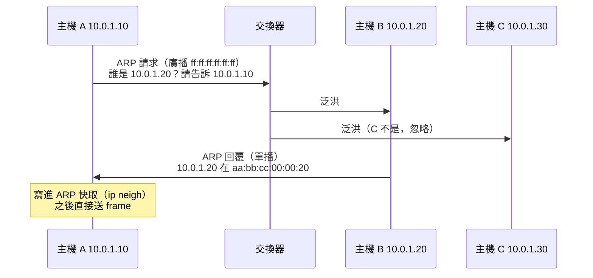
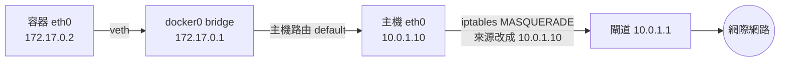

# 第 14 堂：Ethernet、ARP、IP、路由

這堂在「網路通訊」層，把上一堂那疊信封的 **L2（Ethernet）和 L3（IP）** 放大來看：封包怎麼在同一個網段裡找到對方的網卡（ARP），又怎麼跨網段一跳一跳找到路（路由表）。你在 AWS VPC 設的子網路、路由表、Docker bridge、K8s Pod 網路，全部建在這一層。

## 0. 上一堂測驗答案（第 13 堂）

1. VXLAN 會在原本的 frame 外面再包一層（外層 Ethernet + IP + UDP + VXLAN header，約 50 bytes）。如果 Pod 網卡的 MTU 還是 1500，加上外層 header 後就超過底層網路的 1500，會被丟掉或需要分片；小封包沒超過所以正常。若防火牆又擋掉 ICMP「需要分片」訊息，Path MTU Discovery 失效，TCP 一直重送大 segment，看起來就是「卡住到逾時」。修法：把 overlay 介面 MTU 調小（例如 1450），或讓底層支援 jumbo frame（如 9001），並確保 ICMP 沒被擋。
2. MAC 只在同一個 L2 網段內有效，每經過一個路由器，都會拆掉舊的 Ethernet header、換上「自己 → 下一跳」的新 MAC，所以 MAC 每一跳都換。IP 是最終來源與目的地，正常情況全程不變；但經過 NAT（家用路由器、NAT Gateway）時來源 IP/port 會被改寫，經過 DNAT（Docker `-p`、K8s Service、負載平衡器）時目的 IP/port 會被改寫。
3. 用 ALB。URL 路徑是 HTTP 請求內容，屬於 L7；ALB 終結 TLS、解析 HTTP，才看得到 `/api`、`/static`。NLB 在 L4，只看 IP、port 和協定，HTTP 對它只是一串（常是加密的）位元組，只能依 port 轉發。

---

## 1. 兩種位址，兩種用途

| | MAC 位址（L2） | IP 位址（L3） |
|---|---|---|
| 長相 | `02:42:ac:11:00:02`（48 bit） | `172.17.0.2/16`（IPv4 32 bit） |
| 誰給的 | 網卡出廠（或虛擬網卡隨機產生） | 設定、DHCP、雲端平台分配 |
| 有效範圍 | **同一個 L2 網段**（同一台交換器/bridge） | **全網路**，可路由 |
| 比喻 | 這一站要交給誰（宅配員手上的下一站） | 最終收件地址 |

關鍵觀念：**IP 決定「最終要去哪」，MAC 決定「這一跳交給誰」**。所以需要一個把 IP 對應到 MAC 的機制，那就是 ARP。

## 2. Ethernet frame 與交換器

Ethernet frame 長這樣：

```
| 目的 MAC (6) | 來源 MAC (6) | EtherType (2) | 資料 46~1500 (MTU) | FCS (4) |
```

- **EtherType** 告訴對方裡面裝什麼：`0x0800` 是 IPv4、`0x0806` 是 ARP、`0x86DD` 是 IPv6。
- **交換器（switch）** 是 L2 設備：它看來源 MAC 學習「這個 MAC 在哪個 port」，建一張 MAC 表；收到 frame 就查目的 MAC 從對的 port 送出，查不到就**泛洪（flood）** 到所有 port。
- 目的 MAC 是 `ff:ff:ff:ff:ff:ff` 就是**廣播**，整個網段都收得到。一個廣播能到達的範圍叫**廣播域**，也就是一個 L2 網段（VLAN 可以把一台交換器切成多個廣播域）。

Docker 的 `docker0` 就是一台**用軟體做的交換器（Linux bridge）**，每個容器透過一對 veth（虛擬網路線的兩端）插在上面。

## 3. ARP：用 IP 問出 MAC

主機 A（10.0.1.10）要送給同網段的 B（10.0.1.20），但只知道 B 的 IP：



- 結果存在 **ARP 快取**（Linux：`ip neigh`），會過期重問。
- **ARP 沒有任何驗證**：任何人都能回「我就是 10.0.1.1」，這就是 **ARP spoofing**（中間人攻擊）的原理，也是公共 Wi-Fi 不安全、為什麼要 TLS 的原因之一。
- **Gratuitous ARP**：主機主動廣播「這個 IP 現在在我這」，用來偵測 IP 衝突，也用在 keepalived 的 VIP 切換：備機接手後廣播一次，大家就改送給它。
- IPv6 沒有 ARP，改用 **NDP**（ICMPv6 的 Neighbor Solicitation），概念一樣。

## 4. IP 與子網路：同網段還是要找路由器？

IP 位址分成**網路部分**和**主機部分**，用 CIDR 標記：`10.0.1.10/24` 代表前 24 bit 是網路，也就是 `10.0.1.0 ~ 10.0.1.255` 同一個子網路。

主機送封包前只做一個判斷：

> 目的 IP 跟我在**同一個子網路**嗎？
> - **是** → ARP 問**目的主機**的 MAC，直接送。
> - **否** → ARP 問**預設閘道（路由器）**的 MAC，把 frame 交給路由器，IP header 裡的目的 IP 仍然是最終目的地。

這就是上一堂說「MAC 每跳都換、IP 不變」的由來。

IP header 裡幾個實務上會碰到的欄位：

- **TTL**：每過一個路由器減 1，到 0 就丟掉並回 ICMP Time Exceeded，避免封包在迴圈裡繞到天荒地老。`traceroute` 就是故意送 TTL=1、2、3… 的封包，看每一跳是誰回錯誤訊息。
- **Protocol**：6 = TCP、17 = UDP、1 = ICMP，告訴對方往上交給誰。
- **DF（Don't Fragment）**：搭配 Path MTU Discovery，就是上一堂第 1 題的坑。

## 5. 路由表與最長前綴匹配

每台主機和路由器都有一張路由表。在 Linux 上：

```bash
$ ip route
default via 10.0.1.1 dev eth0
10.0.1.0/24 dev eth0 proto kernel scope link src 10.0.1.10
172.17.0.0/16 dev docker0 proto kernel scope link src 172.17.0.1
```

查表規則是**最長前綴匹配（longest prefix match）**：所有符合的條目中，選**遮罩最長、最精確**的那條。`default` 就是 `0.0.0.0/0`，前綴長度 0，什麼都匹配，所以永遠是最後的選擇。

例：送往 `172.17.0.5`，符合 `172.17.0.0/16` 和 `default`，選 /16，從 `docker0` 直接送（同網段）。送往 `8.8.8.8`，只符合 `default`，交給 `10.0.1.1`。

你可以直接問核心它會怎麼走：

```bash
ip route get 8.8.8.8
# 8.8.8.8 via 10.0.1.1 dev eth0 src 10.0.1.10
```

路由器之間怎麼知道路？小網路靠**靜態路由**；大一點用動態路由協定：機房內常用 OSPF，網際網路上 ISP 之間用 **BGP**（2021 年 Facebook 整個從網路上消失，就是 BGP 設定錯誤把自己的路由撤掉了）。

## 6. 連到你熟悉的雲端與容器

**AWS VPC 路由表**就是第 5 節那張表，只是由 AWS 的虛擬路由器執行：

| 目的地 | 目標 | 意義 |
|---|---|---|
| `10.0.0.0/16` | local | VPC 內部互通 |
| `0.0.0.0/0` | igw-xxx | 公有子網路：直接上網際網路 |
| `0.0.0.0/0` | nat-xxx | 私有子網路：經 NAT Gateway 出去（改寫來源 IP） |
| `10.1.0.0/16` | pcx-xxx | VPC Peering 到另一個 VPC |

所以「公有子網路」和「私有子網路」的差別，**只在它的路由表 default 指向 IGW 還是 NAT**。另外 VPC 其實沒有真的 ARP 廣播，AWS 的虛擬網路層直接知道每個 IP 在哪張 ENI 上，代為回答，這也是為什麼雲端裡不能隨便自己設 VIP 用 gratuitous ARP 搶。

**Docker 容器上網的完整路徑**：



1. 容器路由表：目的地不在 `172.17.0.0/16`，交給 default 閘道 `172.17.0.1`（docker0）。
2. 容器 ARP 問到 docker0 的 MAC，frame 經 veth 到 bridge。
3. 主機核心查自己的路由表（需開 `net.ipv4.ip_forward=1`），從 eth0 送出，iptables 的 MASQUERADE 把來源 IP 改成主機 IP（NAT）。

K8s 的 Pod 網路也一樣：每個節點負責一段 Pod CIDR（例如 `10.244.1.0/24`），CNI（Flannel、Calico）在每台節點上加路由「`10.244.2.0/24` 經過節點 2」，或用上一堂的 VXLAN 把封包包起來送過去。Calico 甚至直接在節點間跑 BGP 交換路由。

## 7. 小實驗

```bash
ip addr            # 看你的 IP 與 /前綴
ip route           # 路由表
ip neigh           # ARP 快取
ip route get 1.1.1.1
traceroute -n 1.1.1.1   # 每一跳的路由器
# 在 Docker 容器裡看它的視角
docker run --rm alpine sh -c "ip addr; ip route"
```

## 8. 一句話總結

**送封包時，主機先查路由表（最長前綴匹配）決定下一跳，再用 ARP 問出下一跳的 MAC，用 Ethernet 送過去。** 同網段就直接給對方，不同網段就給路由器；路由器重複一樣的動作直到抵達。雲端 VPC、Docker bridge、K8s CNI 都只是這套機制的虛擬版本。

## 9. 小測驗

1. 你在 AWS 開了一台 EC2 放在「私有子網路」，它可以 `curl` 到外面的 API，但外面完全連不進來；同事把它搬到「公有子網路」並給了 Elastic IP 後外面就能連（Security Group 允許的話）。請用路由表和 NAT 解釋兩者差異，以及為什麼 NAT Gateway 只能「出」不能「進」。
2. 你的電腦是 `192.168.1.50/24`，閘道 `192.168.1.1`。你 ping `192.168.1.80` 和 ping `8.8.8.8` 時，ARP 請求分別是在問誰的 MAC？送出去的 frame 目的 MAC 各是誰的？
3. 有台伺服器的路由表有 `default via 10.0.0.1`、`10.8.0.0/16 via 10.0.0.2`、`10.8.3.0/24 via 10.0.0.3` 三條。送往 `10.8.3.7`、`10.8.9.1`、`10.9.0.1` 各會走哪個下一跳？為什麼？
