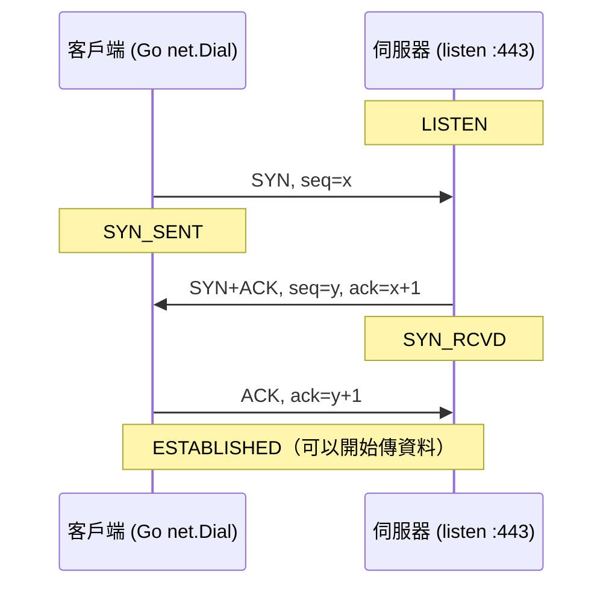
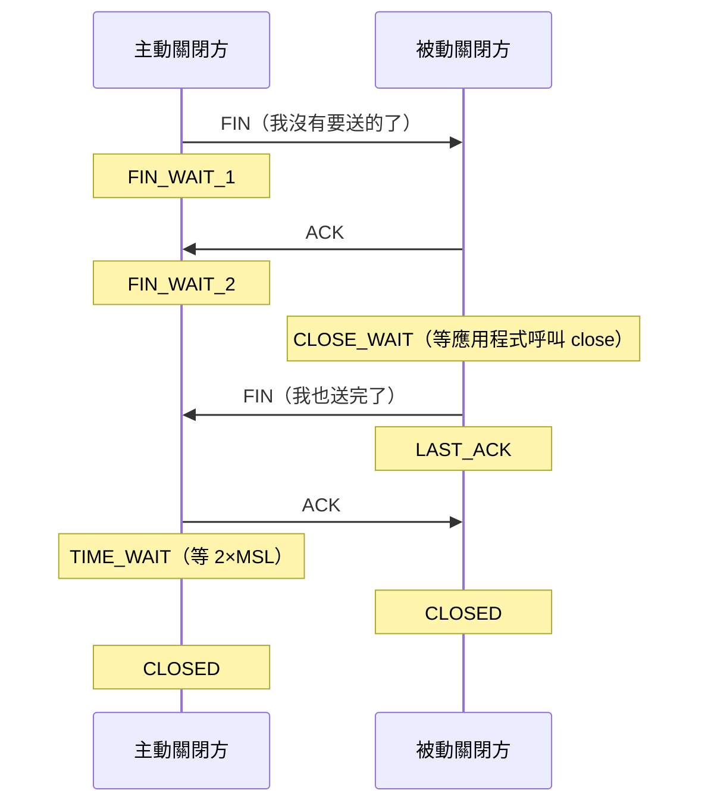

# 第 15 堂：TCP 三次握手、四次揮手、TIME_WAIT

這堂在「網路通訊」層，從 L3 的 IP 往上走一層到 **L4 的 TCP**：IP 只負責「盡力把封包送到」，會掉、會亂序、會重複；TCP 在兩端的核心裡維護一個「連線」狀態機，把這些不可靠的封包變成一條可靠、有序的位元組流。你在 C# 的 `HttpClient`、Go 的 `net.Dial`、資料庫連線池、K8s 的 readiness 問題，很多都卡在這一層。

## 0. 上一堂測驗答案（第 14 堂）

1. 私有子網路的路由表 `0.0.0.0/0` 指向 NAT Gateway，公有子網路指向 Internet Gateway。NAT 出去時把來源私有 IP:port 改寫成 NAT 的公有 IP 和一個 port，並記在轉換表裡，回應封包才能對回去；外面主動連進來時表裡沒有對應項，NAT 不知道要轉給誰，只能丟掉，所以只能「出」。公有子網路走 IGW，加上 Elastic IP 後 IGW 做一對一的公有↔私有 IP 對應，外面連 Elastic IP 就會被轉到那台 EC2（仍受 Security Group/NACL 限制）。
2. ping `192.168.1.80`：同一個 /24，ARP 問的是 `192.168.1.80` 本人的 MAC，frame 目的 MAC 就是那台機器。ping `8.8.8.8`：不同網段走 default，ARP 問的是閘道 `192.168.1.1` 的 MAC，frame 目的 MAC 是路由器的，IP header 的目的 IP 仍是 `8.8.8.8`。
3. 最長前綴匹配：`10.8.3.7` 同時符合 /24、/16、/0，選 /24，下一跳 `10.0.0.3`；`10.8.9.1` 符合 /16 和 /0，選 /16，下一跳 `10.0.0.2`；`10.9.0.1` 只符合 default，下一跳 `10.0.0.1`。

---

## 1. TCP 到底提供了什麼

IP 給你的是「明信片」：每張獨立寄出，可能掉、可能後寄先到。TCP 在上面做了四件事：

| 功能 | 怎麼做 |
|---|---|
| **可靠** | 每個位元組都有**序號（sequence number）**，對方回 **ACK**，沒收到 ACK 就重送 |
| **有序** | 接收端依序號重排，交給應用程式的一定是照順序的位元組流 |
| **連線** | 兩端都有一份狀態（序號、視窗、計時器），用握手建立、用揮手拆掉 |
| **流量/壅塞控制** | 下一堂再講（視窗、慢啟動） |

一條 TCP 連線由**四元組**唯一識別：`(來源 IP, 來源 port, 目的 IP, 目的 port)`。你的瀏覽器開 6 條到同一台伺服器的連線，差別只在來源 port（作業系統從 ephemeral port 範圍挑，Linux 預設 `32768–60999`）。記住這點，後面 TIME_WAIT 會用到。

TCP header 裡幾個關鍵欄位：

```
| 來源 port | 目的 port | 序號 SEQ | 確認號 ACK | 旗標 SYN/ACK/FIN/RST/PSH | 視窗大小 | ... |
```

## 2. 三次握手：建立連線

目的：**雙方都確認「對方收得到我、我也收得到對方」，並交換各自的起始序號（ISN）。**



- **為什麼是三次不是兩次？** 兩次的話，伺服器送出 SYN+ACK 就當作建好了，但它不知道客戶端有沒有收到。更糟的是，網路裡一個「迷路很久的舊 SYN」突然到達，伺服器會白白開一條沒人要的連線。第三個 ACK 讓伺服器確認客戶端真的收到了自己的序號。
- **ISN 為什麼要隨機？** 如果序號可預測，攻擊者就能偽造封包插進別人的連線；也能避免舊連線的殘留封包被誤認成新連線的資料。
- **成本**：握手要一個來回（1 RTT）才能開始傳資料，加上 TLS 再多 1～2 RTT。從馬來西亞連到美東約 200ms RTT，光是建連線就可能吃掉半秒。這就是為什麼**連線池（connection pool）和 keep-alive** 這麼重要。

### 核心裡的兩條佇列

伺服器呼叫 `listen()` 後，核心幫它維護兩條佇列：

1. **SYN queue（半連線）**：收到 SYN、回了 SYN+ACK、還在等第三個 ACK 的連線。
2. **Accept queue（全連線）**：握手完成、等應用程式呼叫 `accept()` 取走的連線。大小由 `listen(backlog)` 和 `net.core.somaxconn` 決定。

如果你的程式 `accept()` 得太慢（例如事件迴圈被卡住），accept queue 滿了，新連線就會被丟掉或重送 SYN，客戶端看到的是「偶爾連線逾時」。**SYN flood 攻擊**則是灌爆 SYN queue，Linux 用 **SYN cookie** 應對：不存狀態，把資訊編碼在回給對方的序號裡。

## 3. 四次揮手：關閉連線

TCP 是**全雙工**：兩個方向各自獨立，所以要各自關一次。主動關閉的一方（假設是客戶端）：



- 為什麼 ACK 和 FIN 不一起送？因為 B 收到 FIN 時，可能還有資料沒送完，它要等**自己的應用程式**呼叫 `close()` 才送 FIN。（如果剛好沒事，也常合併成三次。）
- **CLOSE_WAIT 堆積 = 你的程式有 bug。** 對方已經關了，但你的程式沒呼叫 `close()`。典型例子：Go 裡忘了 `resp.Body.Close()`、C# 裡沒 `Dispose` 掉 stream。`ss -tan state close-wait` 看到一大堆，就去查誰漏關了。
- **RST** 是「硬掛斷」：連到沒在 listen 的 port、或程式 crash，核心會回 RST，你看到的就是 `connection refused` / `connection reset by peer`。

## 4. TIME_WAIT：最常被誤解的狀態

主動關閉的一方送完最後一個 ACK 後，不會馬上釋放，而是停在 **TIME_WAIT** 等 **2×MSL**（Maximum Segment Lifetime；Linux 固定約 60 秒）。理由有兩個：

1. **最後那個 ACK 可能掉了。** 如果掉了，對方會重送 FIN；我還在 TIME_WAIT 就能再回一次 ACK。若我已經徹底忘了這條連線，就只能回 RST，對方會以為出錯。
2. **讓舊連線的迷路封包死光。** 如果同一個四元組立刻被新連線重用，網路上舊連線遲到的封包可能被當成新連線的資料。等 2×MSL 確保它們都過期了。

### 實務上什麼時候會出事

TIME_WAIT 只佔一點核心記憶體，本身不是問題。問題在**它佔住一個四元組**：

- **客戶端每次請求都開新連線又自己關掉**（例如 C# 每次 `new HttpClient()` 再 `Dispose`），同一個目的 IP:port 一秒打幾千次，60 秒內 ephemeral port（約 2.8 萬個）就被 TIME_WAIT 吃光，新連線出現 `SocketException: Only one usage of each socket address` / Go 的 `cannot assign requested address`。
  - **正解：重用連線。** C# 用單一（static）`HttpClient` 或 `IHttpClientFactory`；Go 用共用的 `http.Client`，並且一定要讀完並 `Close` body，連線才會回到池子裡。
- **NAT Gateway / 負載平衡器後面**大量短連線，也會撞到 port 上限（AWS NAT Gateway 對同一個目的地有並行連線數限制）。
- **伺服器重啟時 `bind: address already in use`**：舊 process 留下的連線還在 TIME_WAIT，佔住 listen 的 port。正解是 `SO_REUSEADDR`（Go 的 `net.Listen` 和 .NET Kestrel 在 Linux 上預設都會設）。

不建議的「解法」：亂調 `tcp_tw_recycle`（已從 Linux 4.12 移除，NAT 後面會壞）。`tcp_tw_reuse=1` 只對**客戶端發起的連線**有效、相對安全，但根本解還是連線重用。

### 誰該主動關閉？

TIME_WAIT 落在**主動關閉的那一方**。HTTP/1.1 keep-alive 時通常讓客戶端關；如果伺服器主動關大量閒置連線，TIME_WAIT 就堆在伺服器上。這也是負載平衡器設定 idle timeout 時要注意的：**後端的 keep-alive timeout 要比 LB 的長**，否則後端先關，LB 剛好送請求過去就收到 RST，變成偶發 502（AWS ALB 預設 idle 60 秒，Node/Kestrel 後端常要調到 65 秒以上）。

## 5. 狀態總覽與小實驗

```bash
# 看各狀態數量
ss -tan | awk 'NR>1{print $1}' | sort | uniq -c
# 只看 TIME_WAIT / CLOSE_WAIT
ss -tan state time-wait | head
ss -tanp state close-wait     # -p 看是哪個 process 漏關
# 抓握手封包（另一個終端 curl http://example.com）
sudo tcpdump -ni any 'tcp[tcpflags] & (tcp-syn|tcp-fin|tcp-rst) != 0' and port 80
# accept queue 是否溢位
nstat -az | grep -i -E 'ListenOverflows|ListenDrops'
```

在 tcpdump 裡你會看到 `[S]`（SYN）、`[S.]`（SYN+ACK）、`[.]`（ACK）、`[F.]`（FIN）、`[R]`（RST）。

## 6. 一句話總結

**TCP 用三次握手交換序號、確認雙向可達；用四次揮手各自關掉兩個方向；主動關閉的一方要在 TIME_WAIT 等 2×MSL，確保最後的 ACK 和舊封包不會害到新連線。** 實務上，大量 TIME_WAIT 的解法是**重用連線**，大量 CLOSE_WAIT 的解法是**修好漏關的程式碼**。

## 7. 小測驗

1. 你的 ASP.NET 服務每處理一個請求就 `using (var client = new HttpClient()) { ... }` 去呼叫另一個內部 API。壓測時 QPS 一到約 500，就開始出現 `SocketException`，`ss` 看到幾萬個 TIME_WAIT。請解釋原因（為什麼大約是這個量級會出事），以及正確的修法。
2. 線上一台 Go 服務跑幾天後，`ss -tanp state close-wait` 看到上千條連線，全都屬於你的 process，最後檔案描述子用光。這些連線是誰先關的？你的程式最可能哪裡寫錯？
3. 你的 Node.js 後端放在 AWS ALB 後面，偶爾（約千分之一）出現 502，日誌顯示後端根本沒收到那些請求。後端的 keep-alive timeout 是 5 秒，ALB idle timeout 是 60 秒。請用 TCP 關閉流程解釋 502 怎麼發生，以及怎麼調。
