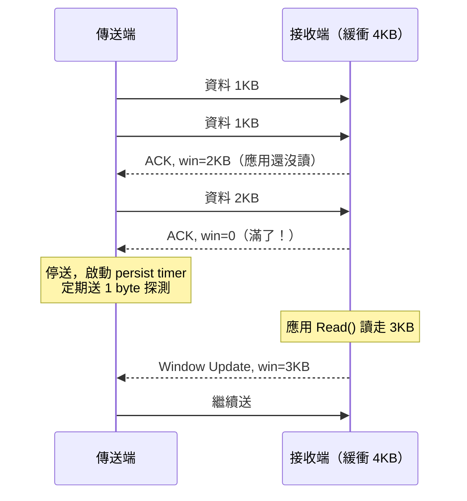
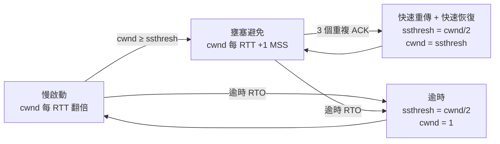

# 第 16 堂：TCP 流量控制與壅塞控制

這堂仍在「網路通訊」層的 **L4 TCP**：上一堂講 TCP 怎麼「開」和「關」一條連線，這堂講連線開著的時候，TCP 怎麼決定**一次能送多快**。答案是兩個煞車：**流量控制**（別把接收端塞爆）和**壅塞控制**（別把中間的網路塞爆）。你遇過的「跨國下載很慢」、「頻寬很大但單一連線跑不滿」、「K8s 裡偶發延遲飆高」，很多都是這兩個機制在作用。

## 0. 上一堂測驗答案（第 15 堂）

1. 每次 `new HttpClient()` + `Dispose` 都開一條新 TCP 連線，再由客戶端主動關閉，關閉後該四元組要停在 TIME_WAIT 約 60 秒。到同一個目的 IP:port 只有來源 port 能變，ephemeral port 約 2.8 萬個（32768–60999）；500 QPS × 60 秒 ≈ 3 萬條 TIME_WAIT，剛好把 port 用光，新連線就配不到 port。修法：重用連線，用單一 static `HttpClient` 或 `IHttpClientFactory`，讓 keep-alive 連線被重複使用；`tcp_tw_reuse` 只是輔助，不是根本解。
2. CLOSE_WAIT 是「被動關閉方」的狀態：對方已經送 FIN 關了，你的核心也回了 ACK，但你的程式一直沒呼叫 `Close()`，所以永遠不送自己的 FIN。Go 最常見的是沒有 `defer resp.Body.Close()`（尤其在錯誤分支提早 return），或自己的 `net.Conn` 在某條路徑沒關。
3. 後端 keep-alive 只有 5 秒，閒置 5 秒就由後端主動送 FIN；ALB 以為這條連線要 60 秒才逾時，仍當成可用。若 ALB 剛好在 FIN 抵達前把新請求送上這條連線，後端核心回 RST，ALB 就回 502，而應用程式根本沒看到請求。修法：後端 keep-alive timeout 要大於 ALB idle timeout（例如 Node 設 `server.keepAliveTimeout = 65000`，`headersTimeout` 再大一點），讓關閉永遠由 ALB 發起。

---

## 1. 兩個煞車，保護兩個不同的對象

| | 流量控制（Flow Control） | 壅塞控制（Congestion Control） |
|---|---|---|
| 保護誰 | **接收端**的緩衝區 | **中間的網路**（路由器佇列、鏈路） |
| 誰說了算 | 接收端直接告訴你：`rwnd`（receive window） | 傳送端自己**猜**：`cwnd`（congestion window） |
| 資訊來源 | TCP header 裡的 Window 欄位 | 封包遺失、重複 ACK、RTT 變化 |
| 類比 | 倉庫說：「我只剩 30 箱空間」 | 司機自己看路況，塞車就放慢 |

傳送端任何時刻「已送出但還沒被 ACK」的資料量上限是：

```
可送量 = min(rwnd, cwnd)
```

兩個窗口誰小就聽誰的。

## 2. 流量控制：滑動窗口

接收端核心為每條連線準備一塊**接收緩衝區**。應用程式（你的 Go `conn.Read`、C# `stream.ReadAsync`）讀得慢，資料就堆在緩衝區裡。每個 ACK 都會帶上「我還剩多少空間」，也就是 `rwnd`。



重點：

- **零窗口（zero window）**：接收端滿了就通告 win=0，傳送端停下來，但會定期送「窗口探測」，避免 Window Update 掉了雙方互等成死結。
- **Window Scaling**：header 的 Window 欄位只有 16 bit，最大 64KB。握手時用 window scale 選項把它左移（最多 ×2^14），現代 Linux 窗口可以到好幾 MB。
- **實務意義**：如果你的消費端處理很慢（例如 Go 程式讀 socket 後同步寫資料庫），對方的 send 就會被塞住，`Write()` 開始阻塞。這就是 TCP 給你的**天然背壓（backpressure）**。用 Wireshark 看到大量 `TCP ZeroWindow`，問題通常在**接收端應用讀太慢**，不是網路。

## 3. 頻寬延遲乘積（BDP）：為什麼窗口大小決定速度

TCP 每送一個窗口的資料，最快要等一個 RTT 才能拿到 ACK 繼續送。所以單一連線的吞吐量上限約是：

```
吞吐量 ≈ 窗口大小 / RTT
```

例子：吉隆坡到美東 RTT 約 250ms。

- 窗口 64KB：64KB / 0.25s ≈ **256 KB/s ≈ 2 Mbps**，就算你有 1 Gbps 也跑不滿。
- 想跑滿 1 Gbps：需要窗口 ≥ 1 Gbps × 0.25s = 250 Mb ≈ **31 MB**。

這個「頻寬 × RTT」就叫 **BDP（Bandwidth-Delay Product）**，代表「管線裡同時能裝多少資料」。窗口小於 BDP，管線就有空隙。這就是為什麼跨區 S3 複製、跨洲備份工具都喜歡**多連線平行傳**：每條連線各有自己的窗口，加總才能填滿管線。Linux 用 `net.ipv4.tcp_rmem` / `tcp_wmem` 的第三個值限制自動調整的上限。

## 4. 壅塞控制：傳送端自己猜網路有多擠

網路中間的路由器不會告訴你「我快滿了」（ECN 例外，稍後提），佇列滿了就直接丟封包。如果大家都猛送，就會出現 1986 年真實發生過的**壅塞崩潰**：大家都在重送，有效吞吐量掉到原本的千分之一。Van Jacobson 因此設計了 TCP 壅塞控制，核心是 `cwnd` 加上四個階段。

### 4.1 經典 Reno 四階段



1. **慢啟動（Slow Start）**：名字很騙人，其實是**指數成長**。連線一開始 `cwnd` 很小（Linux 預設初始 10 個 MSS ≈ 14KB），每收到一個 ACK 就 +1 MSS，等於每個 RTT 翻倍：10 → 20 → 40 → 80…
2. **壅塞避免（Congestion Avoidance）**：`cwnd` 超過門檻 `ssthresh` 後改成**線性成長**，每 RTT 只 +1 MSS，小心試探。
3. **快速重傳／快速恢復**：收到 **3 個重複 ACK**（接收端一直說「我還在等第 N 號」），表示某個封包掉了但後面的有到，網路只是「有點擠」。立刻重送那個封包，`cwnd` 砍半，不用從頭來。
4. **逾時（RTO）**：連重複 ACK 都沒有，代表網路很糟，`cwnd` 打回 1，重新慢啟動。

這種「線性加、遇事砍半」叫 **AIMD（Additive Increase, Multiplicative Decrease）**，畫出來就是有名的**鋸齒波**。AIMD 的妙處是：多條連線共用同一條瓶頸時，最後會收斂到**公平分享**。

### 4.2 現代演算法：CUBIC 與 BBR

| 演算法 | 判斷壅塞的訊號 | 特色 | 誰在用 |
|---|---|---|---|
| Reno | 掉包 | 線性成長，高 BDP 網路爬很慢 | 教科書 |
| **CUBIC** | 掉包 | 用三次函數成長，砍半後快速回到上次掉包點附近再慢慢試探 | Linux、Windows、macOS 預設 |
| **BBR** | 測量**瓶頸頻寬**與**最小 RTT** | 不等掉包，主動估算管線大小，維持「剛好填滿」；高延遲、有隨機掉包的鏈路表現好很多 | Google、YouTube、很多 CDN |

掉包型演算法有個毛病叫 **bufferbloat**：路由器佇列很大時，它會一路把佇列塞滿才看到掉包，結果延遲暴增（你在家下載大檔時視訊會議卡頓就是這個）。BBR 盯著 RTT，佇列一開始變長就收手。

```bash
# 看目前用哪個演算法、有哪些可選
sysctl net.ipv4.tcp_congestion_control
sysctl net.ipv4.tcp_available_congestion_control
# 換成 BBR（需要核心支援，通常搭配 fq qdisc）
sudo sysctl -w net.core.default_qdisc=fq
sudo sysctl -w net.ipv4.tcp_congestion_control=bbr
```

**ECN（Explicit Congestion Notification）**：路由器在佇列快滿時不丟包，而是在 IP header 打個標記，接收端在 ACK 裡回報，傳送端就提前減速。資料中心（例如 DCTCP）大量使用。

## 5. 和你的日常連起來

- **長連線比短連線快，不只是省握手**：新連線的 `cwnd` 從 10 MSS 開始慢啟動，一個 1MB 的回應要好幾個 RTT 才爬上去。重用的 keep-alive 連線 `cwnd` 已經爬高了（Linux 預設閒置太久會重設，見 `tcp_slow_start_after_idle`）。這又是一個要用 `IHttpClientFactory`、Go 共用 `http.Client` 的理由。
- **HTTP/2 的隊頭阻塞**：HTTP/2 把很多請求多工到**一條** TCP 連線，一個封包掉了，整條連線的 `cwnd` 砍半、後面的資料全部卡著等重傳。這是下一堂 QUIC/HTTP/3 要解決的問題。
- **Docker / K8s**：容器的 veth、overlay 網路（VXLAN）會多一層封裝，MTU 變小；MTU 設錯導致大封包被丟，在 TCP 看來就是「莫名掉包 → cwnd 一直被砍」，表現為大回應特別慢、小請求正常。
- **雲端**：AWS 跨區或跨洲傳大量資料時，S3 Transfer Acceleration、多段上傳（multipart）本質上都是在對抗高 RTT 下單連線窗口不夠的問題。

## 6. 小實驗

```bash
# 看每條連線的 cwnd、rtt、rwnd、重傳次數
ss -tin state established | head -40
# 輸出裡找：cubic / bbr、rtt:12.3/4.5、cwnd:10、rcv_space、retrans

# 用 tc 在本機製造延遲和掉包，再用 iperf3 測吞吐
sudo tc qdisc add dev lo root netem delay 100ms loss 1%
iperf3 -s &                      # 另一個終端
iperf3 -c 127.0.0.1 -t 10        # 觀察吞吐
sudo tc qdisc del dev lo root    # 記得移除
```

試著在有 1% 掉包時分別用 cubic 和 bbr 跑 iperf3，你通常會看到 BBR 吞吐明顯較高。

## 7. 一句話總結

**TCP 一次能送多少，取決於 `min(rwnd, cwnd)`：`rwnd` 是接收端說的「我還裝得下多少」，`cwnd` 是傳送端自己根據掉包或 RTT 猜的「網路還塞得下多少」。** 單連線吞吐量約等於窗口 / RTT，所以高延遲鏈路要大窗口或多連線；慢啟動讓新連線一開始很慢，這也是連線重用重要的原因之一。

## 8. 小測驗

1. 你從吉隆坡的機器用單一 TCP 連線從美東的 S3 下載大檔，RTT 約 240ms，頻寬有 500 Mbps，但速度一直卡在約 2 Mbps。用 `ss -tin` 看到 `rcv_space` 一直很小。請計算要跑滿 500 Mbps 需要多大的窗口，並說明可能的原因和兩種解法。
2. 你的 Go 服務從 Kafka 之外的另一個 TCP 資料源串流讀資料，每讀一筆就同步寫入 PostgreSQL。Wireshark 在資料源那端看到大量 `TCP ZeroWindow`，資料源團隊說「你們網路有問題」。真的是網路問題嗎？是哪個機制在作用？你會怎麼改？
3. 同事說：「慢啟動是指數成長，所以 TCP 一開始其實很快，連線重用對大回應沒什麼幫助，只是省了三次握手。」請反駁他：一條新連線（初始 cwnd = 10 MSS ≈ 14KB、RTT 100ms、不考慮掉包）傳 1MB 的回應大約要幾個 RTT？重用一條 cwnd 已經很大的連線又要幾個？
