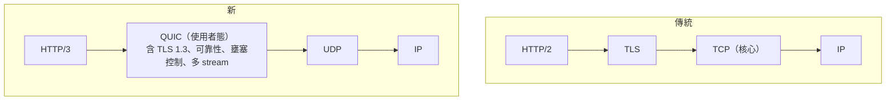
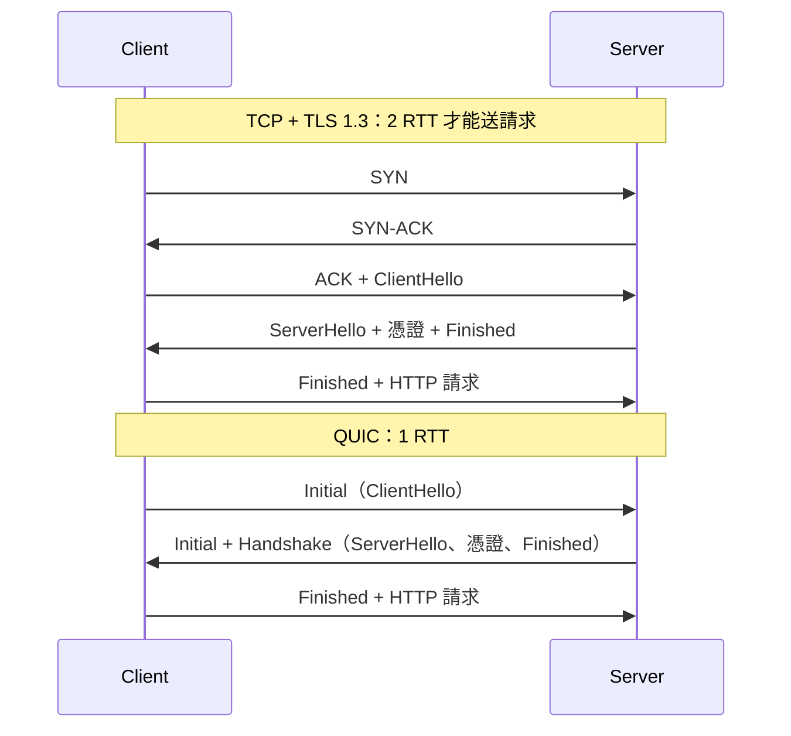

# 第 17 堂：UDP、QUIC、HTTP/3

這堂在「網路通訊」層，接在 TCP 之後：上一堂看到 TCP 的可靠傳輸和壅塞控制很強，但也帶來握手延遲和隊頭阻塞。這堂看另一條路：用最簡單的 UDP 當底，在使用者態自己做出一個更好的傳輸協定 QUIC，再在上面跑 HTTP/3。

## 0. 上一堂測驗答案

1. **BDP = 500 Mbps × 0.24 s = 120 Mb ≈ 15 MB**，窗口至少要這麼大。2 Mbps × 0.24 s ≈ 60 KB，代表窗口卡在約 64KB：可能 window scaling 沒生效（被中間設備剝掉）、接收端 `tcp_rmem` 上限太小，或程式手動設了很小的 `SO_RCVBUF`（這會關掉自動調整）。解法：調高 `tcp_rmem`/`tcp_wmem` 並確認 window scaling 開啟；或用多條連線平行下載（S3 range GET / 多段下載）讓多個窗口加總填滿管線。
2. **不是網路問題。** ZeroWindow 是接收端（你的 Go 服務）在流量控制裡說「緩衝區滿了」，因為每筆都同步等 DB 寫入，`conn.Read` 很久才被呼叫一次。這是 TCP 的背壓在保護你。改法：一個 goroutine 持續讀 socket 放進有界 channel，多個 worker 批次寫 PostgreSQL（批次 INSERT 或 `COPY`）。
3. 1MB ≈ 70 個 MSS。慢啟動每 RTT 翻倍：10 → 20（累計 30）→ 40（累計 70），約 **3 個 RTT** 傳資料，加握手 1 個 RTT（HTTPS 再加 TLS 1～2 個），總共約 4～6 個 RTT ≈ 400～600ms。重用且 cwnd ≥ 70 MSS 的連線 **1 個 RTT** 就送完。所以連線重用不只省握手，也省慢啟動爬坡（注意 `tcp_slow_start_after_idle` 會在閒置後重設 cwnd）。

## 1. UDP：只多做一點點的 IP

UDP header 只有 **8 個位元組**：來源 port、目的 port、長度、checksum。就這樣。

| | TCP | UDP |
|---|---|---|
| 連線 | 要三次握手 | 不用，直接送 |
| 可靠性 | 掉了會重傳 | 掉了就掉了 |
| 順序 | 保證按順序交給應用 | 不保證 |
| 邊界 | 位元組串流，沒有訊息邊界 | 一個 `send` 就是一個 datagram |
| 流量/壅塞控制 | 有 | 沒有（要自己做） |
| header | 20～60 bytes | 8 bytes |

UDP 適合的場景：
- **DNS**：一問一答，一個封包裝得下，掉了重問就好（下一堂細講）。
- **即時語音、視訊、遊戲**：晚到的封包等於沒用，不如丟掉繼續。
- **VPN 隧道**（WireGuard）、**VXLAN**（K8s overlay 網路）：外層用 UDP 包住內層封包，可靠性交給內層的 TCP。
- 想**自己設計傳輸邏輯**的協定，例如 QUIC。

Go 寫一個 UDP echo，對比你熟悉的 TCP `Accept` 迴圈，會發現沒有連線這回事：

```go
pc, _ := net.ListenPacket("udp", ":9000")
buf := make([]byte, 1500)
for {
    n, addr, _ := pc.ReadFrom(buf)   // 每次讀到一個完整 datagram，附帶來源位址
    pc.WriteTo(buf[:n], addr)        // 直接回給那個位址
}
```

C# 對應的是 `UdpClient.ReceiveAsync()`。注意：一個 datagram 最好小於 MTU（約 1500，扣掉 IP/UDP header 約 1472），否則會被 IP 分片，任一片掉了整個 datagram 都掉。

## 2. TCP 的三個痛點

QUIC 就是為了解決這三件事：

1. **建連太慢**：TCP 握手 1 RTT + TLS 1.3 握手 1 RTT，第一個 HTTP 請求要等 2 RTT。吉隆坡到美東 RTT 240ms，光建連就快半秒。
2. **隊頭阻塞（Head-of-Line blocking）**：HTTP/2 把很多請求多工在一條 TCP 上。TCP 只認識「一條位元組串流」，序號 1000 的封包掉了，後面 2000～9000 就算已經到了也不能交給應用，**所有請求一起卡住**等重傳。
3. **改不動**：TCP 寫在作業系統核心裡，中間還有無數防火牆、NAT 會檢查 TCP header。想改進 TCP（例如新的選項）要等全世界升級核心和中間設備，十年起跳。這叫**協定僵化（ossification）**。

## 3. QUIC：在 UDP 上重做一個 TCP + TLS

QUIC 跑在 UDP 上，實作在**使用者態函式庫**裡（Chrome、Cloudflare quiche、Go 的 quic-go、.NET 的 MsQuic）。對中間設備來說它只是 UDP 封包，而且幾乎整個 header 都加密了，中間設備看不懂也就無從干涉，協定可以隨應用一起升級。



### 3.1 握手合併：1-RTT，回訪 0-RTT

QUIC 把傳輸握手和 TLS 1.3 握手**合併成一次**：



回訪同一台伺服器時，客戶端有上次留下的金鑰，可以在第一個封包就帶著加密的請求（**0-RTT**）。代價：0-RTT 資料可能被攻擊者**重放（replay）**，所以只適合冪等請求（GET），不要拿來送「扣款」這種 POST。

### 3.2 多 stream：每條 stream 各自排隊

QUIC 原生支援多條獨立的 **stream**，每條有自己的序號和重組緩衝區。stream 3 的封包掉了，只有 stream 3 等重傳，stream 5、7 照樣把資料交給應用。HTTP/3 把每個請求放在一條 stream 上，**消除了傳輸層的隊頭阻塞**。

（壅塞控制仍是整條連線共用的：掉包還是會讓整條連線的 cwnd 降下來，但不會讓其他請求的資料卡在緩衝區裡等。）

### 3.3 Connection ID：換網路不斷線

TCP 連線靠四元組（來源 IP、來源 port、目的 IP、目的 port）識別。手機從 Wi-Fi 切到 4G，IP 變了，TCP 連線就斷了，要全部重來。

QUIC 用一個 **Connection ID** 識別連線，IP 換了只要 Connection ID 對得上，連線繼續（**connection migration**）。對手機 App、在電梯裡看影片的人很有感。

### 3.4 其他改進

- **封包號碼永不重用**：TCP 重傳用同一個序號，分不清 ACK 是回原始封包還是重傳的（重傳歧義），RTT 量不準。QUIC 每個封包號碼都遞增，重傳的資料用新號碼，RTT 量得準。
- **壅塞控制可插拔**：CUBIC、BBR 都可以，換演算法只要更新函式庫，不用改核心。
- **強制加密**：沒有「不加密的 QUIC」。

## 4. HTTP/3

HTTP/3 = HTTP 語意（方法、header、狀態碼都一樣）跑在 QUIC 上。對寫 API 的你來說，`GET /users` 回 `200` 完全沒變，變的是底下的傳輸。

瀏覽器怎麼知道伺服器支援 HTTP/3？第一次先用 HTTP/1.1 或 HTTP/2 連，伺服器回應裡帶：

```
alt-svc: h3=":443"; ma=86400
```

瀏覽器記住，下次改用 UDP 443 試 QUIC。如果 UDP 被公司防火牆擋了，就退回 TCP（所以 HTTP/3 永遠要有 TCP 備援）。也可以用 DNS 的 HTTPS 記錄（SVCB）直接公布。

| | HTTP/1.1 | HTTP/2 | HTTP/3 |
|---|---|---|---|
| 傳輸 | TCP | TCP | QUIC（UDP） |
| 多工 | 無（開多條連線） | 有，一條 TCP | 有，多 stream |
| 隊頭阻塞 | 應用層有 | 傳輸層有 | 傳輸層沒有 |
| 建連 | TCP + TLS 2～3 RTT | 同左 | 1 RTT，回訪 0-RTT |
| header 壓縮 | 無 | HPACK | QPACK |

## 5. 和你的日常連起來

- **.NET**：Kestrel 從 .NET 7 起支援 HTTP/3（底下是 MsQuic）。設定 `ListenOptions.Protocols = HttpProtocols.Http1AndHttp2AndHttp3` 並開 HTTPS；`HttpClient` 可設 `DefaultRequestVersion = HttpVersion.Version30`。
- **Go**：標準庫 `net/http` 還沒內建 HTTP/3，常用 `quic-go/http3`。Caddy 用的就是它，預設就開 HTTP/3。
- **雲端**：Cloudflare、CloudFront、Google Cloud LB 都可以在邊緣一鍵開 HTTP/3。常見架構是「客戶端 ↔ CDN 走 HTTP/3，CDN ↔ 你的源站走 HTTP/1.1 或 2」，大部分好處（高 RTT、行動網路那一段）你不改程式就拿到了。
- **AWS 注意**：ALB 不支援 HTTP/3 對外；NLB 支援 UDP 監聽器，可以自己在後面跑 QUIC 伺服器，但要處理 Connection ID 與負載平衡的對應（第 21 堂會再提到）。
- **Docker / K8s**：要開 HTTP/3 記得同時發佈 UDP port：`docker run -p 443:443/tcp -p 443:443/udp ...`；Service 也要加 `protocol: UDP` 的 port。很多人只開 TCP，結果 HTTP/3 永遠退回 HTTP/2 還不知道。
- **CPU 成本**：QUIC 在使用者態做加密和封包處理，每個封包都要一次 syscall（除非用 GSO/`sendmmsg` 批次），同樣吞吐下 CPU 通常比 TCP + 核心 TLS 高。在資料中心內部、低延遲低掉包的服務間呼叫，HTTP/2 over TCP 往往仍是更好的選擇（gRPC 預設就是）。

## 6. 小實驗

```bash
# 看網站有沒有公布 HTTP/3
curl -sI https://www.cloudflare.com | grep -i alt-svc

# 有支援 HTTP/3 的 curl（curl -V 裡看到 HTTP3）可以直接測
curl --http3 -sI https://www.cloudflare.com | head -1

# 觀察 UDP socket
ss -uanp | head
```

瀏覽器開 DevTools → Network，在欄位上按右鍵打開 **Protocol** 欄，就能看到哪些請求是 `h3`。

## 7. 一句話總結

**UDP 只是幫 IP 加上 port 的薄層；QUIC 在 UDP 上、在使用者態重新實作了可靠傳輸、壅塞控制和 TLS 1.3，換來 1-RTT/0-RTT 建連、沒有傳輸層隊頭阻塞的多 stream，以及換網路不斷線；HTTP/3 就是跑在 QUIC 上的 HTTP。** 代價是 CPU 較高、UDP 可能被擋，所以永遠要保留 TCP 備援。

## 8. 小測驗

1. 你的 App 使用者多在馬來西亞的行動網路上，API 伺服器在 AWS 新加坡，RTT 約 60ms、掉包率偶爾到 2%。首頁一次要打 20 個小 API。請比較 HTTP/2 和 HTTP/3 在「冷啟動第一個請求的延遲」和「掉包時其他請求的表現」上的差異，並說明你不改後端程式碼、最快拿到 HTTP/3 好處的做法。
2. 同事想用 0-RTT 加速結帳 API（`POST /checkout`）。你會同意嗎？說明風險，以及什麼請求適合用 0-RTT。
3. 你在 K8s 上部署了支援 HTTP/3 的 Caddy，瀏覽器 DevTools 卻顯示全部是 `h2`。列出至少三個可能的原因和檢查方法。


<details><summary>參考答案</summary>

1. **冷啟動**：HTTP/2 要 TCP 握手 1 RTT + TLS 1.3 1 RTT，第一個請求約 2 RTT 後才送出（≈120ms 再加回應的 60ms）；HTTP/3 握手合併只要 1 RTT（≈60ms），回訪還能 0-RTT。**掉包時**：HTTP/2 的 20 個請求共用一條 TCP，掉一個封包所有請求都卡在重組緩衝區等重傳（傳輸層隊頭阻塞）；HTTP/3 只有掉包那條 stream 要等，其他請求照常完成（不過整條連線的 cwnd 仍會下降）。手機切換 Wi-Fi/4G 時 QUIC 還能靠 Connection ID 不斷線。**不改後端**：在前面放支援 HTTP/3 的 CDN 或邊緣（Cloudflare、CloudFront 開啟 HTTP/3），客戶端到邊緣這段高 RTT、易掉包的行動網路走 HTTP/3，邊緣到源站仍走 HTTP/1.1/2。
2. **不同意。** 0-RTT 資料沒有完整的重放保護，攻擊者可以把截到的 0-RTT 封包再送一次，伺服器可能執行兩次結帳。0-RTT 只適合**冪等、無副作用**的請求（GET 靜態資源、查詢）。若真要用，伺服器必須拒絕 0-RTT 的非冪等請求（例如回 425 Too Early 讓客戶端在握手完成後重送），或要求帶冪等鍵（idempotency key）。
3. 可能原因與檢查：(a) **UDP port 沒開**：Service / LoadBalancer / Ingress 只開了 TCP 443，要加 `protocol: UDP` 的 443（用 `kubectl get svc -o yaml` 檢查；本機可用 `ss -uanp` 看 Caddy 有沒有在聽 UDP 443）。(b) **負載平衡器不支援 UDP/QUIC**：例如前面是 AWS ALB 或某些 L7 Ingress controller，它們終結 TLS 後只會講 HTTP/1.1/2；要改用 NLB（UDP）或支援 HTTP/3 的 Ingress。(c) **沒有 `alt-svc` 標頭**或被前面代理拿掉：`curl -sI https://你的網域 | grep -i alt-svc` 檢查。(d) **客戶端網路擋 UDP 443**：公司防火牆常見，換手機熱點測試。(e) **瀏覽器還沒切換**：第一次一定先走 h2，看到 alt-svc 後下次才試 h3，重新整理或開新分頁再看；也可用 `curl --http3` 直接驗證伺服器端。

</details>
