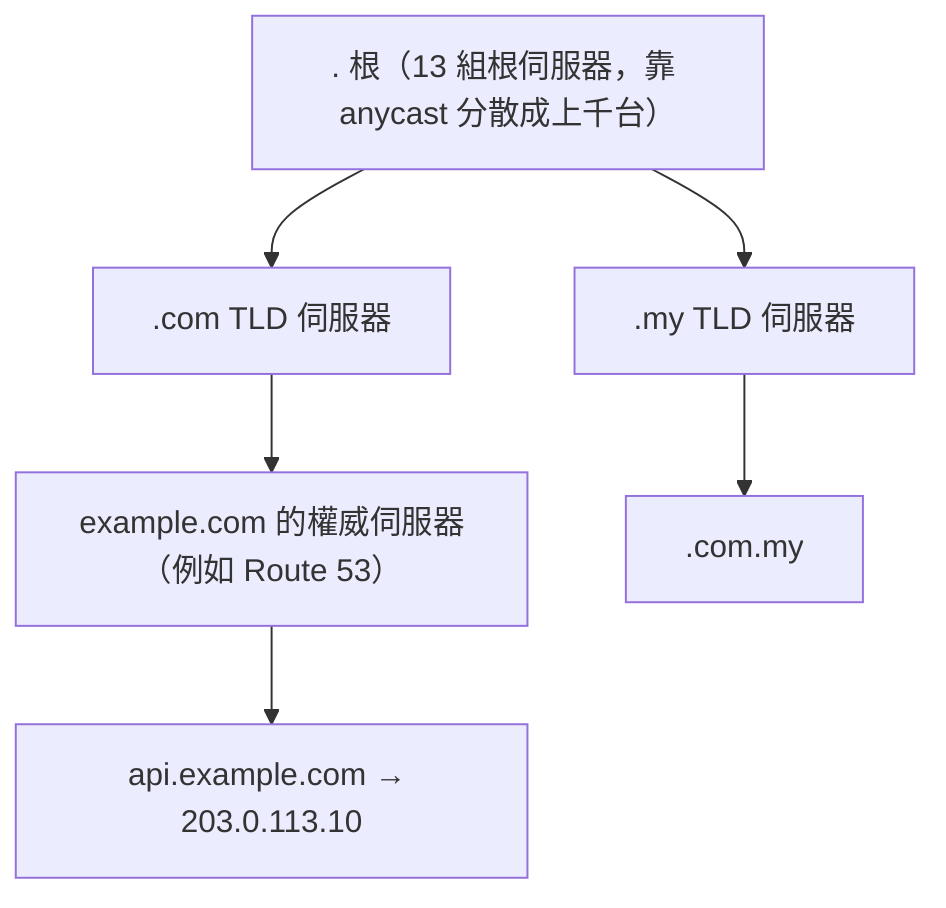
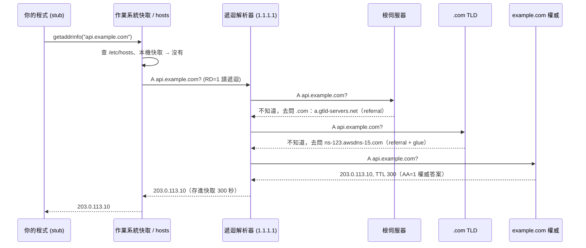

# 第 18 堂：DNS 完整解析流程

這堂在「網路通訊」層的應用層入口：前幾堂我們把封包從 Ethernet、IP、TCP、UDP/QUIC 一路送到目的地，但「目的地的 IP 是誰告訴你的？」答案就是 DNS。幾乎每一個 HTTP 請求、每一次 `docker pull`、每一個 K8s Service 呼叫，第一步都是一次（可能被快取掉的）DNS 查詢。

## 0. 上一堂測驗答案

1. **冷啟動**：HTTP/2 要 TCP 握手 1 RTT + TLS 1.3 1 RTT，約 2 RTT 後才送出第一個請求；HTTP/3 把傳輸和 TLS 握手合併，只要 1 RTT，回訪還能 0-RTT。**掉包時**：HTTP/2 的 20 個請求共用一條 TCP，掉一個封包全部卡住等重傳（傳輸層隊頭阻塞）；HTTP/3 只有掉包那條 stream 要等，其他照常完成。手機換網路時 QUIC 還能靠 Connection ID 不斷線。**不改後端**：前面放支援 HTTP/3 的 CDN（Cloudflare、CloudFront 開 HTTP/3），高 RTT、易掉包的行動網路那段走 HTTP/3，邊緣到源站照舊。
2. **不同意。** 0-RTT 資料沒有完整的重放保護，攻擊者把封包再送一次就可能結帳兩次。0-RTT 只適合冪等、無副作用的請求（GET、查詢）。真要用，伺服器要拒絕 0-RTT 的非冪等請求（回 `425 Too Early`），或要求 idempotency key。
3. 可能原因：(a) Service / LoadBalancer 只開了 TCP 443，沒開 **UDP 443**（`kubectl get svc -o yaml`、`ss -uanp`）；(b) 前面的負載平衡器不支援 QUIC（例如 AWS ALB 只講 h1/h2，要改 NLB UDP 或支援 HTTP/3 的 Ingress）；(c) 沒有 **`alt-svc`** 標頭或被代理拿掉（`curl -sI ... | grep -i alt-svc`）；(d) 客戶端網路擋 UDP 443（換手機熱點測）；(e) 瀏覽器第一次一定先走 h2，看到 alt-svc 後才切 h3，重新整理再看，或用 `curl --http3` 直接驗證。

## 1. DNS 是什麼：一個分散式、分層、大量快取的資料庫

DNS 把名字（`api.example.com`）對應到資料（IP、別名、郵件伺服器……）。它不是一台大伺服器，而是一棵**樹**，每一層只管自己那一段，再「授權（delegate）」給下一層：



三種角色要分清楚：

| 角色 | 做什麼 | 例子 |
|---|---|---|
| **Stub resolver** | 你程式裡的「問問題的人」，只會問一台遞迴伺服器 | glibc `getaddrinfo`、Go 的 `net.Resolver`、.NET `Dns.GetHostAddressesAsync` |
| **遞迴解析器（Recursive resolver）** | 替你跑完整趟查詢並快取結果 | 8.8.8.8、1.1.1.1、ISP 的 DNS、AWS VPC 的 `.2` resolver、K8s 的 CoreDNS |
| **權威伺服器（Authoritative）** | 真正「擁有」某個 zone 的答案 | Route 53、Cloudflare DNS、Azure DNS 的 hosted zone |

## 2. 一次完整解析：從 `getaddrinfo` 到 IP

假設你在吉隆坡的筆電上第一次打開 `https://api.example.com`，所有快取都是空的：



重點：

- **遞迴 vs 迭代**：你的程式對遞迴解析器是「遞迴查詢」（你幫我問到底）；遞迴解析器對根、TLD、權威是「迭代查詢」（每個只回「去問誰」的 referral）。
- **Glue record**：如果 `example.com` 的 NS 是 `ns1.example.com`，要先知道它的 IP 才能問它，但問它的 IP 又要問它自己 → 雞生蛋。所以上層（.com）會在 referral 裡順便附上 NS 的 IP，這叫 glue。
- **傳輸**：傳統 DNS 走 **UDP 53**（一問一答，正好符合上一堂講的 UDP 適用場景）；回應太大（超過 512 bytes 或 EDNS0 宣告的大小，常見 1232）會設 TC 旗標，客戶端改用 **TCP 53** 重問。zone transfer（AXFR）也走 TCP。
- 現實中，根和 TLD 的答案 TTL 很長（.com 的 NS 是 2 天），幾乎永遠在遞迴解析器的快取裡，所以一般查詢只有最後一跳（問權威）真正會發生。

## 3. 常見的記錄類型

| 類型 | 用途 | 實務例子 |
|---|---|---|
| **A / AAAA** | 名字 → IPv4 / IPv6 | `api → 203.0.113.10` |
| **CNAME** | 別名，指向另一個名字 | `www → myapp.azurewebsites.net` |
| **NS** | 這個 zone 由哪些權威伺服器管 | 換 DNS 供應商時要改註冊商上的 NS |
| **MX** | 郵件伺服器 | Google Workspace 的 MX |
| **TXT** | 任意文字 | SPF、DKIM、Let's Encrypt 的 DNS-01 驗證、網域擁有權驗證 |
| **SRV** | 服務 + port | K8s headless service、SIP、XMPP |
| **CAA** | 誰可以幫這個網域發憑證 | 限定只有 Let's Encrypt |
| **PTR** | 反查：IP → 名字 | 郵件伺服器信譽檢查 |

兩個常踩的雷：

- **CNAME 不能放在 zone apex**（`example.com` 本身），因為 apex 一定有 NS/SOA，而 CNAME 規定不能和其他記錄共存。所以 Route 53 有「Alias」、Cloudflare 有「CNAME flattening」：在權威伺服器端幫你解開成 A 記錄。
- **CNAME 鏈每多一層就多一次查詢**（有時還跨不同權威），例如 `www → xxx.cloudfront.net → ...`。

## 4. 快取與 TTL：DNS 快的原因，也是你改了卻沒生效的原因

快取至少有這幾層，每層都照 TTL 倒數：

1. **應用程式 / 執行環境**：瀏覽器自己的 DNS 快取（Chrome `chrome://net-internals/#dns`）、JVM 預設會快取很久；.NET 的 `HttpClient` 本身不快取 DNS，但**長連線會一直用舊 IP**（見測驗）。
2. **作業系統**：macOS 的 `mDNSResponder`、Linux 的 `systemd-resolved` / `nscd`（Docker 映像通常沒有，所以容器裡每次都真的問）。
3. **遞迴解析器**：1.1.1.1、ISP、VPC resolver、CoreDNS 的 cache plugin。

還有**負面快取（negative caching）**：查不到（NXDOMAIN）也會被快取，時間由 zone 的 SOA 記錄決定。經典事故：你在建立記錄**之前**先 `curl` 了一次，拿到 NXDOMAIN，接著建好記錄卻還是查不到好幾分鐘。

**換 IP 的標準流程**：先把 TTL 從 3600 降到 60，**等舊 TTL 過完**（至少 1 小時），再改 IP，確認沒問題再把 TTL 調回去。

## 5. 容器與 K8s 裡的 DNS

`docker run` 的容器：Docker 會把主機的 `/etc/resolv.conf` 處理後放進容器；自訂 bridge 網路裡有個內建 DNS（`127.0.0.11`）讓你用容器名稱互相找。

K8s 的 Pod 裡 `/etc/resolv.conf` 長這樣：

```
nameserver 10.96.0.10          # CoreDNS 的 Service IP
search default.svc.cluster.local svc.cluster.local cluster.local
options ndots:5
```

`ndots:5` 的意思是：名字裡的點少於 5 個，就**先**依序加上 search 網域去試。所以你的 Go 程式呼叫 `api.stripe.com`（只有 2 個點）時，實際會發生：

```
api.stripe.com.default.svc.cluster.local  → NXDOMAIN
api.stripe.com.svc.cluster.local          → NXDOMAIN
api.stripe.com.cluster.local              → NXDOMAIN
api.stripe.com                            → 成功
```

而且 A 和 AAAA 各問一次，一個外部呼叫變成 **8 次查詢**。高流量服務會把 CoreDNS 打爆、延遲飆高。解法：在名字最後加點變成 FQDN（`api.stripe.com.`），或在 Pod spec 用 `dnsConfig` 把 `ndots` 調成 1～2，或部署 NodeLocal DNSCache。

## 6. DNS 的安全與隱私

- **快取投毒（cache poisoning）**：UDP 沒有連線，攻擊者可以偽造回應搶在真答案之前到達。防禦：隨機化來源 port + 16 位元 transaction ID（Kaminsky 攻擊之後的標準做法）、**DNSSEC**（權威伺服器對記錄簽章，遞迴解析器驗章）。
- **隱私**：傳統 DNS 是明文，ISP 看得到你查了什麼網域。**DoT**（DNS over TLS，853）和 **DoH**（DNS over HTTPS，443，看起來就是普通 HTTPS 流量），以及 DoQ（over QUIC）把查詢加密。
- **DNS 也是負載平衡工具**：權威伺服器可以依查詢者位置回不同 IP（GeoDNS、Route 53 latency-based routing），或輪流回多個 IP（round-robin）。這是很便宜的 L4 之前的「第 0 層」負載平衡，下下堂講負載平衡時會再接上。

## 7. 動手看看

```bash
# 完整追蹤一次從根開始的解析（自己扮演遞迴解析器）
dig +trace api.github.com

# 只看答案和剩餘 TTL（多跑幾次看 TTL 倒數 → 你打到的是快取）
dig +noall +answer github.com @1.1.1.1

# 看 CNAME 鏈
dig +noall +answer www.microsoft.com

# 看郵件、驗證記錄
dig MX gmail.com +short
dig TXT google.com +short

# macOS 清 DNS 快取
sudo dscacheutil -flushcache; sudo killall -HUP mDNSResponder
```

Go 裡可以用 `GODEBUG=netdns=go+1` 看程式是用純 Go resolver 還是 cgo（glibc）resolver，兩者讀設定的方式略有不同；在 Alpine（musl）容器裡 DNS 行為不同也是常見坑（例如舊版 musl 不支援 TCP fallback、對 search 網域的處理不同）。

## 8. 一句話總結

**DNS 是一棵分層授權、到處快取的分散式資料庫：你的 stub 問遞迴解析器，遞迴解析器從根 → TLD → 權威一路被 referral 指路，拿到答案後依 TTL 快取；大多數「DNS 問題」其實是快取（含負面快取）、CNAME/apex 限制，或容器裡 search/ndots 造成的查詢放大。**

## 9. 小測驗

1. 你要把 `api.aicde.my` 從舊的 VPS 搬到 AWS 新加坡的新 IP，目前 A 記錄 TTL 是 86400。請寫出零停機的切換步驟，並解釋為什麼「改完記錄後，有些使用者一整天都還連到舊機器」。
2. 你的 C# 服務用一個長壽的 `HttpClient`（正確做法，避免 socket 耗盡）呼叫一個在藍綠部署間會換 IP 的內部 API。切換後，這個服務還是一直打到舊環境，直到重啟才好。DNS TTL 只有 60 秒，為什麼會這樣？要怎麼修？（提示：想想連線重用。）
3. 某個在 K8s 上跑的 Go 服務每秒呼叫外部支付 API 數百次，你發現 CoreDNS CPU 很高，服務的 p99 延遲有時多了好幾十毫秒。請說明可能的原因，並給出至少兩種改善方法。

<details><summary>參考答案</summary>

1. 步驟：(1) 先把 TTL 從 86400 降到 60（或 300）；(2) **等至少 86400 秒（舊 TTL）**，讓全世界的快取都拿到新的低 TTL；(3) 新機器先準備好並測試（可用 `curl --resolve api.aicde.my:443:新IP` 直接打新機器）；(4) 改 A 記錄到新 IP，舊機器保持運作一段時間（或反向代理到新機器）；(5) 確認流量轉移完成後把 TTL 調回並關掉舊機。一整天還連到舊機的原因：遞迴解析器（ISP、1.1.1.1）在 TTL 86400 期間合法地快取舊答案，你改權威記錄並不會通知它們；此外瀏覽器、作業系統、甚至有些 ISP 會自行延長 TTL，長連線也會一直用舊 IP。
2. DNS 只在**建立新連線**時查詢。`HttpClient` 的連線池會一直重用已建立的 TCP 連線（keep-alive），只要連線沒斷，就一直打到舊 IP，TTL 再短也沒用。修法：用 `SocketsHttpHandler` 設定 `PooledConnectionLifetime`（例如 1～2 分鐘），讓連線定期汰換、重新解析 DNS；或用 `IHttpClientFactory`（handler 會輪替）。藍綠切換時舊環境也應該優雅關閉連線（回 `Connection: close` / HTTP/2 GOAWAY），讓客戶端重連。
3. 原因：Pod 的 `ndots:5` + search 網域讓 `api.payment.com` 這種外部名字先試 3 個叢集內後綴，每個都 NXDOMAIN，A/AAAA 各一次，一次呼叫放大成多達 8 次查詢；Go 若每次新建連線（沒重用）就每次都查；容器裡沒有本機 DNS 快取；UDP 查詢偶爾掉包（例如 conntrack 競態）會等 5 秒逾時重試，造成延遲尖峰。改善：(a) 用 FQDN `api.payment.com.` 或在 Pod `dnsConfig` 設 `ndots: 1`～`2`；(b) 部署 NodeLocal DNSCache，每個節點有本地快取；(c) 程式端重用連線（共用 `http.Client`、調大 `MaxIdleConnsPerHost`），減少新連線與 DNS 查詢；(d) 擴充 CoreDNS 副本數、開啟 cache plugin 並調整 TTL。

</details>

