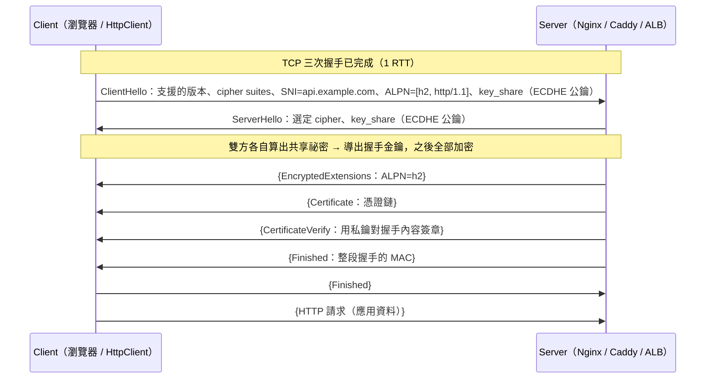
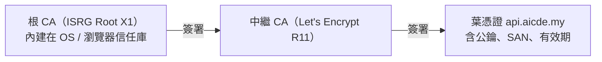
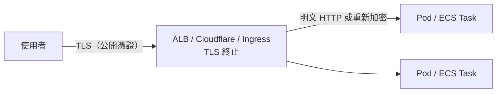

# 第 19 堂：TLS 握手

這堂在「網路通訊」層、TCP/QUIC 之上、HTTP 之下：前一堂 DNS 告訴你對方的 IP，TCP 把位元組可靠送到，但「對方真的是 `api.stripe.com` 嗎？中間的人看得到內容嗎？」由 TLS 負責。你每一個 `https://`、gRPC、資料庫的 `sslmode=require`、K8s API server 連線，都先跑一次 TLS 握手。

## 0. 上一堂測驗答案

1. **零停機搬家**：(1) 先把 TTL 從 86400 降到 60～300；(2) **至少等完舊的 TTL（86400 秒）**，讓各地快取都換成新的低 TTL；(3) 準備並測好新機器（`curl --resolve api.aicde.my:443:新IP https://api.aicde.my` 直接打新機）；(4) 改 A 記錄，舊機器先保持運作（或反向代理到新機）；(5) 流量轉完後關舊機、把 TTL 調回。一整天還連舊機，是因為遞迴解析器在 TTL 86400 內**合法快取**舊答案，改權威記錄不會通知它們；再加上有些 ISP / 作業系統會延長 TTL、長連線一直用舊 IP。
2. DNS 只在**建立新連線**時查詢。長壽 `HttpClient` 的連線池一直重用 keep-alive 的 TCP 連線，只要不斷線就一直打舊 IP，TTL 多短都沒用。修法：`SocketsHttpHandler.PooledConnectionLifetime = TimeSpan.FromMinutes(2)` 讓連線定期汰換並重新解析，或用 `IHttpClientFactory`；舊環境下線時也要優雅關連線（`Connection: close`／HTTP/2 GOAWAY）。
3. 原因：Pod 預設 `ndots:5` + search 網域，外部名字先試 3 個叢集後綴都 NXDOMAIN，A/AAAA 各一次，一次呼叫最多 8 次查詢；Go 若常建新連線就每次都查；容器內沒本機快取；UDP 偶爾掉包（conntrack 競態）會等 5 秒重試，造成 p99 尖峰。改善：(a) 用 FQDN `api.payment.com.` 或 `dnsConfig` 設 `ndots: 1～2`；(b) 部署 NodeLocal DNSCache；(c) 共用 `http.Client`、調大 `MaxIdleConnsPerHost` 重用連線；(d) 擴充 CoreDNS 副本、開 cache plugin。

## 1. TLS 要解決三件事

| 目標 | 意思 | 靠什麼 |
|---|---|---|
| **機密性** | 中間人看不到內容 | 對稱加密（AES-GCM、ChaCha20-Poly1305） |
| **完整性** | 內容沒被竄改 | AEAD 的認證標籤（tag） |
| **身分驗證** | 對方真的是 `api.stripe.com` | 憑證 + 數位簽章 + CA 信任鏈 |

關鍵難題：對稱加密很快，但雙方要先有**同一把金鑰**，而且不能在網路上明文傳。TLS 握手的全部工作，就是在不安全的網路上**協商出一把共享金鑰，並確認對方身分**。之後的資料全部用那把對稱金鑰加密。

## 2. 金鑰交換：Diffie-Hellman 的白話版

把它想成混顏料：

- 公開的底色：黃色（大家都知道）
- Client 偷偷選紅色，混出「橘」送出；Server 偷偷選藍色，混出「綠」送出
- Client 把收到的綠 + 自己的紅；Server 把收到的橘 + 自己的藍 → 兩邊得到**同一種棕色**
- 竊聽者只看到黃、橘、綠，「把顏料拆回去」在數學上極難

實務上用 **ECDHE**（橢圓曲線、Ephemeral，常見 X25519）。**Ephemeral = 每次連線都產生新的臨時金鑰**，所以就算伺服器私鑰哪天外洩，過去錄下的流量也解不開，這叫**前向保密（Forward Secrecy）**。TLS 1.3 強制只能用這類交換，舊的「RSA 金鑰交換」（client 用伺服器公鑰加密 pre-master secret）被移除了，因為私鑰一洩漏，歷史流量全倒。

## 3. TLS 1.3 握手：1-RTT



逐步拆開：

1. **ClientHello**：Client 直接「猜」伺服器會用 X25519，順便把自己的 key_share 帶上。這個「先猜先送」就是 TLS 1.3 比 1.2 少一個 RTT 的原因。
   - **SNI**（Server Name Indication）：告訴伺服器我要哪個網域。一台 IP 上掛幾百個網站（Cloudflare、Ingress）全靠它選憑證。注意 SNI 預設是**明文**，所以防火牆看得到你連哪個網域；ECH（Encrypted Client Hello）在解決這件事。
   - **ALPN**：順便協商上層協定（`h2` 或 `http/1.1`），所以 HTTP/2 不需要額外往返。
2. **ServerHello**：伺服器回自己的 key_share。此刻雙方都能算出共享祕密，透過 HKDF 導出一堆金鑰。從這裡開始，**連憑證都是加密傳送的**（TLS 1.2 憑證是明文）。
3. **Certificate + CertificateVerify**：伺服器送憑證鏈，再用**憑證對應的私鑰**對「到目前為止的整段握手內容」簽章。這證明它「擁有私鑰」，而不只是複製了一張公開的憑證。
4. **Finished**：雙方對整段握手做 MAC，任何一個欄位被中間人改過（例如把 cipher 降級），這裡就對不上、握手失敗。

總成本：**TCP 1 RTT + TLS 1 RTT = 2 RTT** 才送出第一個請求。對照：TLS 1.2 是 TCP 1 + TLS 2 = 3 RTT。上一堂的 QUIC 把 TCP 和 TLS 合併成 1 RTT。

## 4. 憑證與信任鏈：「為什麼我要相信這個公鑰？」



Client 收到憑證鏈後檢查：

1. **鏈能接到信任的根**：葉 ← 中繼 ← 根，每一層簽章都驗得過，根在本機信任庫（macOS Keychain、Linux `/etc/ssl/certs`、Docker image 裡的 `ca-certificates`）。
2. **名字對得上**：請求的主機名要出現在憑證的 **SAN**（Subject Alternative Name）裡；`*.aicde.my` 涵蓋 `api.aicde.my` 但不涵蓋 `aicde.my` 本身，也不涵蓋 `a.b.aicde.my`。
3. **沒過期**、用途正確（serverAuth）。
4. **沒被撤銷**（OCSP／CRL，實務上常被軟性處理，所以短效期憑證越來越流行，Let's Encrypt 是 90 天）。

常見坑：**伺服器只送葉憑證、沒送中繼憑證**。瀏覽器常會自己補（快取或 AIA 下載），所以你在 Chrome 看起來正常；但 Go、C#、curl、Java 等程式直接報 `x509: certificate signed by unknown authority`。設定 Nginx 時要用 `fullchain.pem` 而不是 `cert.pem`。

## 5. 恢復連線與 0-RTT

- **Session resumption（PSK）**：第一次握手後伺服器給一張 session ticket，下次 ClientHello 帶上，可以省掉憑證驗證與簽章（省 CPU），仍然 1-RTT。
- **0-RTT（early data）**：回訪時把第一個請求和 ClientHello 一起送，零往返。代價就是上一堂第 2 題說的**重放風險**，只適合冪等請求。
- 負載平衡器後面有很多台機器時，session ticket 的加密金鑰要共用（或在 LB 終止 TLS），否則恢復率很低。

## 6. 連到你熟悉的實務

**TLS 在哪裡終止？**



- **邊緣終止**（ALB + ACM 憑證、Cloudflare、Nginx Ingress + cert-manager）：後端省 CPU、憑證集中管理；但 LB 到後端那段要嘛在私有網路裡明文，要嘛再加密。
- **mTLS**（雙向 TLS）：伺服器也要求 client 出示憑證（CertificateRequest）。服務網格（Istio、Linkerd）會在 sidecar 自動幫每個 Pod 做 mTLS，零信任網路的基礎；銀行、支付 API 也常要求 client cert。
- **C#**：`HttpClient` 底層用 `SslStream`，Linux 上走 OpenSSL、macOS 走系統 API；千萬別在正式環境寫 `ServerCertificateCustomValidationCallback = (_, _, _, _) => true`，那等於把身分驗證關掉。
- **Go**：`crypto/tls` 是純 Go 實作；`tls.Config{InsecureSkipVerify: true}` 同樣是地雷。`FROM scratch` 或 distroless 映像沒有 CA 檔，要 `COPY` 進 `/etc/ssl/certs/ca-certificates.crt`，否則每個 HTTPS 呼叫都失敗。
- **CPU 成本**：現代 CPU 有 AES-NI，對稱加密幾乎不花錢；貴的是握手（簽章、ECDHE）。這就是為什麼**連線重用**（keep-alive、HTTP/2、連線池）同時省下 TCP、TLS 兩種握手。

## 7. 動手看看

```bash
# 看完整握手、協定版本、cipher、憑證鏈
openssl s_client -connect github.com:443 -servername github.com -tls1_3 </dev/null

# 只看憑證的 SAN 和有效期
openssl s_client -connect github.com:443 -servername github.com </dev/null 2>/dev/null \
  | openssl x509 -noout -subject -issuer -dates -ext subjectAltName

# 看每一段花多少時間（DNS / TCP / TLS / 第一個位元組）
curl -so /dev/null -w 'dns=%{time_namelookup} tcp=%{time_connect} tls=%{time_appconnect} ttfb=%{time_starttransfer}\n' https://github.com

# 詳細握手過程
curl -v https://github.com 2>&1 | grep -E 'TLS|ALPN|SSL'
```

在 `curl -w` 的結果裡，`tls - tcp` 大約就是一個 RTT；從馬來西亞連美國的網站，你會看到這段比連新加坡長很多。

## 8. 一句話總結

**TLS 1.3 用 ClientHello／ServerHello 交換 ECDHE 公鑰，在 1 個 RTT 內算出共享金鑰（附帶前向保密），伺服器用憑證 + 私鑰簽章證明身分、client 沿著 CA 信任鏈驗證並比對 SAN，Finished 防止竄改；之後全部是便宜的對稱加密。大多數 TLS 問題其實是：缺中繼憑證、SAN 不符、容器裡沒有 CA 檔，或為了「先跑起來」關掉驗證。**

## 9. 小測驗

1. 你用 Nginx 部署 `api.aicde.my`，Chrome 打開正常，但你的 Go 服務呼叫它時出現 `x509: certificate signed by unknown authority`。最可能的原因是什麼？怎麼用指令確認，怎麼修？另外再列一個「同樣錯誤、但原因在 Go 服務的 Docker 映像」的可能性。
2. 某天伺服器的私鑰外洩了。有人在過去半年錄下了你網站的所有加密流量。在 TLS 1.3（ECDHE）和「TLS 1.2 + RSA 金鑰交換」兩種情況下，攻擊者能解開過去的流量嗎？為什麼？你除了換金鑰還要做什麼？
3. 從吉隆坡呼叫一個美國的 API，RTT 約 200ms。你的 C# 服務每次呼叫都 `new HttpClient()` 並且呼叫完就 dispose。估算每次呼叫光是建連（TCP + TLS 1.3）就多花多少時間，並說明怎麼改。如果改成 TLS 1.2 呢？
