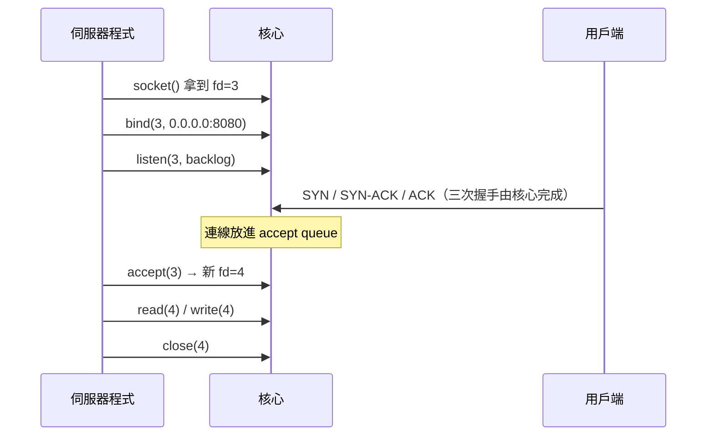
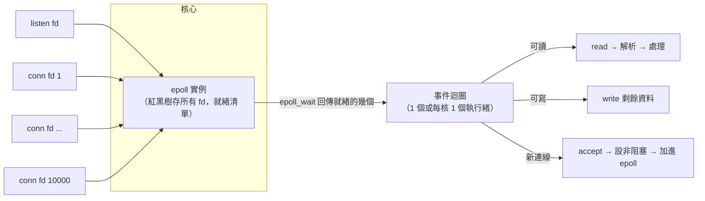

# 第 20 堂：Socket 程式設計與 C10K

這堂在「網路通訊」層的最上緣，也是把作業系統和網路接起來的地方：前幾堂講了 TCP/UDP、DNS、TLS 怎麼在網路上跑，這堂回到「你的程式怎麼用它們」，也就是 socket API，再看「一台機器同時撐一萬條連線」（C10K）這個經典問題怎麼被 epoll、事件迴圈、goroutine 和 async/await 解掉。它會用到第 1 堂（執行緒）、第 3 堂（系統呼叫）、第 6 堂（fd）、第 7 堂（epoll/io_uring）、第 15 堂（TIME_WAIT）。

## 0. 上一堂測驗答案

1. 最可能是 Nginx 只送了**葉憑證**、沒送中繼憑證（`ssl_certificate` 指到 `cert.pem` 而不是 `fullchain.pem`）。Chrome 會自己補中繼憑證（快取或 AIA 下載），Go 不會。確認：`openssl s_client -connect api.aicde.my:443 -servername api.aicde.my -showcerts </dev/null`，看憑證鏈是否只有 depth 0 一張、結尾是否 `Verify return code: 21 (unable to verify the first certificate)`。修法：改用 `fullchain.pem` 並 reload。映像端的可能：Go 服務用 `FROM scratch`／distroless 沒有 `ca-certificates`，要把 CA 檔 `COPY` 進 `/etc/ssl/certs/`。
2. **TLS 1.3（ECDHE）**：解不開。每次連線的金鑰來自臨時 ECDHE 私鑰，用完即丟；伺服器長期私鑰只用來簽章，這就是前向保密。攻擊者只能在未來冒充你的伺服器。**TLS 1.2 + RSA 金鑰交換**：解得開，因為 pre-master secret 是用伺服器公鑰加密傳送的。除了換私鑰，還要撤銷並重簽憑證、輪替 session ticket 金鑰、停用 RSA 金鑰交換與 TLS 1.0/1.1、追查外洩途徑並強制重設可能外洩的密碼或 token。
3. TLS 1.3：TCP 1 RTT + TLS 1 RTT = 2 RTT ≈ **400ms**，每次呼叫都多花；而且一直 new/dispose `HttpClient` 會留下大量 TIME_WAIT，可能耗盡 port。改法：共用長壽的 `HttpClient`（或 `IHttpClientFactory`），設 `PooledConnectionLifetime` 兼顧 DNS 更新，讓連線重用，多數呼叫只剩 1 RTT；能用 HTTP/2 就多工。TLS 1.2 是 3 RTT ≈ **600ms**（有 session resumption 可降到 2 RTT）。

## 1. Socket 是什麼：一個 fd，背後是核心裡的一條連線

在 Linux 裡，socket 就是一個**檔案描述符（fd）**，和打開的檔案一樣是一個小整數。你對它 `read`/`write`，核心把資料放進或拿出它的**接收緩衝區／傳送緩衝區**，真正的 TCP 重傳、壅塞控制、ACK 全部在核心裡跑，你的程式碰不到。

伺服器端的標準流程：



幾個常被誤會的重點：

- **握手是核心做的**，不是 `accept()` 做的。`accept()` 只是從「已完成握手的佇列」拿走一條，給你一個**新的 fd**。listen 的 fd 永遠只負責接新客人。
- 核心有兩個佇列：**SYN queue**（半開連線，收到 SYN 還沒完成握手）和 **accept queue**（握手完成、等你 accept）。`listen(fd, backlog)` 的 backlog 管的是後者，上限還受 `net.core.somaxconn` 限制。程式 accept 太慢，accept queue 滿了，新連線就會被丟或重置，用戶端看到逾時。
- 一條 TCP 連線由**四元組**（來源 IP、來源 port、目的 IP、目的 port）識別。所以伺服器只用一個 port 8080，卻能有幾十萬條連線：只要來源不同就是不同連線。
- `write()` 回傳成功只代表「資料進了核心的傳送緩衝區」，**不代表對方收到了**。`read()` 回傳 0 代表對方關閉（收到 FIN）。

用戶端則是 `socket()` → `connect()`。核心會自動挑一個**臨時 port**（`net.ipv4.ip_local_port_range`，預設約 32768–60999，約 2.8 萬個）。這就是為什麼「對同一個目的地瘋狂開短連線」會耗盡 port（再加上 TIME_WAIT 佔住 60 秒）。

## 2. C10K 問題：為什麼「一條連線一個執行緒」撐不住

1999 年 Dan Kegel 提出 C10K：一台伺服器能不能同時服務一萬個客戶端？當時最直覺的寫法是：

```text
while (true) {
    fd = accept(listen_fd);
    spawn_thread(handle, fd);   // 每條連線一個執行緒，阻塞式 read/write
}
```

一萬條連線就是一萬個執行緒，問題是：

| 成本 | 說明 |
|---|---|
| 記憶體 | 每個 OS 執行緒預設堆疊 8MB 虛擬空間（實際用到才配實體頁），一萬條光堆疊和核心結構就很可觀 |
| 情境切換 | 大部分連線在「等資料」，但排程器還是要在一萬個執行緒間切換，每次切換數微秒，還會清掉 CPU cache 與 TLB（第 2、4、10 堂） |
| 同步 | 執行緒之間共享資料要上鎖，鎖競爭隨執行緒數惡化（第 8 堂） |

關鍵觀察：**大多數連線大多數時間都是閒的**（等使用者、等下一個 HTTP 請求）。用一個執行緒「陪著」每條閒置連線，是浪費。

## 3. 解法：I/O 多工 + 事件迴圈

第 7 堂學過 epoll：一個執行緒把一萬個 socket 交給核心看，核心只回報「誰準備好了」。這就是 **Reactor 模式**：



要點：

1. 所有 socket 設成**非阻塞**，`read` 沒資料就立刻回 `EAGAIN`，不會卡住整個迴圈。
2. `epoll_wait` 的成本和「就緒的 fd 數」成正比，不是總數；這是它勝過 `select`/`poll`（每次掃全部、select 還有 1024 上限）的原因。
3. 事件迴圈裡**絕對不能做阻塞或很久的 CPU 工作**，否則一萬條連線一起卡。重的工作要丟給工作執行緒池。Node.js 的「不要阻塞 event loop」就是這個意思。
4. 多核心時開「每核一個事件迴圈」，再用 `SO_REUSEPORT` 讓多個 socket 綁同一個 port，由核心分配新連線（Nginx 的 worker 就是這樣）。

**Nginx、Redis、Node.js、Netty、HAProxy** 全是這個模式。Redis 單執行緒事件迴圈就能每秒十萬級請求，因為它幾乎從不等待。

## 4. 你熟悉的語言怎麼把這件事藏起來

事件迴圈很快，但寫起來很痛：每個請求的狀態要自己存在 callback 或狀態機裡。現代語言的做法是**讓你寫阻塞風格的程式碼，底層跑事件迴圈**。

**Go**：每條連線一個 goroutine，看起來像「一連線一執行緒」：

```go
ln, _ := net.Listen("tcp", ":8080")
for {
    conn, _ := ln.Accept()
    go func(c net.Conn) {
        defer c.Close()
        buf := make([]byte, 4096)
        for {
            n, err := c.Read(buf) // 看起來會阻塞
            if err != nil { return }
            c.Write(buf[:n])
        }
    }(conn)
}
```

但 goroutine 堆疊起始只有約 2KB，而且 `c.Read` 遇到沒資料時，Go runtime 的 **netpoller**（Linux 上就是 epoll）會把 fd 註冊起來、把這個 goroutine 停放，執行緒（M）轉去跑別的 goroutine；資料到了再喚醒。所以十萬個 goroutine 可能只用到 CPU 核心數那麼多個 OS 執行緒。第 51 堂講 GMP 時會再深入。

**C#**：`await stream.ReadAsync(...)` 也一樣。Kestrel 底層在 Linux 用 epoll、Windows 用 IOCP，`await` 時執行緒還給執行緒池，資料到了由 continuation 接著跑。所以 ASP.NET Core 可以用幾十個執行緒撐上萬條連線。反過來，在 async 程式裡寫 `.Result` 或 `Thread.Sleep` 會把執行緒池執行緒卡住，連線一多就出現**執行緒池飢餓**，延遲暴增。

| 模型 | 寫法 | 底層 | 例子 |
|---|---|---|---|
| 一連線一 OS 執行緒 | 阻塞式 | 核心排程 | 舊 Apache prefork、傳統 Java BIO |
| 事件迴圈 + callback | 非阻塞、callback | epoll/kqueue | Nginx、Redis、早期 Node.js |
| 綠色執行緒／協程 | 看起來阻塞 | runtime 排程 + epoll | Go、Java 21 虛擬執行緒 |
| async/await | `await` | 狀態機 + epoll/IOCP | C#、Rust tokio、JS |

## 5. 從 C10K 到 C10M：真正卡住你的常常不是程式碼

今天一台普通雲主機撐十萬條閒置長連線（WebSocket、MQTT）並不稀奇。這時瓶頸通常在系統設定：

- **fd 上限**：`ulimit -n` 預設常是 1024，超過就 `too many open files`。Docker 裡用 `--ulimit nofile=1048576:1048576`，systemd 用 `LimitNOFILE=`，K8s 繼承容器執行環境的設定。
- **accept queue**：`net.core.somaxconn`、應用的 backlog（Go 會讀 somaxconn；.NET Kestrel 有 `ListenOptions` 的 backlog）。
- **臨時 port 與 TIME_WAIT**：主要出現在「當用戶端的那一方」，例如反向代理對後端、你的服務對外部 API。解法是連線重用（keep-alive、連線池），而不是亂開 `tcp_tw_recycle`（已被移除）。
- **每條連線的記憶體**：核心的 socket 緩衝區加上你程式為每條連線配的 buffer。十萬條 × 64KB 就是 6.4GB。
- **conntrack 表**：Docker/K8s 的 NAT 靠 netfilter conntrack，表滿了會靜默丟包（`nf_conntrack: table full`），這是容器環境特有的坑（第 12 堂）。

再往上（C10M），就要繞過核心：DPDK、XDP/eBPF、io_uring 的批次提交，把每個封包的系統呼叫和複製成本壓到最低。

## 6. 雲端實務連結

- **ALB / Nginx 在前面時**：使用者的十萬條連線停在負載平衡器，LB 再用少量 keep-alive 連線打後端。這也是為什麼後端服務記錄到的來源 IP 都是 LB，要看 `X-Forwarded-For`。
- **Graceful shutdown**：K8s 送 SIGTERM 時，應該先停止 accept（關 listen fd）、讓進行中的請求做完再關連線。Go 用 `http.Server.Shutdown(ctx)`，ASP.NET Core 有 `HostOptions.ShutdownTimeout`。直接殺掉就會讓用戶端看到 connection reset。
- **WebSocket 服務擴展**：連線是有狀態、長壽的，水平擴展時要考慮重新平衡（新 Pod 不會自動分到舊連線）和廣播（用 Redis pub/sub 或訊息佇列）。

## 7. 動手看看

```bash
# 看所有 listen socket 與 accept queue（Recv-Q 是目前排隊數，Send-Q 是 backlog 上限）
ss -ltn

# 統計各狀態的連線數（ESTAB、TIME-WAIT……）
ss -tan | awk 'NR>1 {print $1}' | sort | uniq -c

# 看某個程序開了多少 fd、上限是多少
ls /proc/$(pgrep -n nginx)/fd | wc -l
cat /proc/$(pgrep -n nginx)/limits | grep 'open files'

# 系統設定
sysctl net.core.somaxconn net.ipv4.ip_local_port_range
ulimit -n

# 看 Go 程式的 epoll 系統呼叫
strace -f -e trace=epoll_wait,epoll_ctl,accept4 ./myserver
```

在 `ss -ltn` 裡如果 Recv-Q 一直接近 Send-Q，代表程式 accept 不夠快，accept queue 快滿了。

## 8. 一句話總結

**socket 是一個 fd，握手和重傳都在核心裡完成，`accept` 只是從佇列拿走已建立的連線；C10K 的答案是不要讓一個 OS 執行緒陪一條閒置連線，而是用 epoll 事件迴圈監看大量 fd，Go 的 goroutine 和 C# 的 async/await 就是把這個事件迴圈藏在「看起來阻塞」的程式碼底下。到了十萬級連線，瓶頸通常在 fd 上限、backlog、臨時 port、記憶體與 conntrack，而不是語言。**

## 9. 小測驗

1. 你用 Go 寫的 WebSocket 推播服務跑在 Docker 裡，連線數一到約 1000 就開始出現 `accept: too many open files`，CPU 和記憶體都很低。最可能的原因是什麼？要在哪幾個地方調整？
2. 同事在 ASP.NET Core 的 controller 裡呼叫外部 API 時寫了 `var r = httpClient.GetAsync(url).Result;`。平常沒事，但流量尖峰時所有請求延遲一起飆到好幾秒，CPU 卻不高。請用這堂的觀念解釋發生什麼事，並說明怎麼改。
3. 一個服務在尖峰時，用戶端偶爾連線逾時，但服務本身的請求日誌看起來都很快。`ss -ltn` 顯示它的 listen socket Recv-Q 是 128、Send-Q 也是 128。這代表什麼？可能有哪些原因與修法？
