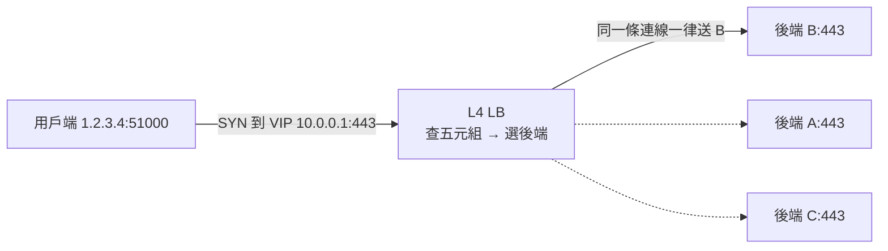
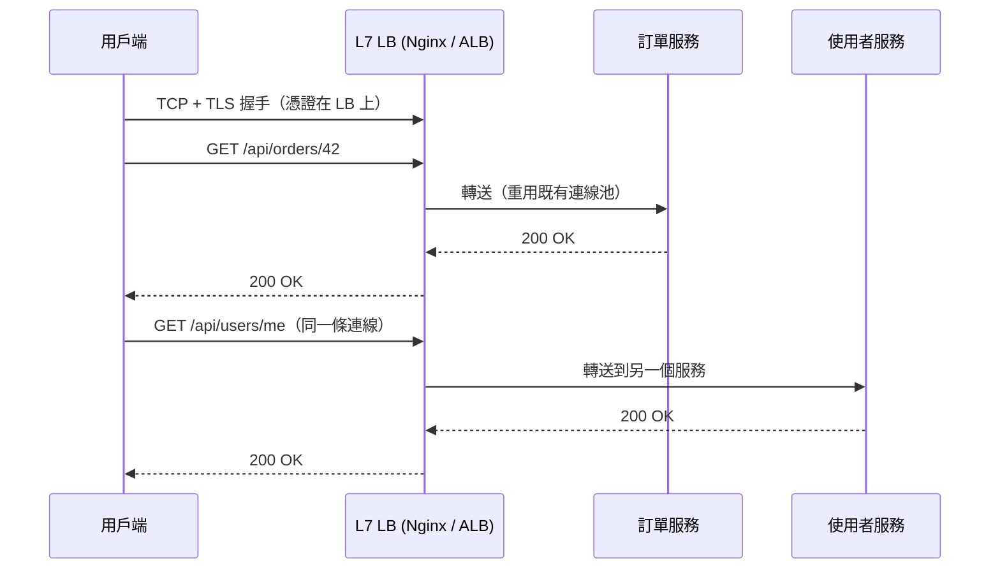

# 第 21 堂：負載平衡 L4 vs L7

這堂在「網路通訊」層靠上方的位置：前面講了 TCP 怎麼建連（第 15 堂）、TLS 怎麼握手（第 19 堂）、一台機器怎麼撐上萬條連線（第 20 堂），這堂把視角拉到「很多台機器」：流量進來之後，誰決定送到哪一台？負載平衡器（Load Balancer, LB）就是把網路層和後面的分散式系統接起來的第一道門。它會用到第 13 堂（分層）、第 14 堂（IP、路由）、第 15 堂（TCP 連線狀態）、第 19 堂（TLS）、第 20 堂（socket、keep-alive）。

## 0. 上一堂測驗答案

1. 最可能是行程的 **fd 上限**只有預設的 1024，每條 WebSocket 連線佔一個 fd。用 `cat /proc/<pid>/limits | grep "open files"` 或容器內 `ulimit -n` 確認。調整：`docker run --ulimit nofile=1048576:1048576`（或 compose 的 `ulimits.nofile`）、systemd 的 `LimitNOFILE`，系統層面確認 `fs.file-max`／`fs.nr_open`。上量後再看 `somaxconn`、每連線記憶體與 conntrack。
2. `.Result` 會**同步阻塞**一個執行緒池執行緒。尖峰時大量執行緒卡住等外部 API，執行緒池耗盡（thread pool starvation），新請求和 await 後的 continuation 都在排隊；執行緒池只會慢慢補執行緒，所以延遲一起飆高，但 CPU 不高（大家都在等）。修法：一路 async 到底，`await httpClient.GetAsync(url)`，action 改成 `async Task<IActionResult>`，並共用 `HttpClient`／`IHttpClientFactory`。可用 `dotnet-counters` 看 `ThreadPool Queue Length` 確認。
3. Recv-Q = Send-Q 表示 **accept queue 滿了**：核心已完成握手的連線在排隊，程式來不及 accept，之後的連線被丟（用戶端重試、看起來逾時），而服務日誌只看得到已被 accept 的請求，所以「都很快」。用 `nstat -az | grep ListenOverflows` 確認。修法：調大 `net.core.somaxconn` 與應用 backlog；別在 accept 迴圈裡做重活（TLS 握手、處理請求、被 CPU 工作卡住的事件迴圈）；開多個 worker 搭配 `SO_REUSEPORT`，或水平擴展加 Pod。

## 1. 為什麼需要負載平衡

一台機器再強也有上限，而且會壞。負載平衡器做三件事：

- **分流**：把請求分給多台後端（scale out）。
- **健康檢查**：發現某台壞了就不再送過去（高可用）。
- **單一入口**：用戶只看到一個 IP 或網域，後面怎麼增減機器都不用改用戶端。

關鍵問題是：**LB 要看封包看到多深？** 這就是 L4 和 L7 的差別，名字來自 OSI 分層（第 13 堂）：第 4 層是傳輸層（TCP/UDP），第 7 層是應用層（HTTP、gRPC）。

## 2. L4 負載平衡：只看 IP 和 port

L4 LB 只看封包的**五元組**：來源 IP、來源 port、目的 IP、目的 port、協定。它**不看內容**，不知道這是 `GET /api/users` 還是 `POST /login`。

它在**新連線**（TCP SYN）進來時挑一台後端，然後把這條連線之後的所有封包都送到同一台。所以它的單位是「連線」，不是「請求」。



L4 LB 常見的轉發方式：

- **NAT 模式**：LB 改寫目的 IP（DNAT）送給後端，回程也經過 LB 改回來。簡單，但回程流量也壓在 LB 上。Linux 的 IPVS、Docker 的 port 映射、K8s Service 的 iptables/IPVS 模式都屬於這類（還記得第 12、20 堂的 conntrack 嗎？就是它在記每條連線送去哪）。
- **DSR（Direct Server Return）**：LB 只改 MAC 位址（第 14 堂）把封包丟給後端，後端直接回給用戶端，不經過 LB。適合下載量遠大於上傳量的服務（影片、CDN）。
- **代理模式**：LB 自己接下 TCP 連線，再另開一條連到後端（例如 HAProxy 的 `mode tcp`）。這時後端看到的來源 IP 是 LB 的。

**優點**：快、便宜、協定無關（資料庫、Redis、MQTT、遊戲 UDP 都能用），TLS 可以直接穿透到後端（LB 看不到明文）。
**缺點**：看不到 HTTP，不能依路徑分流；長連線上的大量請求全部黏在同一台後端。

雲端對應：**AWS NLB**、**Azure Load Balancer**、**GCP Network LB**。

## 3. L7 負載平衡：看懂 HTTP 再決定

L7 LB 一定是**代理**：它跟用戶端完成 TCP 握手、**終結 TLS**（第 19 堂）、解析出 HTTP 請求，再根據內容挑後端，用另一條（通常是連線池裡現成的 keep-alive）連線轉送。



因為看得懂內容，L7 能做的事多很多：

- **依路徑／主機名稱分流**：`/api/orders` 到訂單服務、`admin.aicde.my` 到管理後台。這就是 K8s Ingress、API Gateway 的核心。
- **以請求為單位平衡**：同一條 HTTP/2 連線上的請求可以分給不同後端。
- **改寫與附加**：加 `X-Forwarded-For`、`X-Forwarded-Proto`，改路徑、加 CORS 標頭、壓縮。
- **重試與逾時**：後端回 502/503 時換一台重試（只對冪等請求安全）。
- **會話黏著（sticky session）**：用 cookie 讓同一使用者固定打同一台。
- **安全**：WAF、速率限制、驗證 JWT。

**缺點**：每個請求都要解析，CPU 和延遲成本較高；TLS 在 LB 終結，代表憑證在 LB 上、LB 到後端那段要不要再加密是你要決定的事。

雲端對應：**AWS ALB**、**Azure Application Gateway / Front Door**、**GCP HTTP(S) LB**、Cloudflare；自架用 Nginx、HAProxy（`mode http`）、Envoy、Traefik、YARP（.NET 的反向代理函式庫）。

## 4. 對照表

| | L4 | L7 |
|---|---|---|
| 看到什麼 | IP、port、協定 | 完整 HTTP：路徑、標頭、cookie |
| 平衡單位 | 一條連線 | 一個請求 |
| TLS | 可穿透（後端終結） | 通常在 LB 終結 |
| 後端看到的來源 IP | NAT/DSR 保留原始 IP；代理模式要 PROXY protocol | LB 的 IP，原始 IP 在 `X-Forwarded-For` |
| 速度 | 極快，可到每秒數百萬封包 | 較慢，受解析與 TLS 成本影響 |
| 協定 | 任何 TCP/UDP | HTTP/1.1、HTTP/2、gRPC、WebSocket |
| 雲端 | NLB | ALB |

實務上常常**兩層一起用**：最外面一層 L4（例如 NLB 或雲端的 Anycast 入口）擋住大流量並分給一群 L7 代理（Nginx/Envoy），L7 再依路由分給各微服務。

## 5. 分配演算法

選哪一台後端，常見做法：

- **Round Robin**：輪流。簡單，但假設每個請求成本一樣。
- **Weighted Round Robin**：大機器給較高權重，常用在藍綠／金絲雀部署（新版先給 5%）。
- **Least Connections**：選目前連線最少的。適合請求時間長短不一，或長連線（WebSocket）。
- **Least Response Time / EWMA**：看最近的延遲，Envoy、Linkerd 會用。
- **Power of Two Choices**：隨機挑兩台，選負載較低的那台。幾乎跟「選全域最小」一樣好，卻不需要所有 LB 共享狀態，很多大型系統愛用。
- **Hash（IP hash、一致性雜湊）**：同一個 key 永遠到同一台。一致性雜湊讓增減機器時只有一小部分 key 搬家，快取叢集和第 35 堂的分片也會用到。

一個小例子：三台後端，用 Round Robin，請求成本卻差很多：

```text
請求：  r1(10ms) r2(2s 報表) r3(10ms) r4(10ms) r5(2s 報表) r6(10ms)
RR：    A        B          C        A        B           C
結果：  B 塞了兩個 2 秒的報表，A、C 很閒 → 改用 Least Connections 會好很多
```

## 6. 健康檢查與連線排空

- **主動健康檢查**：LB 每幾秒打一次 `/healthz`，連續失敗 N 次就移出。L4 只能檢查「TCP 連得上」，L7 能檢查「HTTP 回 200」。
- **被動健康檢查（outlier detection）**：觀察真實流量，某台一直回 5xx 就暫時踢掉（Envoy 的做法）。
- **Connection draining / deregistration delay**：要下線的機器先標記為「不收新連線」，等進行中的請求做完再移除。這和上一堂講的 graceful shutdown 是一體兩面：K8s 刪 Pod 時，Endpoints 移除和 SIGTERM 是**同時**發生的，LB 可能還會送幾秒的流量進來，所以很多人會在 `preStop` 加一個 `sleep 5`。

健康檢查要小心「**全部判死**」：如果 `/healthz` 會去查資料庫，資料庫一慢，所有後端同時被判不健康，LB 沒地方送，整站掛掉。liveness 檢查應該只看自己，readiness 才去看相依服務，而且要有上限。

## 7. 和你熟悉的技術連起來

- **Docker / K8s**：`docker run -p 8080:80` 是 iptables DNAT，等於最簡單的 L4。K8s 的 `Service`（ClusterIP）由 kube-proxy 用 iptables/IPVS 做 L4 平衡；`Ingress`／Gateway API 才是 L7。所以 gRPC 走一般 Service 時會出現經典問題：**gRPC 用 HTTP/2 長連線，L4 只在建連時分流一次，所有請求黏在同一個 Pod**，新擴出來的 Pod 一點流量都沒有。解法：用 L7（Envoy、Linkerd、Istio）、headless Service 加用戶端負載平衡，或定期讓連線重建（`MaxConnectionAge`）。下一堂講 gRPC 時會再看。
- **Go**：`net/http/httputil.ReverseProxy` 幾十行就能寫一個 L7 代理；`grpc-go` 內建 `round_robin` 用戶端平衡。
- **C#**：YARP 就是用 ASP.NET Core 寫的 L7 代理；在 LB 後面的 ASP.NET Core 要加 `app.UseForwardedHeaders()`，否則 `HttpContext.Connection.RemoteIpAddress` 是 LB 的 IP，`Request.Scheme` 也會是 http（因為 TLS 在 LB 終結），導致 OAuth 回呼網址錯誤。
- **WebSocket**：L7 LB 要支援 `Upgrade` 標頭，閒置逾時要調長（ALB 預設 60 秒，閒置的 WebSocket 會被切）；用 Least Connections 比 Round Robin 好。

## 8. 動手看看

```bash
# 看一個網站背後的 LB 回了什麼標頭（Server、Via、X-Amzn-Trace-Id、CF-Ray 都是線索）
curl -sI https://example.com

# 用最小的 Nginx 設定做 L7 輪流分流
cat > nginx.conf <<'EOF'
events {}
http {
  upstream app { least_conn; server app1:8080; server app2:8080; }
  server {
    listen 80;
    location /api/ { proxy_pass http://app; proxy_set_header X-Forwarded-For $proxy_add_x_forwarded_for; }
  }
}
EOF

# 看 K8s Service 背後的 L4 規則（在節點上）
sudo iptables -t nat -L KUBE-SERVICES | head
sudo ipvsadm -Ln   # 若 kube-proxy 用 IPVS 模式
```

## 9. 一句話總結

**L4 負載平衡只看 IP 和 port，以「連線」為單位分流，快且協定無關，但看不懂內容；L7 負載平衡終結 TCP 和 TLS、解析 HTTP，以「請求」為單位依路徑、主機名稱、標頭分流，功能多但成本高。實務上兩層常一起用，而最常見的坑是長連線（gRPC、WebSocket）黏在同一台，以及在 LB 後面忘了用 `X-Forwarded-*` 找回真正的用戶 IP 和協定。**

## 10. 小測驗

1. 你把 Go 寫的 gRPC 服務從 2 個 Pod 擴到 6 個，前面是一般的 K8s ClusterIP Service。監控顯示新增的 4 個 Pod 幾乎沒有流量，原本 2 個還是很忙。為什麼？請提出至少兩種解法。
2. 你的 ASP.NET Core 網站放到 AWS ALB 後面（HTTPS 在 ALB 終結，ALB 用 HTTP 打後端）。上線後發現 Google 登入跳轉回來時網址變成 `http://...` 導致失敗，而且日誌裡所有使用者的 IP 都一樣。原因是什麼？怎麼修？修的時候要注意什麼安全問題？
3. 你要替一個 MQTT（基於 TCP 的 IoT 協定）服務和一個有 `/api`、`/admin` 兩組路由的 HTTP 服務各選一種 LB。各選 L4 還是 L7？為什麼？如果 MQTT 服務需要知道每個裝置的真實來源 IP，你要注意什麼？
