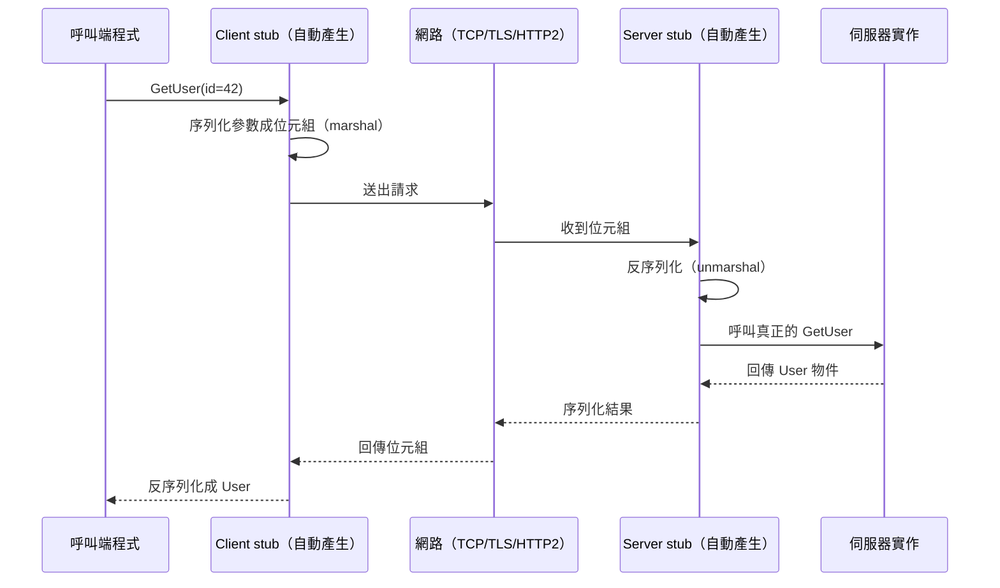
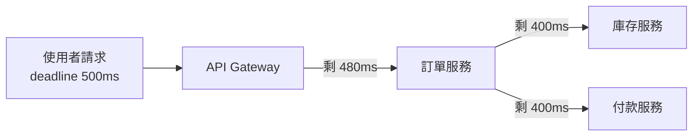

# 第 22 堂：RPC、gRPC、序列化

這堂是「網路通訊」層的最後一堂，也是網路往上接「分散式系統」的橋：前面學了 TCP、TLS、HTTP/2、負載平衡怎麼把位元組送到另一台機器，這堂看「服務和服務之間怎麼互相呼叫」，也就是 RPC，以及資料怎麼在記憶體物件和網路位元組之間轉換（序列化）。下一部分講資料庫和共識時，複寫、Raft 的節點溝通，底層全是 RPC。

## 0. 上一堂測驗答案

1. gRPC 跑在 HTTP/2 上，用戶端會建立**一條長連線**並在上面多工所有請求。ClusterIP Service 是 kube-proxy 的 **L4** 平衡，只在建立連線時挑一次 Pod，之後所有請求都黏在那個 Pod；既有連線不會因為新 Pod 出現而重建，所以新 Pod 沒流量。解法：(a) 用 L7 代理或 service mesh（Envoy、Linkerd、Istio），以「請求」為單位平衡；(b) 改用 headless Service（`clusterIP: None`）讓 DNS 回傳所有 Pod IP，搭配 grpc-go 的 `round_robin` 用戶端負載平衡；(c) 伺服器端設 `keepalive.ServerParameters{MaxConnectionAge: ...}`，讓連線定期優雅關閉、用戶端重連時重新分配。
2. TLS 在 ALB 終結、ALB 用 HTTP 打後端，所以 ASP.NET Core 看到的 `Request.Scheme` 是 `http`，產生的 OAuth redirect_uri 也變成 http；TCP 連線是 ALB 開的，所以 `RemoteIpAddress` 全是 ALB 的內網 IP。真實資訊在 `X-Forwarded-Proto`、`X-Forwarded-For`。修法：設定 `ForwardedHeadersOptions`（`XForwardedFor | XForwardedProto`），並在管線最前面 `app.UseForwardedHeaders()`。安全注意：只信任 LB 加的標頭，把 ALB 子網加進 `KnownNetworks`／`KnownProxies`（或用安全群組確保後端只能從 ALB 連入），否則任何人都能偽造 `X-Forwarded-For` 繞過 IP 限制或速率限制；多個值時取最右邊由可信代理加上的那個。
3. MQTT 選 **L4**（例如 NLB）：它不是 HTTP，L7 HTTP 代理看不懂；連線長壽，用 Least Connections 較好，閒置逾時要調長配合 MQTT keep-alive。HTTP 服務選 **L7**（ALB、Nginx、Ingress）：要依 `/api`、`/admin` 分流，還能在 `/admin` 加 IP 白名單或驗證。真實來源 IP：L4 若是透傳模式（NAT/DSR，例如 NLB 的 client IP preservation），後端直接看到原始 IP，但回程路由要經過 LB；若是代理模式（HAProxy `mode tcp` 等），要開 **PROXY protocol**，讓 broker（EMQX、Mosquitto 等）解析它，並且只接受來自 LB 的 PROXY header。

## 1. RPC 是什麼：把「網路呼叫」偽裝成「函式呼叫」

RPC（Remote Procedure Call）的想法從 1980 年代就有：讓你寫

```go
user, err := client.GetUser(ctx, &pb.GetUserRequest{Id: 42})
```

看起來像呼叫本地函式，實際上背後發生了：



**stub** 就是那層「假裝成本地函式」的膠水程式，通常由工具從介面定義檔自動產生。

但 RPC 有一個著名的陷阱：**網路呼叫永遠不等於本地呼叫**（分散式運算的八大謬誤：網路可靠、延遲為零、頻寬無限……全是錯的）。本地函式要嘛成功要嘛丟例外；遠端呼叫還多了第三種結果：**不知道**。請求送出後逾時，你無法分辨是：

- 請求根本沒到（可以安全重試）
- 伺服器做完了，回應在路上丟了（重試會做兩次！）
- 伺服器還在做

這就是為什麼 RPC 設計一定要談 **deadline（逾時）**、**重試** 和 **冪等性（idempotency）**。

## 2. 序列化：記憶體裡的物件 ≠ 網路上的位元組

你的 C# 物件在記憶體裡有指標、物件標頭、GC 資訊，Go 的 struct 有對齊填充（第 10 堂的 cache line 還記得嗎），而且兩台機器的語言、CPU 位元組順序（endianness）可能不同。所以要有一個雙方都同意的「位元組格式」。

常見選擇：

| 格式 | 類型 | 有 schema？ | 大小／速度 | 典型用途 |
|---|---|---|---|---|
| JSON | 文字 | 否（可選 JSON Schema） | 大、慢、好讀 | REST API、設定檔 |
| XML | 文字 | 可選（XSD） | 更大 | SOAP、MyInvois 也支援 XML/JSON |
| Protocol Buffers | 二進位 | 是（.proto） | 小、快 | gRPC、Google 內部 |
| MessagePack | 二進位 | 否 | 小、快 | Redis、SignalR 選項 |
| Avro | 二進位 | 是（schema 放旁邊） | 很小 | Kafka + Schema Registry |
| FlatBuffers / Cap'n Proto | 二進位 | 是 | 零拷貝，不用解析 | 遊戲、極低延遲 |

### Protobuf 的編碼長什麼樣？

```protobuf
message User {
  int32  id    = 1;
  string name  = 2;
  repeated string tags = 3;
}
```

`{id: 150, name: "Tee"}` 用 JSON 是 `{"id":150,"name":"Tee"}`，24 位元組。Protobuf 編碼：

```
08 96 01        ← 欄位 1，型別 varint，值 150（varint 用 2 bytes）
12 03 54 65 65  ← 欄位 2，型別 length-delimited，長度 3，"Tee"
```

只有 8 位元組。關鍵觀念：

- **欄位名不上網路，只送「欄位編號」**（= 1、= 2）。所以改欄位名沒關係，但**改編號會讓資料錯亂**。
- **varint**：小數字用少 bytes（每 byte 用 7 bits 存值、最高位表示「後面還有」）。所以負數用 `int32` 會很浪費（要 10 bytes），該用 `sint32`（zigzag 編碼）。
- 不認得的欄位編號會被**跳過**（因為每個欄位都帶型別和長度），這就是向前相容的基礎。

### Schema 演進：微服務最常踩的雷

服務 A 和 B 不會同時部署。v2 的 A 可能會收到 v1 的 B 送來的資料，反之亦然。Protobuf 的規則：

- ✅ 新增欄位（用新編號）：舊程式忽略它，新程式讀舊資料得到預設值
- ✅ 刪除欄位：但要 `reserved 3;` 把編號封起來，永不重用
- ❌ 改欄位編號、改型別（例如 int32 → string）
- ⚠️ proto3 沒有「必填」：0、""、false 和「沒送」分不出來，需要分辨時用 `optional` 或 wrapper 型別

JSON 也有一樣的問題，只是沒有工具幫你檢查：C# `System.Text.Json` 預設遇到未知欄位會忽略，但大小寫、null 處理、enum 序列化成數字還是字串，常常讓 Go 和 C# 服務互相看不懂。

## 3. gRPC：Protobuf + HTTP/2 + 程式碼產生

gRPC 是 Google 開源的 RPC 框架，三件事組成：

1. **IDL**：用 `.proto` 定義服務和訊息
2. **程式碼產生**：`protoc` 為 Go、C#、Java… 產生 client/server stub
3. **傳輸**：跑在 **HTTP/2** 上（第 17 堂）

```protobuf
syntax = "proto3";
service UserService {
  rpc GetUser (GetUserRequest) returns (User);                 // 一問一答
  rpc ListUsers (ListUsersRequest) returns (stream User);      // 伺服器串流
  rpc UploadLogs (stream LogLine) returns (UploadSummary);     // 用戶端串流
  rpc Chat (stream ChatMsg) returns (stream ChatMsg);          // 雙向串流
}
```

### 一次 gRPC 呼叫在 HTTP/2 上長什麼樣

```
HEADERS 框
  :method = POST
  :path   = /UserService/GetUser       ← 方法就是路徑
  content-type = application/grpc
  grpc-timeout = 200m                  ← deadline 會傳給伺服器
DATA 框
  [1 byte 是否壓縮][4 bytes 長度][protobuf 位元組]
HEADERS 框（trailers）
  grpc-status = 0                      ← 結果放在「尾巴」
  grpc-message = ...
```

這解釋了幾個實務現象：

- **為什麼瀏覽器不能直接打 gRPC**：瀏覽器的 fetch 拿不到 HTTP/2 trailers，也不能控制框，所以需要 **gRPC-Web** 加一個代理（Envoy）轉換，或改用 Connect 協定。
- **為什麼 L4 平衡器對 gRPC 不友善**：一條 HTTP/2 長連線多工所有呼叫（上一堂第 1 題）。
- **為什麼 gRPC 錯誤碼不是 HTTP 狀態碼**：HTTP 層幾乎永遠是 200，真正的結果在 `grpc-status`（`OK`、`DEADLINE_EXCEEDED`、`UNAVAILABLE`、`NOT_FOUND`…）。

### Deadline 傳遞：gRPC 最被低估的功能



在 Go 裡，`ctx` 帶著 deadline，往下呼叫時 gRPC 自動把剩餘時間放進 `grpc-timeout` 標頭；下游一看已經超時就直接放棄，不會白做工。C# 一樣：`context.CancellationToken` 往下傳就好。沒有 deadline 的 RPC 是生產事故的溫床：一個下游變慢，上游的連線、goroutine、執行緒池全卡住（第 20 堂的執行緒池飢餓）。

## 4. REST vs gRPC vs 其他：怎麼選？

| | REST + JSON | gRPC | GraphQL | 訊息佇列（Kafka、RabbitMQ） |
|---|---|---|---|---|
| 互動 | 同步請求／回應 | 同步 + 串流 | 同步查詢 | 非同步 |
| 契約 | OpenAPI（常常沒人維護） | .proto 強制 | Schema 強制 | Schema Registry 可選 |
| 瀏覽器 | 原生 | 要 gRPC-Web | 原生 | 不直接 |
| 效能 | 中 | 高 | 中 | 高吞吐、高延遲容忍 |
| 除錯 | curl 就好 | 要 grpcurl | GraphiQL | 要工具 |
| 適合 | 公開 API、第三方串接 | 內部微服務、多語言、串流 | 前端彈性取資料 | 解耦、削峰、事件驅動 |

經驗法則：**對外用 REST，對內微服務用 gRPC，不需要立即回應的用訊息佇列。** 像 MyInvois 這種政府對外 API 一定是 REST + JSON/XML，因為要讓所有語言、所有廠商都能輕鬆串。

## 5. 和你熟悉的技術連起來

- **Go**：`protoc --go_out=. --go-grpc_out=. user.proto` 產生程式碼；實作 `UnimplementedUserServiceServer` 的方法。Kubernetes、etcd、Docker（containerd）內部全用 gRPC，`kubectl` 打 API server 雖是 REST，但 kubelet 和容器執行環境之間（CRI）是 gRPC。
- **C#**：`Grpc.AspNetCore` 套件，把 `.proto` 加進 csproj 的 `<Protobuf Include=... />`，建置時自動產生類別。Kestrel 要開 HTTP/2（本機開發沒 TLS 時要設 `Http2` only）。用 `IHttpClientFactory` 一樣的觀念：`GrpcChannel` 要共用，不要每次 new（第 19、20 堂的連線重用）。
- **Docker / K8s**：健康檢查用標準的 `grpc.health.v1.Health` 服務，K8s 1.24+ 的 probe 直接支援 `grpc:`。
- **雲端**：AWS ALB 支援 gRPC 目標群組（L7，以請求分流）；Cloud Run、Azure Container Apps 也支援 HTTP/2 端對端。
- **序列化效能**：C# 熱路徑裡 `Newtonsoft.Json` → `System.Text.Json` + source generator 可以省掉反射；Go 的 `encoding/json` 用反射偏慢，高流量時常換 `protobuf` 或 `sonic`／`easyjson`。

## 6. 重試與冪等：RPC 的生存法則

回到第 1 節的「不知道」。安全重試的條件是操作**冪等**：做一次和做十次結果一樣。

- `GetUser`、`SetPrice(100)`：天生冪等
- `AddBalance(+100)`、`CreateOrder`：不冪等，重試會重複扣款、重複下單

讓不冪等的操作變冪等的標準做法：**冪等鍵（idempotency key）**。用戶端產生一個 UUID 放進請求，伺服器記住「這個鍵已經處理過，結果是 X」，重複的請求直接回 X。Stripe API 的 `Idempotency-Key` 標頭就是這樣，你送 MyInvois 發票時用自己的發票號碼防重複送出也是同樣的精神。

重試還要搭配**指數退避 + 抖動（jitter）**，而且要有上限，否則下游一掛，所有用戶端同時重試會形成「重試風暴」把它打得更死。gRPC 可以在 service config 裡宣告重試策略，只針對 `UNAVAILABLE` 這類可重試的狀態碼。

## 7. 動手看看

```bash
# 像 curl 一樣打 gRPC（伺服器要開 reflection）
grpcurl -plaintext localhost:50051 list
grpcurl -plaintext -d '{"id": 42}' localhost:50051 UserService/GetUser

# 看 protobuf 的實際位元組
echo 'id: 150 name: "Tee"' | protoc --encode=User user.proto | xxd
# 00000000: 0896 0112 0354 6565

# 比較大小
echo -n '{"id":150,"name":"Tee"}' | wc -c   # 24
```

用 Wireshark 抓 h2c（明文 HTTP/2）流量，可以看到 HEADERS、DATA、trailers 三種框，以及 `grpc-status` 在最後。

## 8. 一句話總結

**RPC 把遠端呼叫包裝成函式呼叫，但網路多了「不知道成功沒」這第三種結果，所以要有 deadline、重試和冪等鍵；序列化把物件轉成雙方同意的位元組，Protobuf 只送欄位編號和 varint 所以又小又快，代價是要守 schema 演進規則；gRPC 則是 Protobuf + HTTP/2 長連線 + 程式碼產生，對內微服務很強，但要注意瀏覽器支援和 L4 平衡的坑。**

## 9. 小測驗

1. 你的 Go 訂單服務呼叫 C# 付款服務的 gRPC `Charge(order_id, amount)`。某次呼叫回傳 `DEADLINE_EXCEEDED`，訂單服務自動重試一次並成功，結果客戶被扣了兩次款。發生了什麼？請提出讓重試變安全的設計。
2. 同事把 `.proto` 裡的 `string phone = 4;` 刪掉，又新增了 `int64 created_at = 4;`，只重新部署了新版的伺服器，舊版用戶端還在跑。會發生什麼事？正確的做法是什麼？
3. 你要替公司做三個介面：(a) 給外部會計軟體廠商串接的發票查詢 API；(b) 內部 Go 和 C# 微服務之間每秒上萬次的庫存查詢；(c) 訂單成立後要通知寄信、積分、報表三個系統。各選 REST、gRPC 還是訊息佇列？為什麼？

<details><summary>參考答案</summary>

1. `DEADLINE_EXCEEDED` 只代表「呼叫端等不及了」，不代表付款服務沒做：很可能第一次 Charge 其實已經扣款成功，只是回應晚於 deadline（或回應在路上丟失），重試就扣了第二次。這是 RPC 的「第三種結果：不知道」。設計：(a) 讓 Charge 冪等：請求帶冪等鍵（例如 order_id 或用戶端產生的 UUID），付款服務在同一個交易裡記錄「此鍵已處理、結果是 X」，重複請求直接回傳 X（資料庫用唯一索引擋重複）；(b) 只對確定安全的狀態碼（如 `UNAVAILABLE`、連線失敗）自動重試，不冪等的操作遇到 `DEADLINE_EXCEEDED` 先查詢狀態再決定；(c) 重試用指數退避加抖動並設上限；(d) deadline 要合理並往下傳，讓付款服務在超時後主動取消。
2. 欄位編號 4 被重用、型別又不同。舊用戶端送來的 `phone`（編號 4，length-delimited 字串）會被新伺服器當成 `created_at` 讀：wire type 不符時 protobuf 程式庫可能解析失敗、丟掉欄位，或得到亂掉的值；反過來新伺服器回的 `created_at`（varint）舊用戶端會當成 phone 而出錯或被忽略，造成資料靜默損壞。正確做法：永遠不要重用或改編號；刪欄位時寫 `reserved 4; reserved "phone";` 封住編號和名稱，新欄位用新編號（例如 `int64 created_at = 5;`）；在 CI 用 `buf breaking` 之類的工具檢查不相容變更；部署時考慮新舊版本並存期間的雙向相容。
3. (a) **REST + JSON**（附 OpenAPI 文件）：外部廠商語言、環境不一，REST 用 curl 就能測、任何語言都能串、穿過防火牆和代理最容易，認證、速率限制、版本控制的生態成熟。(b) **gRPC**：內部、多語言（Go/C#）、高頻率，Protobuf 小又快、HTTP/2 長連線多工、.proto 契約強制兩邊一致、有 deadline 傳遞；記得用 L7 或用戶端負載平衡。(c) **訊息佇列**（Kafka、RabbitMQ、SNS+SQS）：訂單服務發布一個「訂單已成立」事件，三個消費者各自訂閱，彼此解耦；某個系統掛掉或變慢不影響下單，事件會排隊等它恢復；新增第四個系統也不用改訂單服務。消費者要做成冪等，因為佇列通常是「至少一次」投遞。

</details>
