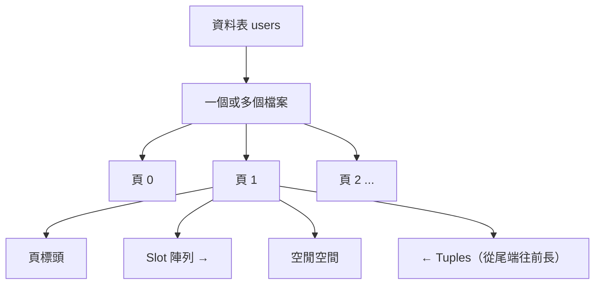

# 第 23 堂：儲存引擎：頁、Heap file

這堂是「資料庫系統」部分的第一堂，位置在作業系統（第 4～6 堂的分頁、檔案系統、page cache）正上方：資料庫其實就是一支「很懂磁碟的使用者態程式」，這堂看它怎麼把一張表變成磁碟上一塊塊固定大小的「頁」，之後的 B+Tree、WAL、buffer pool、MVCC 全都建立在這個基礎上。

## 0. 上一堂測驗答案

1. `DEADLINE_EXCEEDED` 只代表「呼叫端等不及了」，不代表付款服務沒做：很可能第一次 Charge 已經扣款成功，只是回應晚於 deadline（或在路上丟失），重試就扣了第二次。這就是 RPC 的「第三種結果：不知道」。設計：(a) 讓 Charge 冪等：請求帶冪等鍵（例如 order_id 或用戶端產生的 UUID），付款服務在同一個交易裡記錄「此鍵已處理、結果是 X」，重複請求直接回 X（用唯一索引擋重複）；(b) 只對確定安全的狀態碼（如 `UNAVAILABLE`、連線失敗）自動重試，不冪等的操作遇到 `DEADLINE_EXCEEDED` 先查狀態再決定；(c) 重試用指數退避加抖動並設上限；(d) deadline 要往下傳，讓付款服務超時後主動取消。
2. 欄位編號 4 被重用、型別又不同。舊用戶端送的 `phone`（編號 4，length-delimited 字串）會被新伺服器當成 `created_at` 讀：wire type 不符時可能解析失敗、丟掉欄位或得到亂值；反過來新伺服器回的 `created_at`（varint）舊用戶端會當成 phone 而出錯或忽略，造成資料靜默損壞。正確做法：永遠不要重用或改編號；刪欄位時寫 `reserved 4; reserved "phone";`，新欄位用新編號（例如 `int64 created_at = 5;`）；CI 用 `buf breaking` 檢查不相容變更。
3. (a) **REST + JSON**（附 OpenAPI）：外部廠商語言環境不一，curl 就能測、穿過防火牆和代理最容易，認證、速率限制、版本控制生態成熟。(b) **gRPC**：內部、多語言、高頻率，Protobuf 小又快、HTTP/2 長連線多工、.proto 契約強制一致、有 deadline 傳遞；記得用 L7 或用戶端負載平衡。(c) **訊息佇列**（Kafka、RabbitMQ、SNS+SQS）：訂單服務發布「訂單已成立」事件，三個消費者各自訂閱，彼此解耦；某系統掛掉不影響下單，事件排隊等它恢復；消費者要冪等，因為通常是「至少一次」投遞。

## 1. 為什麼資料庫不直接「一列一行寫進檔案」？

最天真的做法：把每筆資料用 CSV 一行一行 append 到檔案。問題馬上出現：

- **更新**：把 `name` 從 "Tee" 改成 "Tee Zhi Chean"，長度變了，後面所有資料都要往後挪。
- **刪除**：中間挖掉一行，留下的洞誰來用？
- **讀取**：磁碟（和 SSD）一次讀的最小單位是區塊，OS 的 page cache 以 4 KB 頁為單位（第 6 堂）。為了讀 50 bytes 的一列，你無論如何都會讀進一整頁。

所以資料庫的第一個設計決定是：**把檔案切成固定大小的「頁」（page，也叫 block），所有 I/O 都以頁為單位**。

| 資料庫 | 預設頁大小 |
|---|---|
| PostgreSQL | 8 KB |
| MySQL InnoDB | 16 KB |
| SQL Server | 8 KB |
| SQLite | 4 KB |
| Oracle | 8 KB（可調） |

頁是資料庫世界的「原子」：從磁碟讀進記憶體、在 buffer pool 裡快取（第 27 堂）、寫 WAL 時記錄變更（第 26 堂），都是一頁一頁地處理。

## 2. 三層結構：檔案 → 頁 → tuple



- **Tuple**：一列資料在磁碟上的樣子，前面有自己的小標頭（例如 PostgreSQL 的 23 bytes 標頭，含交易 ID `xmin`/`xmax`，第 31 堂 MVCC 會用到），後面是各欄位的位元組。
- **頁**：裝很多 tuple 的固定大小容器。
- **檔案**：一串頁。PostgreSQL 每張表一個檔案（每 1 GB 切一段），你可以在 `$PGDATA/base/<db_oid>/<relfilenode>` 看到它。

## 3. Slotted page：頁內部怎麼放變長資料

這是本堂最核心的結構，幾乎所有關聯式資料庫都用它：

```
+------------------------------------------------------------+
| 頁標頭：LSN、checksum、slot 數量、空閒空間起點/終點          |
+------------------------------------------------------------+
| slot[0] | slot[1] | slot[2] | ...  →  （往後長）             |
|                                                            |
|                  ↓ 空閒空間 ↑                               |
|                                                            |
|      （往前長） ← | tuple 2 | tuple 1 | tuple 0             |
+------------------------------------------------------------+
```

- **Slot 陣列**從頁頭往後長，每個 slot 只存「tuple 在頁內的位移和長度」（PostgreSQL 叫 line pointer，4 bytes）。
- **Tuple** 從頁尾往前長。
- 兩者在中間相遇時，頁就滿了。

為什麼要多一層 slot？因為**外界只用「(頁號, slot 號)」來指一筆資料**，這個位址叫 **RID / TID**。PostgreSQL 裡你可以直接看到：

```sql
SELECT ctid, * FROM users LIMIT 3;
--  ctid  | id | name
-- (0,1)  |  1 | Tee
-- (0,2)  |  2 | Vivi
-- (0,3)  |  3 | ...
```

`(0,1)` 就是「第 0 頁、第 1 個 slot」。好處：

1. **頁內搬家不影響外界**：tuple 變長了、或做頁內整理（compaction）把洞補起來時，只要改 slot 裡的位移，索引裡記的 TID 不用動。
2. **刪除很便宜**：把 slot 標成「空」，空間之後回收。
3. **變長欄位很自然**：tuple 多長都行，slot 記長度就好。

這和你熟悉的東西很像：slot 陣列就像 C# `List<T>` 裡存的「參照」，真正的物件在 heap 別處，GC 搬動物件時更新參照即可（第 5 堂記憶體配置器的概念）。

## 4. Heap file：沒有順序的一堆頁

**Heap file** 是最基本的表格組織方式：資料**不照任何順序**存放，哪裡有空位就塞哪裡。（這裡的 heap 是「一堆」的意思，和資料結構的 heap、記憶體的 heap 都無關。）

插入一筆資料時要回答：「哪一頁還有空位？」兩種常見做法：

- **鏈結串列**：用標頭頁串起「有空位的頁」和「滿的頁」兩條鏈。簡單但找空位可能要走很久。
- **頁目錄 / 空閒空間地圖**：用專門的頁記錄每一頁還剩多少空間。PostgreSQL 的 **FSM（Free Space Map）**就是這個，存在 `<relfilenode>_fsm` 檔案裡，是一棵小樹，能快速找到「至少有 N bytes 空間的頁」。

Heap file 的特性：

| 操作 | 成本 |
|---|---|
| 插入 | 很快：找個有空位的頁塞進去 |
| 用 TID 讀一筆 | 很快：直接讀那一頁 |
| 依條件找資料（`WHERE email = ?`）| **全表掃描**，讀過每一頁 |
| 依範圍、排序讀 | 也要全表掃描再排序 |

最後兩行就是下一堂 **B+Tree 索引**存在的理由：索引把「email → TID」排好序，查詢只需讀幾頁就找到 TID，再回 heap 讀那一頁。

> 對照：**PostgreSQL 的表是 heap**，所有索引（包括主鍵）都指向 TID。**MySQL InnoDB 不是 heap**，它的表本身就是按主鍵排序的 B+Tree（clustered index），次要索引存的是主鍵值而不是實體位址。SQL Server 兩種都有：有 clustered index 的表是 B+Tree，沒有的就是 heap。這個差異會影響你選主鍵：InnoDB 用隨機 UUID（v4）當主鍵會讓插入到處亂跳、頁分裂頻繁；用遞增 ID 或 UUIDv7 好很多。

## 5. 更新與刪除時發生什麼

**刪除**：在 PostgreSQL 裡，`DELETE` 不會真的抹掉資料，只是在 tuple 標頭寫上「哪個交易刪了它」（`xmax`）。舊資料還在頁裡，叫 **dead tuple**，要等 **VACUUM** 確認沒有任何交易還看得到它，才回收空間並更新 FSM。

**更新**：PostgreSQL 的 `UPDATE` = 標記舊版本死亡 + 插入一個新版本（新 TID）。這就是為什麼大量 UPDATE 的表會 **膨脹（bloat）**。優化：如果新版本能放在同一頁、而且沒有更新到有索引的欄位，就做 **HOT update（Heap-Only Tuple）**，索引不用改，舊 slot 轉指向新 tuple。調低表的 `fillfactor`（例如 90）就是在每頁預留空間給 HOT update。

**Tuple 太大放不下一頁怎麼辦？** PostgreSQL 用 **TOAST**：超過約 2 KB 的大欄位（長 `text`、`jsonb`）會壓縮，或切塊搬到另一張 TOAST 表，原 tuple 只留一個指標。InnoDB 也類似，用 overflow page。這也是為什麼 `SELECT *` 把大 `jsonb` 欄位一起撈出來特別慢。

## 6. 列式 vs 行式：同樣是頁，放法不同

上面講的都是 **行式儲存（row store / NSM）**：一列的所有欄位放在一起。適合 OLTP：「拿出訂單 #123 的全部資料」一次讀一頁就有。

**列式儲存（column store / DSM）**把同一欄的值放在一起：

```
行式：[1,Tee,MY,30] [2,Vivi,MY,5] [3,Ali,SG,28] ...
列式：id:[1,2,3...]  name:[Tee,Vivi,Ali...]  country:[MY,MY,SG...]  age:[30,5,28...]
```

`SELECT AVG(age) FROM users WHERE country='MY'` 只需讀 `country` 和 `age` 兩欄，同類資料又極好壓縮（字典編碼、RLE），還能配合 SIMD（第 54 堂）。適合 OLAP：BigQuery、Redshift、ClickHouse、Snowflake、Parquet 檔都是列式。SQL Server 的 columnstore index 讓你在同一個資料庫裡兩種都用。

## 7. 連結你的實務

- **Docker 裡跑 Postgres**：`-v pgdata:/var/lib/postgresql/data` 掛的就是這些 heap 檔案、FSM、VM（visibility map）檔案。容器砍了資料還在，就是因為頁都在 volume 上。
- **EF Core / GORM**：`context.SaveChanges()` 背後每個 UPDATE 在 Postgres 都產生新 tuple 版本；批次大量更新後監看 `pg_stat_user_tables.n_dead_tup`，確認 autovacuum 跟得上。
- **雲端**：RDS / Aurora / Cloud SQL 的 IOPS 計費、儲存「只增不減」的問題，很多就是 bloat 造成的；Aurora 甚至把「頁」這一層改寫成分散式儲存，只送 WAL 給儲存層，由儲存層自己重建頁。
- **SSD 對齊**：資料庫頁（8/16 KB）最好是 OS 頁（4 KB）和檔案系統區塊的整數倍，否則一次頁寫入可能變兩次底層 I/O；這也連到 MySQL 的 doublewrite buffer 和 Postgres 的 `full_page_writes`，用來防「頁寫到一半斷電」（torn page），第 26 堂細講。

## 8. 動手看看

```bash
docker run -d --name pg -e POSTGRES_PASSWORD=pw -p 5432:5432 postgres:16
docker exec -it pg psql -U postgres
```

```sql
CREATE TABLE t (id int, name text);
INSERT INTO t SELECT g, 'user' || g FROM generate_series(1, 1000) g;

SELECT ctid, * FROM t LIMIT 5;                 -- 看 (頁, slot)
SELECT pg_relation_filepath('t');              -- 實際檔案路徑
SELECT pg_relation_size('t') / 8192 AS pages;  -- 幾頁

UPDATE t SET name = 'changed' WHERE id = 1;
SELECT ctid, * FROM t WHERE id = 1;            -- ctid 變了！新版本

CREATE EXTENSION pageinspect;
SELECT lp, lp_off, lp_len, t_xmin, t_xmax
FROM heap_page_items(get_raw_page('t', 0)) LIMIT 5;  -- 直接看 slot 陣列
```

你會在 `heap_page_items` 裡看到 `lp`（slot 號）、`lp_off`（tuple 在頁內的位移，從 8192 往前遞減）、以及舊版本被設了 `t_xmax`，正是本堂畫的結構。

## 9. 一句話總結

**資料庫把資料切成固定大小的頁做 I/O；頁內用 slotted page，slot 陣列從前往後、tuple 從後往前長，外界用 (頁號, slot) 這個 TID 指向一筆資料，所以頁內搬動不影響索引；heap file 是不排序、哪裡有空就塞的頁集合，插入快但查詢要全表掃描，所以需要下一堂的 B+Tree 索引。PostgreSQL 的 UPDATE/DELETE 留下舊版本，要靠 VACUUM 回收。**

## 10. 小測驗

1. PostgreSQL 一張 `orders` 表，你每晚跑一次 `UPDATE orders SET status = 'archived' WHERE created_at < now() - interval '1 year'`，更新約 500 萬列。幾週後發現表的磁碟大小翻倍，但列數沒變多。為什麼？你可以怎麼處理和預防？
2. 一個 slotted page 已經有好幾個被刪除的 tuple 留下的洞，加起來有 2 KB 空閒，但沒有任何一個單獨的洞大於 500 bytes。現在要插入一筆 1 KB 的 tuple，資料庫可以怎麼做？為什麼這個操作不會讓指向這頁其他資料的索引失效？
3. 你要在 MySQL InnoDB 建一張事件記錄表，每秒寫入幾千筆。同事提議主鍵用 C# 的 `Guid.NewGuid()`（隨機 UUIDv4），另一個同事提議用自增 `BIGINT`。從「頁」的角度分析兩者差異；如果一定要用 UUID，有什麼折衷？
