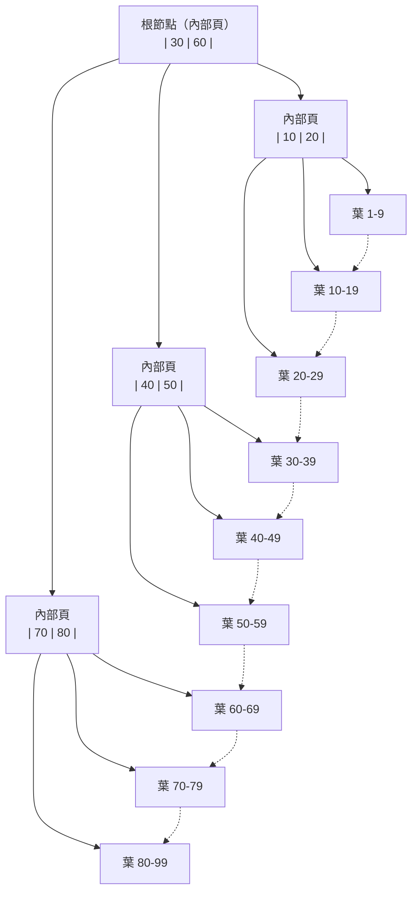
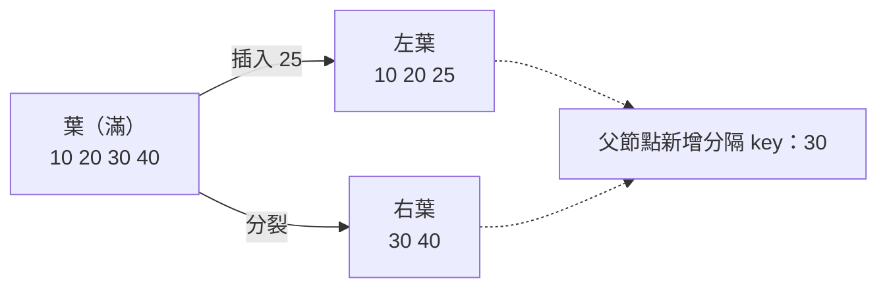
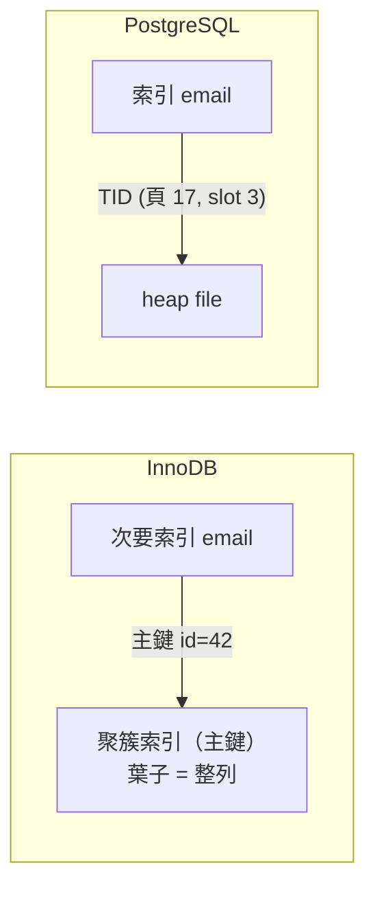

# 第 24 堂：B+Tree 索引

這堂在「資料庫系統」部分，接在上一堂的頁與 heap file 正上方：heap file 解決了「資料放哪裡」，B+Tree 解決「怎麼不掃全表就找到它」。它是幾乎所有關聯式資料庫（PostgreSQL、MySQL InnoDB、SQL Server、SQLite）的預設索引，也是你在 EF Core 寫 `HasIndex()` 時真正建出來的東西。

## 0. 上一堂測驗答案

1. PostgreSQL 的 UPDATE 不是原地改，而是標記舊版本死亡（設 `xmax`）並插入新版本，所以 500 萬列更新後表裡多了 500 萬個 dead tuple。若 autovacuum 跟不上（或有長交易、遺忘的 replication slot 擋住它），空間無法回收，新版本只能往檔案尾端加新頁，表就膨脹（bloat）。而且一般 VACUUM 只把空間標成可重用，不會把檔案縮小還給 OS。處理：`VACUUM (VERBOSE) orders` 讓空間可重用；要真的縮小檔案用 `VACUUM FULL`（會鎖表重寫）或線上工具 `pg_repack`。預防：分批更新並在批次間讓 VACUUM 有機會跑；調整這張表的 autovacuum 參數（調低 `autovacuum_vacuum_scale_factor`、提高 cost limit）；避免長交易；若 status 沒有索引，調低 `fillfactor` 讓 HOT update 在同頁完成；更好的設計是按時間分區（partition），封存時直接 detach/drop 舊分區，而不是逐列 UPDATE。
2. 做**頁內整理（compaction / defragmentation）**：把頁內所有仍存活的 tuple 搬到一起（往頁尾擠緊），把零碎的洞合併成一整塊連續空閒空間，然後放入 1 KB 的新 tuple。索引不會失效，因為索引存的是 TID =（頁號, slot 號），不是頁內位移；搬動 tuple 時只更新每個 slot 裡的位移，slot 號不變，外界看到的位址也就不變。這正是 slotted page 多一層間接的目的。（PostgreSQL 的頁內整理叫 page pruning / defragmentation，常在存取頁時順便做。）
3. InnoDB 的表本身就是按主鍵排序的 B+Tree（clustered index）。**自增 BIGINT**：新資料永遠落在最右邊的葉頁，頁一路填滿再開新頁，寫入集中在少數熱頁，buffer pool 命中率高、頁幾乎是滿的；主鍵 8 bytes，每個次要索引都要存主鍵，也比較省。**隨機 UUIDv4**：每筆插入落在 B+Tree 的隨機位置，要把隨機的舊頁讀進記憶體，頁滿了就**頁分裂**（一頁拆兩頁，各剩約一半），造成大量隨機 I/O、頁只半滿（空間浪費）、buffer pool 被打爆；16 bytes（存成字串更是 36 bytes）也讓所有次要索引變大。折衷：用**時間有序的 UUID**，例如 UUIDv7 或 ULID（前段是時間戳，所以大致遞增），並用 `BINARY(16)` 存；或內部用自增 BIGINT 當主鍵、另加一個有唯一索引的 UUID 欄位當對外 ID。（C# 的 `Guid.NewGuid()` 是 v4；.NET 9 起有 `Guid.CreateVersion7()`。）

## 1. 問題：heap file 找一筆資料要掃全表

上一堂說過，heap file 是「哪裡有空就塞」的頁集合，資料沒有排序。所以 `SELECT * FROM users WHERE email = 'tee@example.com'` 只能從第 0 頁讀到最後一頁。1 億列、每頁約 100 列，就是約 100 萬頁、8 GB 的 I/O。

我們要的是一種結構：

- 用很少的**頁讀取**次數找到一筆（記住：資料庫的成本單位是「讀幾頁」，不是「比較幾次」）。
- 支援**範圍查詢**（`BETWEEN`、`>`、`ORDER BY`）。
- 插入、刪除後依然保持平衡，不會退化。

### 為什麼不用二元搜尋樹或雜湊表？

| 結構 | 問題 |
|---|---|
| 二元搜尋樹（紅黑樹、AVL） | 每個節點只有 2 個子節點，1 億筆高度約 27 層。如果每個節點是一頁，就是 27 次隨機 I/O。在記憶體裡很快（像 C# 的 `SortedDictionary`），在磁碟上太慢。 |
| 雜湊索引 | 等值查詢 O(1)，但**不能做範圍查詢和排序**：`created_at > '2026-01-01'` 雜湊幫不上忙。PostgreSQL 有 hash index，但很少用。 |
| 排序陣列 + 二元搜尋 | 查詢快，但插入一筆要把後面全部往後挪。 |

B+Tree 的答案是：**把樹變得又矮又胖**。每個節點就是一整頁（8 KB 或 16 KB），一頁塞幾百個 key，於是每個節點有幾百個子節點。

## 2. B+Tree 的結構



三條規則：

1. **內部節點（internal page）只放「路標」**：key 和指向子頁的頁號。key 是分隔值，例如根節點的 `| 30 | 60 |` 表示「< 30 往左、30 到 59 往中間、≥ 60 往右」。
2. **所有真正的資料項都在葉節點（leaf page）**，而且葉節點內是排序的。葉節點的值可能是：
   - 一個 TID（頁號, slot），指回 heap file 那筆資料，這是 PostgreSQL 的作法；
   - 或者整列資料本身，這是 InnoDB 的「聚簇索引」（第 5 節）。
3. **葉節點用指標串成雙向鏈結串列**（圖中虛線）。範圍查詢找到起點後，沿著葉子往右走就好，不用回到樹上。

這就是 B+Tree 和教科書 B-Tree 的差別：B-Tree 的內部節點也放資料；B+Tree 把資料全部推到葉子，內部節點只放 key，所以**內部節點塞得更多、樹更矮**，而且葉子串起來，範圍掃描很便宜。

### 算一下有多矮

假設 key 是 8 bytes 的 BIGINT，加上 6 bytes 的子頁指標，一個 entry 約 14～16 bytes。8 KB 的頁扣掉頁首，大約能放 **400～500 個 entry**，這叫 **fanout（扇出）**。

- 高度 1（只有根）：約 500 個 entry
- 高度 2：500 × 500 ≈ 25 萬
- 高度 3：500³ ≈ 1.25 億
- 高度 4：500⁴ ≈ 625 億

**1 億筆資料，只要 3～4 層。** 而且根節點和第二層幾乎一定常駐在 buffer pool（第 27 堂）裡，所以一次等值查詢實際上通常只要 **1～2 次真正的磁碟 I/O**。這就是索引快的根本原因。

## 3. 操作：查詢、範圍、插入、刪除

### 查詢 `WHERE id = 42`

從根開始，在頁內用二元搜尋找到「42 應該在哪個子頁」，讀那一頁，重複到葉子。每層一頁，總共「樹高」次頁讀取。

### 範圍查詢 `WHERE id BETWEEN 42 AND 300`

先像上面一樣找到 42 所在的葉子，然後**沿著葉子的鏈結往右讀**，直到遇到 > 300 的 key 為止。`ORDER BY id` 也是同一招：索引本身就是排好序的，資料庫不用另外排序。

### 插入與頁分裂（page split）

插入 key 時，先找到它應該在的葉子：

- 葉子還有空間：直接插入（頁內保持排序，用的正是上一堂的 slotted page）。
- 葉子滿了：**分裂**。開一個新頁，把一半的 entry 搬過去，然後在父節點插入一個新的分隔 key 指向新頁。如果父節點也滿了，父節點也分裂，一路往上；如果根分裂，就長出新的根，**樹高 +1**。



注意：B+Tree **永遠從根往上長**，所以所有葉子永遠在同一層，樹天生平衡，不會像沒平衡的二元樹那樣退化成鏈結串列。

這也解釋了上一堂第 3 題：自增主鍵的插入永遠落在最右邊的葉子，滿了就開新頁，舊頁保持接近全滿（InnoDB 對遞增插入有優化，不會對半切）。隨機 UUID 則一直在中間分裂，頁只剩半滿。

### 刪除與合併

刪除時把 entry 從葉子拿掉。理論上葉子太空（例如低於一半）時要跟兄弟頁借 entry 或合併。實務上很多資料庫**很懶**：

- PostgreSQL 的 B-Tree 只在整頁變空時才回收頁，所以大量刪除後索引也會 bloat，需要 `REINDEX`（或 `REINDEX CONCURRENTLY`）。
- InnoDB 有 `MERGE_THRESHOLD`（預設 50%），低於門檻才嘗試合併。

## 4. 複合索引與「最左前綴」

`CREATE INDEX idx ON orders (customer_id, created_at);`

這棵樹的 key 是一個 **tuple**，先按 `customer_id` 排序，相同 customer 內再按 `created_at` 排序，就像電話簿先按姓、再按名排序。

| 查詢 | 能用索引嗎？ |
|---|---|
| `WHERE customer_id = 7` | ✅ 找到 7 的起點，往右掃 |
| `WHERE customer_id = 7 AND created_at > '2026-11-01'` | ✅ 精準定位到 (7, 2026-11-01) 開始掃 |
| `WHERE customer_id = 7 ORDER BY created_at DESC LIMIT 20` | ✅ 連排序都省了，從 7 的尾端往回讀 20 筆 |
| `WHERE created_at > '2026-11-01'` | ❌（通常不行）：created_at 散在每個 customer 底下，不連續 |

這就是**最左前綴原則**：索引只能從最左邊的欄位開始用。所以設計複合索引時，**等值條件的欄位放前面，範圍或排序的欄位放後面**。

## 5. 聚簇索引 vs 次要索引

這是 PostgreSQL 和 MySQL 最大的結構差異之一：

**InnoDB（MySQL）**：表本身就是一棵按主鍵排序的 B+Tree（clustered index），葉子裡放整列資料。次要索引的葉子放的是**主鍵值**。所以用次要索引查詢要走兩棵樹：先查次要索引拿到主鍵，再到聚簇索引查整列，這叫「回表」。

**PostgreSQL**：表是 heap file（上一堂），**所有**索引（包括主鍵）都是次要索引，葉子放 TID。用索引查詢 = 走一棵 B+Tree 拿到 TID，再到 heap 讀那一頁。



**覆蓋索引（covering index）**：如果查詢需要的欄位全在索引裡，就不用回表。

```sql
-- PostgreSQL 11+ / SQL Server：INCLUDE 把欄位放在葉子，但不參與排序
CREATE INDEX idx_orders_cust ON orders (customer_id, created_at) INCLUDE (total);
SELECT created_at, total FROM orders WHERE customer_id = 7;  -- Index Only Scan
```

在 PostgreSQL 的 `EXPLAIN` 會看到 `Index Only Scan`（前提是 visibility map 顯示該頁全部可見，這跟上一堂的 VACUUM 有關）。

## 6. 索引不是免費的

- **寫入放大**：每 INSERT 一列，每個索引都要插一個 entry，可能還要分裂。一張表 8 個索引，一次插入就是 1 次 heap 寫入加 8 次 B+Tree 插入。
- **空間**：索引常常跟表一樣大，甚至更大。
- **優化器不一定用它**：如果條件會命中表的大部分資料（低選擇性），走索引要對每一筆做一次隨機的 heap 讀取，還不如直接循序掃全表。第 32 堂會講優化器怎麼估算。
- **函式會讓索引失效**：`WHERE lower(email) = ...` 用不到 `email` 上的索引，因為樹是按 `email` 原值排序的。要用**運算式索引** `CREATE INDEX ON users (lower(email));`。

## 7. 連結到你熟悉的東西

- **EF Core**：`modelBuilder.Entity<Order>().HasIndex(o => new { o.CustomerId, o.CreatedAt });` 產生的就是第 4 節的複合 B+Tree；`.IncludeProperties(o => o.Total)`（Npgsql / SQL Server provider）對應 `INCLUDE`。
- **Go**：`go.etcd.io/bbolt`（etcd 用的嵌入式資料庫）就是一棵 B+Tree，每個 bucket 一棵樹，用 mmap 讀檔（連到第 5 堂）。
- **分頁 API**：`OFFSET 100000 LIMIT 20` 很慢，因為 B+Tree 不知道「第 100000 筆」在哪，只能沿著葉子數過去。改用 keyset pagination：`WHERE created_at < @lastSeen ORDER BY created_at DESC LIMIT 20`，直接從樹上定位。這就是很多 API 用 cursor 分頁的原因。
- **雲端**：RDS Performance Insights 或 Cloud SQL Query Insights 裡排名前面的慢查詢，最常見的原因就是缺索引導致 `Seq Scan`；IOPS 帳單也直接跟「讀了幾頁」相關。
- **SQLite**：表和索引都是 B-Tree，表本身按 rowid 聚簇，類似 InnoDB。

## 8. 動手看看

延續上一堂的 Docker Postgres：

```sql
CREATE TABLE users (id bigserial PRIMARY KEY, email text, created_at timestamptz);
INSERT INTO users (email, created_at)
SELECT 'user' || g || '@example.com', now() - g * interval '1 minute'
FROM generate_series(1, 1000000) g;
ANALYZE users;

EXPLAIN ANALYZE SELECT * FROM users WHERE email = 'user500000@example.com';  -- Seq Scan
CREATE INDEX idx_users_email ON users (email);
EXPLAIN ANALYZE SELECT * FROM users WHERE email = 'user500000@example.com';  -- Index Scan

CREATE EXTENSION IF NOT EXISTS pageinspect;
SELECT level, root FROM bt_metap('idx_users_email');   -- level = 樹高 - 1
SELECT itemoffset, ctid, data FROM bt_page_items('idx_users_email', 1) LIMIT 5;  -- 葉子：key + TID
SELECT pg_size_pretty(pg_relation_size('users')),
       pg_size_pretty(pg_relation_size('idx_users_email'));  -- 索引有多大
```

比較兩次 `EXPLAIN ANALYZE` 的執行時間；`bt_metap` 的 `level` 告訴你這棵樹有幾層，葉子裡的 `ctid` 就是上一堂的 (頁號, slot)。

## 9. 一句話總結

**B+Tree 讓每個節點佔一整頁、塞幾百個 key，所以樹只有 3～4 層，1 億筆資料只要幾次頁讀取；資料全部在排序的葉子裡，葉子串成鏈結，所以等值、範圍、排序都快；插入靠頁分裂往上長，永遠平衡。代價是寫入放大和空間，而且只有符合最左前綴、沒包函式的條件才用得到。**

## 10. 小測驗

1. 你的 SaaS 有一張 `invoices` 表，常見的查詢是「某個租戶最近 20 張發票」：`WHERE tenant_id = @t ORDER BY issued_at DESC LIMIT 20`。現在只有 `(issued_at)` 和 `(tenant_id)` 兩個單欄索引。這個查詢為什麼可能還是慢？你會建什麼索引？欄位順序為什麼這樣排？如果查詢只需要 `id, issued_at, total`，還能怎麼優化？
2. PostgreSQL 的 `orders` 表有 5000 萬列，`status` 欄位上有 B+Tree 索引，其中 95% 的列是 `'completed'`。你發現 `WHERE status = 'pending'` 走了索引而且很快，但 `WHERE status = 'completed'` 卻是 Seq Scan。這是優化器的 bug 嗎？為什麼？如果你只需要查 pending，還有什麼更省空間的索引？
3. 一個後台列表 API 用 `ORDER BY id DESC OFFSET @skip LIMIT 50` 分頁，使用者翻到第 2000 頁時要好幾秒。從 B+Tree 的結構解釋為什麼，並改寫成 keyset（cursor）分頁的 SQL。這種寫法在 C# / Go 的 API 上要怎麼傳 cursor？
