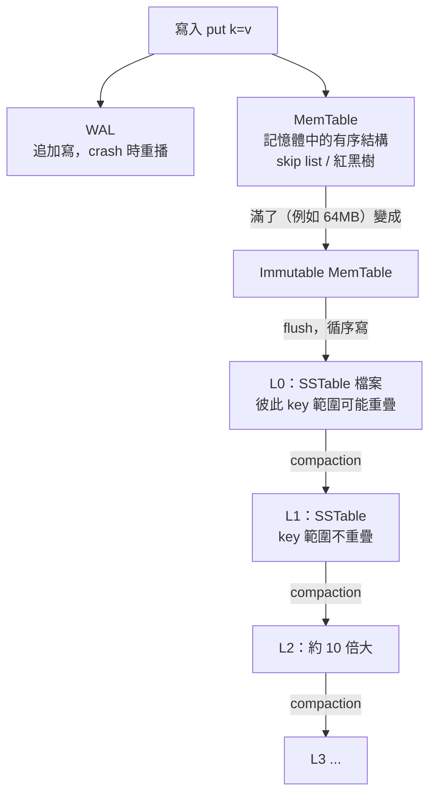

# 第 25 堂：LSM-Tree 與 compaction

這堂在「資料庫系統」部分，是上一堂 B+Tree 的另一條路：B+Tree 為「讀」最佳化、原地修改頁；LSM-Tree（Log-Structured Merge-Tree）為「寫」最佳化、只追加不修改，再靠背景的 compaction 整理。RocksDB、LevelDB、Cassandra、ScyllaDB、HBase、TiKV、CockroachDB（Pebble）、InfluxDB，甚至 Kafka 的日誌設計都是這個思路。

## 0. 上一堂測驗答案

1. 兩個單欄索引都不理想：用 `(issued_at)` 要從最新往回掃，邊掃邊過濾掉其他租戶，小租戶可能要掃很多頁才湊到 20 筆；用 `(tenant_id)` 要把該租戶所有發票撈出來再排序。建複合索引 `CREATE INDEX ON invoices (tenant_id, issued_at DESC);`：等值條件 `tenant_id` 放最左，排序欄位放後面，B+Tree 直接定位到該租戶的區段，按順序讀 20 筆就停，不用排序（B+Tree 可以反向掃，`DESC` 可省略，但寫出來意圖清楚）。若只需要 `id, issued_at, total`：PostgreSQL 加 `INCLUDE (id, total)` 成為覆蓋索引，走 Index Only Scan，不用回 heap；InnoDB 的次要索引葉子本來就帶主鍵 `id`，只要把 `total` 加進索引即可覆蓋。建了複合索引後，原本的 `(tenant_id)` 單欄索引是它的最左前綴，可以考慮刪掉，減少寫入放大。
2. 不是 bug，是正確的成本估算。pending 很少（選擇性高），走索引只要讀少數葉頁和少數 heap 頁；completed 佔 95%，走索引等於對約 4750 萬筆做隨機 heap 讀取，比循序掃整張表（可以預讀、大塊 I/O）貴得多，所以優化器選 Seq Scan。更省空間的作法是**部分索引（partial index）**：`CREATE INDEX ON orders (created_at) WHERE status = 'pending';`，只把 pending 那 5% 放進樹，索引小很多，寫入 completed 的列也不用維護它，查 `WHERE status = 'pending'` 的查詢可以直接使用。低選擇性欄位單獨建索引通常沒什麼價值。
3. B+Tree 只知道 key 的順序，不知道「第 N 筆」在哪（葉子沒有存排名）。`OFFSET 100000` 得從最大的 id 開始沿著葉子讀過 100000 筆，全部讀完再丟掉，只回傳後 50 筆，越後面越慢（PostgreSQL 往往還要回 heap 檢查可見性）。Keyset 分頁：`SELECT * FROM t WHERE id < @lastId ORDER BY id DESC LIMIT 50;`，直接在樹上定位到 `@lastId`，往左讀 50 筆，成本跟第幾頁無關。若排序欄位不唯一（例如 `created_at`），用複合條件 `WHERE (created_at, id) < (@lastCreatedAt, @lastId) ORDER BY created_at DESC, id DESC`，並建 `(created_at, id)` 索引。API 上：回應帶 `nextCursor`（把最後一筆的排序 key 編成不透明字串，例如 base64 的 JSON `{"createdAt":...,"id":...}`），下一次請求帶 `?cursor=...` 回來；C# 可用 `JsonSerializer` 加 `Convert.ToBase64String`，Go 用 `encoding/json` 加 `base64.URLEncoding`。代價是不能直接跳到「第 2000 頁」，只能上一頁、下一頁，這也是 GitHub、Stripe、Slack 等 API 用 cursor 分頁的原因。

## 1. 問題：B+Tree 的寫入很貴

回想上一堂：在 B+Tree 插入一筆 100 bytes 的資料，資料庫要

1. 從根走到葉子，把那個 8～16 KB 的葉頁讀進記憶體（如果不在 buffer pool，就是一次**隨機讀**）。
2. 在頁裡改幾十 bytes，頁變成 dirty。
3. 之後把整頁寫回磁碟（一次**隨機寫**），頁滿了還要分裂。
4. 為了 crash safety 還要先寫 WAL（第 26 堂會講）。

所以寫 100 bytes 可能造成好幾 KB 的實際 I/O，這叫**寫入放大（write amplification）**。每秒幾十萬筆寫入的場景，例如 IoT 感測器、日誌、指標（metrics）、訊息、聊天紀錄、區塊鏈狀態，隨機寫很快就成為瓶頸。在 SSD 上，隨機小寫還會加速磨損。

LSM-Tree 的想法很簡單：**不要原地改。寫入先放記憶體，攢夠一批再排好序，一次循序寫成一個新檔案。** 循序寫比隨機寫快很多（HDD 差上百倍，SSD 也差好幾倍），而且檔案寫完就不再修改（immutable）。

## 2. 三個元件：WAL、MemTable、SSTable



- **WAL（write-ahead log）**：每筆寫入先追加到日誌檔尾端。MemTable 在記憶體，斷電會消失，重啟時重播 WAL 就能還原。這是循序追加，很快。
- **MemTable**：記憶體中依 key 排序的結構，RocksDB 預設用 skip list（跳躍串列，可以無鎖並發插入）。寫入只要「寫 WAL + 插入 MemTable」就回傳成功，完全不碰資料檔。
- **SSTable（Sorted String Table）**：MemTable 滿了以後先凍結成 immutable MemTable（新寫入去新的 MemTable），背景執行緒把它**依 key 順序**一口氣寫成一個磁碟檔。檔案寫完就不再改。

一個 SSTable 檔案的內部大致長這樣：

```
[data block 0: apple=1, banana=2, ... ]   ← 每個 block 約 4～64 KB，內部排序，可壓縮
[data block 1: cherry=..., ... ]
...
[filter block: Bloom filter]               ← 快速判斷「某 key 一定不在這個檔」
[index block: 每個 data block 的最後一個 key + 位移]
[footer: index/filter 的位置]
```

因為是排好序的，找 key 時先查 index block 做二元搜尋定位到一個 data block，只要讀一個 block。

## 3. 更新和刪除：不改舊資料，只寫新版本

LSM 沒有「原地改」：

- **更新** `put(user:42, "Tee v2")`：直接寫一筆新的。舊的 `"Tee v1"` 還留在某個舊的 SSTable 裡，但讀取時**越新的越優先**，所以讀到的是 v2。每筆資料帶一個遞增的序號（sequence number）來判斷新舊。
- **刪除** `delete(user:42)`：寫一筆特殊標記叫 **tombstone（墓碑）**，意思是「這個 key 從此刻起不存在」。讀取時碰到 tombstone 就回傳找不到。

所以同一個 key 可能散落在很多檔案裡，有好幾個版本。這帶出兩個問題：讀取要查很多地方，空間也被舊版本佔著。解法就是 compaction。

## 4. 讀取路徑：由新到舊一層一層找

`get(k)` 的順序：

1. 查 MemTable（最新）。
2. 查 immutable MemTable。
3. 查 L0 的每個 SSTable（L0 檔案彼此 key 範圍重疊，所以可能每個都要看，由新到舊）。
4. 查 L1、L2、……每層 key 範圍不重疊，所以每層最多只要看一個檔案。

找到第一筆（最新的）就停。如果是 tombstone，回傳不存在。

最慘的情況是 key 根本不存在，每一層都得查一遍。所以要靠 **Bloom filter**：一個很小的位元陣列加上幾個雜湊函式。

- 它說「不在」→ 一定不在，直接跳過這個檔案，不用讀磁碟。
- 它說「可能在」→ 才去讀 data block，有小機率是誤判（false positive）。

每個 key 花 10 bits，誤判率大約 1%。一個 LSM 的讀取效能好不好，很大程度取決於 Bloom filter 和 block cache 有沒有放在記憶體裡。

範圍查詢（`scan(a..m)`）比較麻煩：每一層、每個 MemTable 都要開一個 iterator，用 **k 路合併（merge）** 把它們合成一個有序串流，同時丟掉舊版本和 tombstone。這就是名字裡「Merge」的來源。

## 5. Compaction：背景的垃圾回收與重新排序

Compaction 就是背景執行緒挑幾個 SSTable，把它們做一次**合併排序（merge sort）**，寫成新的 SSTable，再刪掉舊檔案。過程中：

- 同一個 key 只留最新版本（舊版本丟掉，回收空間）。
- tombstone 下面的舊資料一起丟掉；確定最底層也沒有舊資料了，tombstone 本身才能丟。
- 把檔案數量變少，讀取要查的地方變少。

因為輸入的每個檔都已排序，合併只要循序讀、循序寫，不需要隨機 I/O。這跟你在 Go 裡合併多個已排序 slice、或 C# 裡用 `PriorityQueue` 做 k 路合併是同一個演算法。

### 兩大策略

| | Leveled（分層） | Size-tiered（分大小） |
|---|---|---|
| 代表 | LevelDB、RocksDB 預設 | Cassandra 預設（STCS）、ScyllaDB |
| 作法 | 每層總大小是上一層的約 10 倍；L1 以下每層 key 範圍不重疊。L(n) 的一個檔案和 L(n+1) 範圍重疊的檔案合併 | 攢到幾個（例如 4 個）差不多大的檔案，就把它們合成一個更大的 |
| 讀 | 好：每層最多查一個檔 | 差：同一個 key 可能在很多個檔裡 |
| 空間 | 好：約只多 10% | 差：合併時需要暫存兩倍空間，舊版本留比較久 |
| 寫入放大 | 高：一筆資料每往下一層就可能被重寫約 10 次，總共可達 10～30 倍 | 低 |

這是一個經典的三角取捨，叫 **RUM 猜想**（Read、Update、Memory）：讀放大、寫放大、空間放大，三者不能同時最小化。B+Tree 偏讀，size-tiered 偏寫，leveled 在中間。

> 注意：LSM 也有寫入放大，而且 leveled 的寫入放大可能比 B+Tree 還高。它真正的優勢是**把寫入變成循序的、大塊的、可壓縮的**，前台寫入不用等磁碟上的隨機 I/O。

### Compaction 跟不上會怎樣？

寫入速度大於 compaction 速度時，L0 檔案越堆越多，讀取越來越慢。RocksDB 會啟動 **write stall**：先減速（slowdown），再直接暫停寫入（stop），直到 compaction 趕上。實務上看到的症狀是「寫入延遲突然一陣一陣飆高」。所以 compaction 的執行緒數和磁碟頻寬是 LSM 系統最重要的調校項目之一。

## 6. 一個小例子

假設 MemTable 只能放 3 筆，依序寫入：

```
put a=1, put c=3, put b=2         → flush 成 SST-1: [a=1, b=2, c=3]
put a=9, delete b, put d=4        → flush 成 SST-2: [a=9, b=🪦, d=4]
```

此時 `get(b)`：MemTable 沒有 → SST-2（較新）找到 tombstone → 回傳「不存在」，SST-1 不用看。
`get(c)`：SST-2 的 Bloom filter 說不在 → 跳過 → SST-1 找到 c=3。

Compaction 合併 SST-1 和 SST-2（假設已是最底層）：

```
a: 9 比 1 新 → 留 a=9
b: tombstone 比 b=2 新，且已是最底層 → 兩個都丟
c=3、d=4 → 留
結果 SST-3: [a=9, c=3, d=4]，刪除 SST-1、SST-2
```

## 7. B+Tree vs LSM-Tree 怎麼選

| 情境 | 傾向 |
|---|---|
| 寫多讀少：日誌、指標、事件、IoT、聊天訊息 | LSM |
| 讀多、需要穩定低延遲的點查和範圍查 | B+Tree |
| 需要高壓縮率、省儲存成本 | LSM（檔案不可變，可整塊壓縮） |
| SSD 壽命、雲端 IOPS 計費 | LSM 通常較省（大塊循序寫） |
| 延遲不能有尖峰 | B+Tree 較穩（LSM 有 compaction 和 write stall 的干擾） |

## 8. 連結到你的實務

- **Go**：`github.com/cockroachdb/pebble`（CockroachDB 的儲存引擎）、`github.com/dgraph-io/badger` 都是純 Go 的 LSM。etcd 用的 bbolt 則是 B+Tree，正好對照上一堂。
- **C#**：RocksDB 有 .NET 綁定（`RocksDbSharp`）；Microsoft 的 **FASTER / Garnet** 是另一種 log-structured 設計。EF Core 背後的 SQL Server、PostgreSQL 都是 B+Tree。
- **資料庫**：MySQL 可以換 **MyRocks**（Facebook 用來省下一半以上儲存空間）；TiDB 底下的 TiKV、YugabyteDB 底層是 RocksDB；Cassandra / ScyllaDB 是 LSM，所以「Cassandra 寫很快、刪除要小心 tombstone」。
- **雲端**：AWS DynamoDB 和 Google Bigtable 的設計都受 LSM 影響（Bigtable 論文就是 SSTable 這個名字的來源）。Cassandra 大量刪除後查詢變慢，常見原因就是讀到成千上萬個 tombstone（日誌會出現 `TombstoneOverwhelmingException`）。
- **Docker**：容器映像的 layer 也是「不改舊層，只疊新層，刪除用 whiteout 檔標記」，跟 tombstone 是同一個思路（連到第 12 堂）。
- **Kafka**：log compaction 對同一個 key 只保留最新值，tombstone 是 value 為 null 的訊息（第 59 堂會再見到）。

## 9. 動手看看

用 Docker 跑一個 ScyllaDB（Cassandra 相容），觀察 flush 和 SSTable：

```bash
docker run --name scylla -d scylladb/scylla --smp 1 --memory 1G
docker exec -it scylla cqlsh
```

```sql
CREATE KEYSPACE demo WITH replication = {'class':'SimpleStrategy','replication_factor':1};
CREATE TABLE demo.kv (k text PRIMARY KEY, v text);
INSERT INTO demo.kv (k, v) VALUES ('a', '1');
INSERT INTO demo.kv (k, v) VALUES ('a', '9');
DELETE FROM demo.kv WHERE k = 'a';
```

```bash
docker exec scylla nodetool flush demo kv          # MemTable → SSTable
docker exec scylla ls /var/lib/scylla/data/demo/   # 看到 SSTable 檔案（Data.db、Filter.db、Index.db…）
docker exec scylla nodetool compact demo kv        # 手動 compaction
```

Filter.db 就是 Bloom filter，Index.db 就是 index block，對照第 2 節的檔案結構。如果想寫 Go，可以用 Pebble 寫幾萬筆資料再呼叫 `db.Metrics()`，看每層的檔案數和寫入放大。

## 10. 一句話總結

**LSM-Tree 把寫入先寫 WAL、放進記憶體的 MemTable，滿了就循序寫成不可變的排序檔 SSTable；更新寫新版本、刪除寫 tombstone，讀取由新到舊找並靠 Bloom filter 跳過檔案；背景的 compaction 合併檔案、丟掉舊版本。它用「讀和空間的額外成本」換「快速、循序的寫入」。**

## 11. 小測驗

1. 你用 Cassandra 存聊天訊息，每天有一支排程用 `DELETE` 清掉 30 天前的訊息。幾週後，「讀某個聊天室最新 50 則」的查詢越來越慢，日誌出現 tombstone 警告。從 LSM 的結構解釋為什麼「刪除」反而讓讀取變慢，並提出至少兩種改善方式。
2. 某服務用 RocksDB 存使用者狀態。流量尖峰時，p99 寫入延遲從 1 ms 跳到 500 ms，但 CPU 不高。你會先懷疑什麼機制？要看哪些指標？可以怎麼調整？
3. 你要幫一個 IoT 平台選儲存引擎：每秒 20 萬筆感測器寫入、很少更新、查詢幾乎都是「某裝置最近 1 小時的資料」。你會選 B+Tree 還是 LSM？Compaction 策略選 leveled 還是 size-tiered（或其他）？key 要怎麼設計才能讓「最近 1 小時」的查詢有效率？
