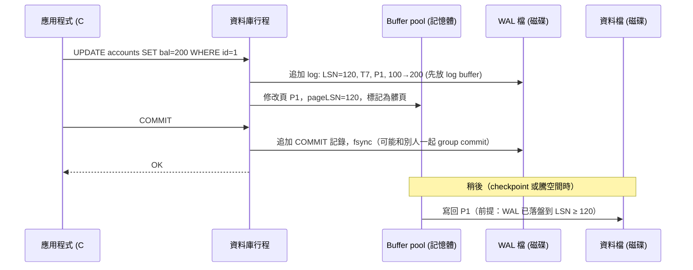
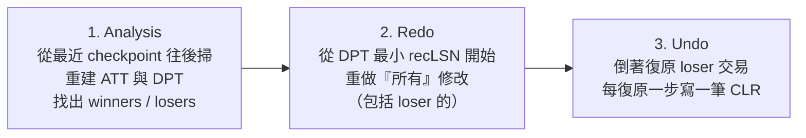

# 第 26 堂：WAL 與 crash recovery（ARIES）

這堂在「資料庫系統」部分，接在儲存引擎（第 23 堂的頁、第 24 堂的 B+Tree、第 25 堂的 LSM）之後，回答一個很實際的問題：**資料庫正在寫的時候突然斷電，重開後資料會不會不見、會不會只寫了一半？** 答案的核心就是 WAL（Write-Ahead Logging，預寫日誌）和 ARIES 恢復演算法。它也是 ACID 裡 A（原子性）和 D（持久性）的地基，下一堂的 buffer pool、第 28 堂的交易、第 34 堂的複寫都建立在它上面。

## 0. 上一堂測驗答案

1. LSM 的刪除不是真的刪掉，而是寫一筆 tombstone。查「最新 50 則」時，引擎要合併各層 SSTable，沿途遇到的 tombstone 不能直接跳過（要用它遮住更舊的資料），所以如果一個分區裡累積了大量 tombstone，讀取得先掃過成千上萬個墓碑才湊到 50 筆活資料；而 tombstone 要等 `gc_grace_seconds`（預設 10 天）過後、且 compaction 把它和底下的舊資料合在一起時才會被清掉。改善：(a) 不用 DELETE，改用 **TTL**（`INSERT ... USING TTL 2592000`），讓資料自然過期；(b) 搭配 **TimeWindowCompactionStrategy（TWCS）**，按時間窗把資料分到不同 SSTable，整個時間窗過期後直接丟掉整個檔案，不用逐筆 tombstone；(c) 資料建模上按時間分桶，例如分區鍵用 `(room_id, yyyymm)`，查最新訊息只讀最近的分區；(d) 視情況調低 `gc_grace_seconds`（要確保 repair 能在這段時間內跑完，否則刪掉的資料可能「復活」）。
2. 先懷疑 **compaction 跟不上導致 write stall**：尖峰時 MemTable flush 太快，L0 檔案數超過 `level0_slowdown_writes_trigger` / `level0_stop_writes_trigger`，或待 compaction 的資料量超過 `soft/hard_pending_compaction_bytes_limit`，RocksDB 就主動減速或暫停寫入，所以 CPU 不高但延遲暴增（在等磁碟 I/O）。指標：RocksDB stats 裡的 stall 時間（`rocksdb.stall.micros`、`DB Stats` 中的 Stall）、每層檔案數、`estimate-pending-compaction-bytes`、immutable MemTable 數量、磁碟 IOPS / 頻寬是否滿載。調整：增加 `max_background_jobs`（compaction/flush 執行緒）、加大 `write_buffer_size` 和 `max_write_buffer_number` 吸收尖峰、調整 L0 觸發門檻、開 subcompaction、換更快的磁碟或提高雲端磁碟的 IOPS，必要時改用寫入放大較低的 compaction 策略（universal / tiered）。
3. 選 **LSM**：寫入量大、幾乎只追加、很少更新，正好是 LSM 的強項，而且時序資料壓縮率高、省儲存成本。Compaction 用 **時間窗策略（TWCS / FIFO）** 或 size-tiered：資料按時間寫入、按時間過期，同一時間窗的資料放在一起，舊窗整個刪掉，避免 leveled 那種反覆重寫舊資料的高寫入放大；如果讀取延遲很重要且資料量可控，leveled 也可以考慮。Key 設計：`device_id + 時間戳`（例如 `device42#2026-11-27T09:00:00`，時間用固定長度、可排序的格式，或用反轉時間戳讓最新的排前面），這樣「某裝置最近 1 小時」就是 LSM 上的一段連續範圍掃描；在 Cassandra 裡就是分區鍵 `(device_id, 日期桶)`、clustering key `ts DESC`。避免用純時間戳當 key 的開頭，否則所有寫入擠在同一個範圍（分散式系統裡會變成熱點分片，第 35 堂會講）。

## 1. 問題：頁在記憶體裡改，什麼時候寫回磁碟？

回想第 23、24 堂：資料庫把磁碟上的頁（8～16 KB）讀進記憶體的 buffer pool，在記憶體裡修改，之後再寫回磁碟。這中間有一段時間，**記憶體和磁碟的內容不一致**。當機時有兩種災難：

| 情況 | 後果 | 違反 |
|---|---|---|
| 交易已回覆「commit 成功」，但改過的頁還在記憶體 | 重開後資料不見了 | D：持久性 |
| 交易還沒 commit，但改過的頁已經被寫回磁碟 | 重開後磁碟上留著「做一半」的資料 | A：原子性 |

還有第三種：**torn page（撕裂頁）**。一個 8 KB 的頁，磁碟或檔案系統可能一次只保證原子寫入 512 bytes 或 4 KB，寫到一半斷電，頁的前半是新的、後半是舊的。

最天真的解法：「commit 時把所有改過的頁都寫回磁碟，沒 commit 的頁絕不寫回」。這可行，但很慢，下一節說明原因。

## 2. 兩個政策：Steal 和 Force

資料庫教科書用兩個開關描述 buffer pool 的寫回策略：

- **Steal**：允許把「未 commit 交易改過的髒頁」寫回磁碟嗎？（buffer pool 滿了要騰空間時，可以「偷」走這一頁。）
- **Force**：commit 時，一定要把該交易改過的所有頁都寫回磁碟嗎？

| | No-Force（commit 不必寫頁） | Force（commit 要寫頁） |
|---|---|---|
| **Steal**（可寫回未 commit 的頁） | 最快，但需要 **Undo + Redo** | 需要 Undo |
| **No-Steal**（不可寫回） | 需要 Redo | 最簡單，但最慢 |

- **Force 很慢**：一個交易改了 10 個分散在各處的頁，commit 就要做 10 次**隨機寫**；熱門頁每次 commit 都要重寫一次。
- **No-Steal 很綁手**：一個大交易改了 1000 萬列，所有髒頁都得留在記憶體直到 commit，記憶體可能不夠。

所以幾乎所有正式的資料庫（PostgreSQL、MySQL InnoDB、SQL Server、Oracle）都選 **Steal + No-Force**：效能最好，代價是當機後要能做兩件事：

- **Redo**：把「已 commit、但頁還沒寫回」的修改重做一次（補 D）。
- **Undo**：把「未 commit、但頁已經寫回」的修改復原（補 A）。

要做到這兩件事，就要有一份記錄「誰改了什麼、改之前是什麼、改之後是什麼」的日誌。這就是 WAL。

## 3. WAL 的兩條鐵律

WAL 是一個**只追加（append-only）**的日誌檔。每次修改頁之前，先寫一筆日誌記錄。兩條規則：

1. **寫回資料頁之前，描述這頁修改的日誌必須先落盤。**（「Write-Ahead」的名字就是這樣來的。這讓 Undo 一定做得到。）
2. **回覆 commit 成功之前，這個交易所有的日誌記錄（包括 COMMIT 記錄）必須先落盤。**（這讓 Redo 一定做得到。）

「落盤」指的是呼叫 `fsync()` / `fdatasync()` 之後，作業系統保證資料已經到達持久儲存。回想第 6 堂：一般的 `write()` 只寫到 page cache，斷電就沒了。

為什麼這比 Force 快？

- **commit 只需要一次循序寫**：把日誌尾端追加到檔案，一次 fsync。資料頁可以晚點、慢慢、合併地寫回（這叫 checkpoint，第 5 節）。
- **日誌記錄很小**：改 100 bytes 的一列，日誌可能只有一兩百 bytes，而不是整個 8 KB 的頁。
- **Group commit**：fsync 一次約 0.1～10 ms，很貴。資料庫會把同一時間內好幾個交易的 commit 記錄攢在一起，用一次 fsync 一起落盤，吞吐量大幅提升。（上一堂 LSM 的 WAL 也是同樣的做法。）



## 4. 日誌記錄長什麼樣：LSN、pageLSN

每筆日誌記錄大概有這些欄位：

| 欄位 | 意思 |
|---|---|
| **LSN**（Log Sequence Number） | 單調遞增的編號，通常就是它在日誌檔中的位元組位移 |
| **prevLSN** | 同一個交易的上一筆記錄，串成一條每個交易各自的鏈結串列（undo 時倒著走） |
| txnId | 哪個交易 |
| type | UPDATE / COMMIT / ABORT / END / CLR / CHECKPOINT… |
| pageId、offset | 改了哪一頁的哪裡 |
| before image | 修改前的值（undo 用） |
| after image | 修改後的值（redo 用） |

另外有兩個關鍵的「水位」：

- **pageLSN**：每一頁的頁首都記著「最後一次修改這頁的日誌 LSN」。磁碟上的頁有 pageLSN，就能知道這頁「已經包含到哪一筆修改」。
- **flushedLSN**：記憶體裡記著「日誌已經 fsync 到哪個 LSN」。

鐵律 1 就變成一個簡單的檢查：**要把頁寫回磁碟，必須 `page.pageLSN ≤ flushedLSN`**，不然先去 flush 日誌。

## 5. Checkpoint：不要每次都從頭重播

如果日誌從資料庫建立那天開始累積，當機後要從頭重播幾個月的日誌，不可能。Checkpoint 定期做兩件事：

1. 在日誌裡寫一筆 CHECKPOINT 記錄，記下當下的兩張表：
   - **Active Transaction Table（ATT）**：還在執行的交易，以及各自最後一筆 LSN（lastLSN）。
   - **Dirty Page Table（DPT）**：buffer pool 裡哪些頁是髒的，以及每頁**第一次變髒時的 LSN（recLSN）**。
2. 背景慢慢把髒頁寫回磁碟。

ARIES 用的是 **fuzzy checkpoint**：做 checkpoint 時不暫停交易，也不要求當下就把所有髒頁寫完，只是把這兩張表「拍照」存起來。恢復時從最近一次 checkpoint 開始，用 DPT 裡最小的 recLSN 決定要從哪裡開始 redo。所有 DPT 頁都寫回之後，比那更早的日誌就能刪除或回收了。

PostgreSQL 的 `checkpoint_timeout`（預設 5 分鐘）、`max_wal_size` 就是在控制這件事：checkpoint 越久做一次，平時寫入越省，但當機恢復要重播的日誌越多。

## 6. ARIES：三個階段的恢復

ARIES（IBM 在 1992 年發表的論文，C. Mohan 等人）是現代資料庫恢復的標準範本。重開機後分三步：



### 階段 1：Analysis（分析）

從最近的 CHECKPOINT 記錄開始往後掃到日誌尾端：

- 看到 BEGIN / UPDATE：交易加入 ATT，更新它的 lastLSN；UPDATE 的頁如果不在 DPT，就加入並設 recLSN = 這筆 LSN。
- 看到 COMMIT：標記為已 commit（winner）。看到 END：從 ATT 移除。
- 掃完後，ATT 裡**還沒 commit 的交易就是 loser**，要被 undo。

### 階段 2：Redo（重做，「重演歷史」）

從 DPT 裡最小的 recLSN 開始往後，對每一筆 UPDATE（和 CLR）：

- 如果那頁不在 DPT，或這筆 LSN < 該頁的 recLSN：跳過（那頁早就寫回了）。
- 否則讀出那頁，如果 **`page.pageLSN ≥ 這筆 LSN`**：磁碟上的頁已經包含這次修改，跳過。
- 否則套用 after image，把 pageLSN 設成這筆 LSN。

注意 ARIES 的特色：**連 loser 的修改也一起 redo**。這叫 *repeating history*，先把資料庫精確地恢復到「當機那一刻」的狀態，再用 undo 統一處理 loser。這讓邏輯簡單，而且支援只鎖一列（row-level lock）的細粒度並行。

pageLSN 的比較讓 redo 具備**冪等性（idempotent）**：重做兩次和一次的結果一樣。

### 階段 3：Undo（復原）

把所有 loser 的 lastLSN 放進集合，每次挑**最大**的 LSN 往回處理：

- 是 UPDATE：套用 before image 復原，並寫一筆 **CLR（Compensation Log Record，補償日誌）**，記下「我復原了什麼」以及 **undoNextLSN**（下一筆要復原的 = 這筆的 prevLSN）。
- 走到交易的開頭：寫一筆 END。

為什麼要寫 CLR？因為**恢復過程中也可能再當機**。CLR 只會被 redo、永遠不會被 undo；第二次恢復時看到 CLR，就照 undoNextLSN 直接跳過已經復原的部分，不會重複復原，也不會「把復原再復原回去」。

### 一個小例子

```
LSN  記錄
10   T1 BEGIN
20   T1 UPDATE P1: x 1→2
30   T2 BEGIN
40   T2 UPDATE P2: y 5→6
50   T1 COMMIT
60   T2 UPDATE P1: z 7→8
---- 當機 ----
磁碟上：P1.pageLSN = 20（含 T1 的修改，不含 T2 的 z），P2.pageLSN = 40（含 T2 的 y！steal）
```

- **Analysis**：T1 已 commit → winner；T2 沒 commit → loser，lastLSN = 60。DPT：P1 recLSN 20、P2 recLSN 40。
- **Redo**：從 20 開始。LSN 20：P1.pageLSN = 20 ≥ 20，跳過。LSN 40：P2.pageLSN = 40，跳過。LSN 60：P1.pageLSN = 20 < 60，重做，z = 8，P1.pageLSN = 60。
- **Undo** T2：從 60 開始，z 8→7，寫 CLR 70（undoNextLSN = 40）；接著 40，y 6→5，寫 CLR 80（undoNextLSN = 無）；寫 T2 END 90。

結果：x = 2（T1 的修改保住了，D），y = 5、z = 7（T2 的痕跡全清掉，A）。

## 7. 物理日誌、邏輯日誌，以及 torn page

- **物理日誌**：「頁 P1 第 200 bytes 從 A 改成 B」。redo 精確，但日誌大。
- **邏輯日誌**：「在 accounts 表插入 (1, 'Tee')」。很小，但 redo 時要重新跑邏輯，而且頁的狀態必須一致才能套用。
- 實務多用 **physiological（物理到頁、頁內邏輯）**：「在頁 P1 的 slot 3 插入這筆 tuple」。ARIES 也是這種。

Torn page 怎麼辦？

- **PostgreSQL：full page writes**。checkpoint 之後某頁**第一次**被修改時，把整頁的完整映像寫進 WAL。恢復時以這份完整頁為底再 redo，撕裂的頁直接被覆蓋。（這也是為什麼剛做完 checkpoint 時 WAL 量會暴增。）
- **MySQL InnoDB：doublewrite buffer**。寫回資料頁前，先把頁循序寫到一塊 doublewrite 區並 fsync，再寫到真正的位置。萬一撕裂，就從 doublewrite 區拿完整副本。

## 8. 連結到你熟悉的世界

- **PostgreSQL**：WAL 檔在 `pg_wal/`，每個段預設 16 MB。`synchronous_commit = off` 讓 commit 不等 fsync（可能遺失最近幾百毫秒已 commit 的交易，但不會讓資料庫損壞）。串流複寫（streaming replication）就是把 WAL 傳給備機重播（第 34 堂）；PITR（時間點還原）就是「基礎備份 + 重播 WAL 到指定時間」；Debezium 這類 CDC 工具讀的是 logical decoding 解出來的 WAL。
- **MySQL InnoDB**：**redo log**（`innodb_redo_log_capacity`，負責 redo）＋ **undo log**（負責 undo，也拿來做 MVCC，第 31 堂）＋ 伺服器層的 **binlog**（給複寫用）。redo log 和 binlog 之間用內部兩階段提交保持一致。`innodb_flush_log_at_trx_commit = 1` 是每次 commit 都 fsync（最安全），設成 2 或 0 換取吞吐。
- **SQLite**：`PRAGMA journal_mode=WAL;` 會多出 `-wal` 檔，讀寫可以並行；預設的 rollback journal 則是反過來，先備份舊頁（undo log）。.NET 的 `Microsoft.Data.Sqlite`、Go 的 `modernc.org/sqlite` 都能直接開啟。
- **etcd（Go）**：`member/wal/` 目錄就是 Raft 日誌的 WAL，加上定期 snapshot，跟 checkpoint 一樣的想法（第 43、44 堂）。etcd 對磁碟 fsync 延遲很敏感，這也是官方建議用 SSD 的原因。
- **雲端**：AWS Aurora 的口號是「the log is the database」：計算節點只把 redo log 送到分散式儲存層，由儲存層自己重播成資料頁，不再寫整頁。Azure SQL / SQL Server 的 `ldf` 檔就是交易日誌。雲端磁碟（EBS、Azure Disk）的 fsync 延遲比本機 NVMe 高，所以 commit 延遲常常由磁碟決定。
- **Docker**：`docker stop` 先送 SIGTERM，資料庫會乾淨地關閉（做最後一次 checkpoint）；`docker kill` 或 OOM kill 是 SIGKILL，下次啟動就要走 crash recovery。資料庫的資料目錄一定要掛 volume，而且要確定底層儲存真的會尊重 fsync（某些網路檔案系統、開了 write cache 卻沒有斷電保護的磁碟，會讓 WAL 的保證失效）。
- **自己寫程式**：C# 的 `FileStream.Flush(true)` 才會呼叫 fsync（`Flush()` 不帶參數只清 .NET 自己的緩衝）；Go 的 `f.Write` 只到 page cache，要 `f.Sync()` 才落盤。2018 年 PostgreSQL 的「fsyncgate」事件就是發現 Linux 上 fsync 失敗一次後再重試，可能「假裝成功」，所以現在 PostgreSQL 遇到 fsync 失敗就直接 PANIC，重開走 WAL 恢復。

一個最小的 Go WAL 寫入，示意 group commit 的精神：

```go
type WAL struct {
    mu  sync.Mutex
    f   *os.File
    lsn uint64
}

// Append 追加一筆記錄，回傳它的 LSN（這裡還沒落盤）
func (w *WAL) Append(rec []byte) uint64 {
    w.mu.Lock()
    defer w.mu.Unlock()
    var hdr [12]byte
    binary.LittleEndian.PutUint32(hdr[0:4], uint32(len(rec)))
    binary.LittleEndian.PutUint32(hdr[4:8], crc32.ChecksumIEEE(rec)) // 偵測寫一半的尾巴
    w.f.Write(hdr[:8])
    w.f.Write(rec)
    w.lsn += uint64(8 + len(rec))
    return w.lsn
}

// Commit：fsync 之後才能回覆客戶端 OK
func (w *WAL) Commit() error { return w.f.Sync() }
```

恢復時從頭讀，遇到長度不對或 CRC 不符的記錄，就代表那是當機時寫到一半的尾巴，從那裡截斷即可。

## 9. 動手看看

用 Docker 跑 PostgreSQL，觀察 WAL 和 crash recovery：

```bash
docker run --name pg -e POSTGRES_PASSWORD=pw -d postgres:16
docker exec -it pg psql -U postgres
```

```sql
SELECT pg_current_wal_lsn(), pg_walfile_name(pg_current_wal_lsn());
CREATE TABLE t (id int PRIMARY KEY, v text);
INSERT INTO t SELECT g, 'x' FROM generate_series(1, 100000) g;
SELECT pg_current_wal_lsn();   -- LSN 往前跳了多少，就是這次寫了多少 WAL
```

```bash
# 看 WAL 裡的記錄（把檔名換成上面查到的）
docker exec pg pg_waldump /var/lib/postgresql/data/pg_wal/000000010000000000000001 | tail -5

# 模擬斷電：SIGKILL，不給它乾淨關閉的機會
docker kill pg && docker start pg
docker logs pg | tail -10
# 會看到 "database system was interrupted"、"redo starts at 0/..."、"redo done at 0/..."
```

資料都還在，這就是 redo 在作用。

## 10. 一句話總結

**資料庫為了效能採用 Steal + No-Force：頁可以晚寫、也可以在 commit 前寫。為了不丟資料，修改前先把日誌循序寫進 WAL 並在 commit 時 fsync；當機後 ARIES 用 Analysis 找出誰贏誰輸、用 Redo 重演歷史到當機那一刻、再用 Undo（加上 CLR）把沒 commit 的交易清乾淨。**

## 11. 小測驗

1. 你的 PostgreSQL 主要用來存 API 請求日誌和使用者點擊事件，寫入量很大，commit 延遲卡在 fsync。同事建議把 `synchronous_commit` 設成 `off`，另一位建議乾脆把 `fsync` 設成 `off`。這兩個設定在當機時各會造成什麼後果？哪一個可以接受、哪一個不行？如果同一個資料庫也存付款資料，你會怎麼處理？
2. 根據下面的日誌和磁碟狀態，用 ARIES 走一遍恢復：誰是 winner、誰是 loser？Redo 從哪個 LSN 開始、實際重做了哪幾筆？Undo 做了什麼、寫了哪些 CLR？
   ```
   10  T1 BEGIN
   20  T1 UPDATE P1: A 100→200
   30  T2 BEGIN
   40  T2 UPDATE P2: B 50→80
   50  CHECKPOINT  ATT={T1:20, T2:40}  DPT={P1:20, P2:40}
   60  T1 COMMIT
   70  T2 UPDATE P1: C 5→9
   80  T3 BEGIN
   90  T3 UPDATE P3: D 1→2
   100 T3 COMMIT
   ---- 當機 ----
   磁碟上：P1.pageLSN=20，P2.pageLSN=0（從未寫回），P3.pageLSN=90
   ```
3. 你用 Go 寫一個小型 KV 服務：每次 `PUT` 就把記錄 `f.Write` 到 append-only 檔，然後回 HTTP 200。跑在 Docker 裡，資料目錄掛在雲端磁碟上。這樣在斷電或容器被 SIGKILL 時安全嗎？要怎麼改才符合 WAL 的保證？改完後吞吐量掉很多，有什麼方法拿回來？


<details><summary>參考答案</summary>

1. `synchronous_commit = off`：commit 時只把 WAL 放進記憶體就回覆成功，由背景的 WAL writer 稍後（約 `wal_writer_delay` 的三倍以內，預設約 600 ms）再 fsync。當機時**可能遺失最後一小段已回覆成功的交易**，但 WAL 的順序和完整性不受影響，資料庫恢復後是一致的，只是少了最後幾筆。`fsync = off`：PostgreSQL 完全不呼叫 fsync，WAL 和資料頁何時落盤、以什麼順序落盤都交給作業系統，鐵律 1 和 2 都失效，斷電後可能出現**資料檔損壞、索引和表不一致，甚至整個叢集無法啟動**，只能從備份還原。所以前者對日誌、點擊事件這種「掉幾百毫秒可以接受」的資料是合理的取捨，後者在正式環境絕對不行（只適合可隨時重建的測試資料庫）。`synchronous_commit` 可以**依交易或依連線設定**：全域保持 `on`，在寫日誌的連線或交易裡 `SET LOCAL synchronous_commit = off`，付款交易照常完整 fsync。另外也可以調大批次（一次 INSERT 多列）或靠 group commit（`commit_delay`）減少 fsync 次數。
2. **Analysis**：從 checkpoint（LSN 50）開始，ATT = {T1, T2}，DPT = {P1:20, P2:40}。60 T1 COMMIT → T1 是 winner；70 T2 更新 P1（P1 已在 DPT，recLSN 維持 20），T2 的 lastLSN = 70；80、90 T3 開始並更新 P3，P3 加入 DPT（recLSN 90）；100 T3 COMMIT → winner。結果：**winner = T1、T3；loser = T2**（lastLSN 70）。**Redo**：從 DPT 最小的 recLSN = **20** 開始。LSN 20（P1）：P1.pageLSN = 20 ≥ 20，跳過。LSN 40（P2）：P2.pageLSN = 0 < 40，**重做** B = 80。LSN 70（P1）：P1.pageLSN = 20 < 70，**重做** C = 9（雖然 T2 是 loser，也要重演歷史）。LSN 90（P3）：P3.pageLSN = 90，跳過。**Undo** T2：先處理 LSN 70，C 9→5，寫 **CLR 110**（undoNextLSN = 40）；再處理 LSN 40，B 80→50，寫 **CLR 120**（undoNextLSN = 無，因為 40 的 prevLSN 指向 BEGIN）；最後寫 **T2 END 130**。最終 A = 200、B = 50、C = 5、D = 2。如果在寫完 CLR 110 後又當機，第二次恢復時 redo 會重做 CLR 110，undo 時看到 T2 最後一筆是 CLR 110，直接照 undoNextLSN 跳到 40，不會重複復原 C。
3. 不安全。`f.Write` 只寫到 Linux 的 page cache（第 6 堂）。**容器被 SIGKILL** 時，行程雖然死了，但 page cache 屬於核心，資料最後通常還是會寫到磁碟，所以這種情況大多沒事；**主機斷電或 VM 當機**時，page cache 直接消失，你已經回 200 的資料就不見了，違反持久性。另外，寫到一半當機會留下殘缺的最後一筆。修正：(a) 回 200 之前呼叫 `f.Sync()`（或用 `O_DSYNC` 開檔），這是 WAL 鐵律 2；(b) 每筆記錄加長度和 CRC32，啟動時從頭讀，遇到壞尾巴就截斷；(c) 如果有建立新檔、rotate 或 rename 的操作，也要 fsync 所在的目錄，確保目錄項目落盤；(d) 確認雲端磁碟或 volume 驅動確實尊重 fsync。吞吐量拿回來的方法：**group commit**，用一個 goroutine 專門負責 fsync，許多請求的記錄先寫入，各自等待「flushedLSN ≥ 我的 LSN」的通知（例如用 channel 或 `sync.Cond`），一次 fsync 就能讓一批請求一起回 200；或讓客戶端批次 PUT；換低 fsync 延遲的磁碟（本機 NVMe、或提高雲端磁碟的 IOPS 等級）。如果某些資料允許遺失，也可以像 `synchronous_commit = off` 那樣，提供「非同步落盤」模式讓呼叫端選擇。

</details>
