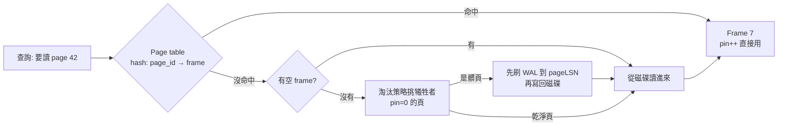

# 第 27 堂：Buffer pool 管理

這堂在「資料庫系統」部分，承接第 23 堂（頁）、第 24～25 堂（索引結構）和第 26 堂（WAL）：資料庫的頁都住在磁碟上，但所有讀寫其實都發生在記憶體裡的 **buffer pool**。這堂講它怎麼決定「哪些頁留在記憶體、哪些頁趕出去、髒頁什麼時候寫回」，這幾乎決定了一個資料庫的效能上限。它也直接呼應作業系統篇的第 4～6 堂（分頁、page fault、page cache），可以說是資料庫自己重做了一套虛擬記憶體。

## 0. 上一堂測驗答案

1. **synchronous_commit = off**：commit 時 WAL 只放進記憶體就回覆成功，背景 WAL writer 稍後（約 600 ms 內）再 fsync。當機時**可能遺失最後一小段已回覆成功的交易**，但 WAL 順序完整，恢復後資料庫是一致的。**fsync = off**：完全不 fsync，WAL 和資料頁的落盤順序交給作業系統，WAL 兩條鐵律都失效，斷電後可能**資料檔損壞、索引和表不一致，甚至叢集起不來**，只能從備份還原。前者對日誌、點擊事件可以接受；後者正式環境絕對不行。付款資料：全域保持 on，只在寫日誌的連線或交易裡 `SET LOCAL synchronous_commit = off`。
2. **Analysis**：從 checkpoint（LSN 50）開始，T1 在 60 commit、T3 在 100 commit → **winner = T1、T3；loser = T2**（lastLSN 70）；P3 加入 DPT（recLSN 90）。**Redo** 從 DPT 最小 recLSN = **20** 開始：LSN 20 跳過（P1.pageLSN=20）；LSN 40 **重做** B=80（P2.pageLSN=0）；LSN 70 **重做** C=9（loser 也要重演歷史）；LSN 90 跳過。**Undo** T2：先復原 70（C 9→5），寫 **CLR 110**（undoNextLSN=40）；再復原 40（B 80→50），寫 **CLR 120**；最後寫 **T2 END**。最終 A=200、B=50、C=5、D=2。
3. 不安全。`f.Write` 只寫進 page cache：容器被 SIGKILL 通常還好（page cache 屬於核心），但**主機斷電、VM 當機**時已回 200 的資料會消失，還可能留下寫到一半的尾巴。修正：回 200 前 `f.Sync()`；每筆加長度與 CRC32，啟動時截斷壞尾巴；rotate/rename 時也 fsync 目錄。吞吐量用 **group commit** 拿回來：一個 goroutine 專門 fsync，一次 fsync 讓一批請求一起回覆；也可以讓客戶端批次寫、換低延遲磁碟。

## 1. 為什麼資料庫要自己管記憶體？

磁碟（就算是 NVMe）比記憶體慢上百到上千倍。資料庫在啟動時向作業系統要一大塊記憶體，切成許多和磁碟頁一樣大的格子，叫做 **frame**（PostgreSQL 每格 8 KB，InnoDB 16 KB）。這整塊就是 buffer pool。

你可能會問：作業系統不是已經有 page cache（第 6 堂）了嗎？資料庫直接 `read()` 讓核心幫忙快取不就好？資料庫自己管的理由有四個：

| 原因 | 說明 |
|---|---|
| **WAL 規則** | 髒頁寫回磁碟前，必須先把 WAL 刷到該頁的 pageLSN（第 26 堂鐵律 1）。作業系統不懂 LSN，可能隨時把髒頁寫出去。 |
| **更懂存取模式** | 資料庫知道「這是全表掃描、只讀一次」或「這是 B+Tree 根節點、每次都會用」，可以用更聰明的淘汰策略。 |
| **控制寫回時機** | 自己決定何時 flush、何時做 checkpoint，避免 I/O 尖峰。 |
| **預讀與鎖** | 可以按執行計畫預讀，並在頁上加 latch 保護併發存取。 |

這也是第 5 堂提過「為什麼很多資料庫不用 mmap」的原因：mmap 把淘汰和寫回的控制權交給核心，資料庫就很難保證 WAL 順序。

## 2. Buffer pool 的四個零件



1. **Frame 陣列**：真正放頁內容的記憶體。
2. **Page table**：一個雜湊表，`page_id → frame 編號`。注意它和作業系統的頁表（第 4 堂）不同，這是資料庫在使用者態自己維護的。
3. **每個 frame 的中繼資料**：
   - **pin count**：現在有幾個執行緒正在用這頁。大於 0 時**絕對不能淘汰**，否則別人正在讀的記憶體會被換掉。
   - **dirty flag**：這頁在記憶體裡被改過、還沒寫回磁碟。
   - **pageLSN**：最後一次修改的 LSN，用來遵守 WAL 規則。
4. **淘汰策略（replacement policy）**：沒有空 frame 時，挑一個 pin count = 0 的頁趕出去。

用起來的 API 就像這樣（很像你在 C# 裡用 `using` 或 Go 裡用 `defer` 管資源）：

```go
page, err := bp.FetchPage(42) // pin++
if err != nil { return err }
defer bp.UnpinPage(42, dirty) // pin--，並告訴它有沒有改過
// ... 讀寫 page.Data ...
```

## 3. 淘汰策略：LRU 為什麼不夠好

**LRU（最近最少使用）**：把最久沒用的頁趕出去。直覺又簡單，但資料庫有一個致命場景：**sequential flooding（循序氾濫）**。

想像 buffer pool 有 10 GB，熱門的使用者表和索引佔了 3 GB，天天被 API 讀。這時有人跑一個報表，全表掃描一張 200 GB 的日誌表。每一頁都只讀一次，但每讀一頁就變成「最近使用」，結果 LRU 把熱門的 3 GB 全部擠出去，換成一堆再也不會被讀的日誌頁。報表跑完，API 的每次查詢都變成磁碟 I/O，延遲暴增。

各家的解法：

### Clock（時鐘演算法）— PostgreSQL 的做法

LRU 每次存取都要調整鏈結串列，在高併發下要搶鎖。Clock 是便宜的近似版：所有 frame 排成一圈，每格有一個計數（PostgreSQL 叫 `usage_count`，上限 5）。

- 頁被存取：`usage_count++`（最多到 5）。
- 要淘汰時：時鐘指針繞圈走，遇到 `usage_count > 0` 就減 1 放過它，遇到 0 且沒被 pin 的就淘汰。

常用的頁計數高，要被繞好幾圈才會掉到 0；只用過一次的頁很快就被收走。

PostgreSQL 再加一招：當全表掃描的表大於 shared_buffers 的 1/4 時，改用一個很小的 **ring buffer**（約 256 KB）重複使用，掃描再大也不會污染整個 buffer pool。VACUUM、COPY 也有類似機制。

### Midpoint insertion — InnoDB 的做法

InnoDB 把 LRU 串列切成兩段：前 5/8 是 **young**（熱區），後 3/8 是 **old**（冷區，`innodb_old_blocks_pct = 37`）。

- 新讀進來的頁**插在中間點**，也就是 old 區的頭，而不是整條串列的頭。
- 頁在 old 區待超過 `innodb_old_blocks_time`（預設 1000 ms）後**再被存取**，才升到 young 區。

全表掃描時，一頁在短時間內被連續讀幾次（一頁裡有很多列），但過了 1 秒就再也不碰，所以永遠升不上 young 區，熱資料就保住了。

### LRU-K

記錄每頁最近 K 次（通常 K=2）存取的時間，用「倒數第 K 次存取」來判斷冷熱。只被存取過一次的頁，第 2 次存取時間視為無限久以前，最先被淘汰。這和 InnoDB 的思路一樣：**只用過一次的不算熱**。

這個觀念你在應用層也用得到：C# 的 `MemoryCache`、Go 的 `hashicorp/golang-lru`（它就有 2Q 和 ARC 這類「抗掃描」的變體），遇到「批次任務把快取洗掉」的問題，用的都是同一套解法。

## 4. 髒頁什麼時候寫回？

如果只在「要淘汰時才寫回髒頁」，查詢執行緒就得先等一次磁碟寫入，才能讀它要的頁，延遲變很差。所以資料庫有背景角色預先清理：

- **Background writer**（PostgreSQL 的 bgwriter、InnoDB 的 page cleaner 執行緒）：持續把快要被淘汰的髒頁先寫回，讓查詢需要 frame 時多半能直接拿到乾淨頁。
- **Checkpoint**：定期把所有髒頁寫回並記錄 checkpoint，縮短當機後 redo 的範圍（第 26 堂）。PostgreSQL 用 `checkpoint_completion_target`（預設 0.9）把寫入攤平在整個 checkpoint 週期，避免 I/O 尖峰。
- **WAL 規則永遠成立**：任何髒頁寫回前，WAL 必須已經刷到該頁的 pageLSN。

這正是第 26 堂 **Steal + No-Force** 的實作現場：Steal = 沒 commit 的髒頁也可以被寫回（因為有 undo）；No-Force = commit 時不必寫回資料頁（因為有 redo）。

## 5. 雙重快取：PostgreSQL vs InnoDB 的不同哲學

| | PostgreSQL | InnoDB（MySQL） |
|---|---|---|
| 讀寫檔案 | 一般 buffered I/O，**同時**用作業系統 page cache | 通常設 `innodb_flush_method = O_DIRECT`，**繞過** page cache |
| 建議大小 | `shared_buffers` ≈ 實體記憶體的 **25%** | `innodb_buffer_pool_size` ≈ 專用機記憶體的 **50～80%** |
| 理由 | 剩下的記憶體留給 OS page cache 當第二層快取 | 不靠 OS 快取，避免同一頁在記憶體存兩份 |

AWS RDS 的參數群組預設也反映了這點：PostgreSQL 的 `shared_buffers` 預設約為執行個體記憶體的 1/4，MySQL 的 `innodb_buffer_pool_size` 預設約為 3/4。

**Docker 實務提醒**：在容器裡跑資料庫時，cgroup 的記憶體上限（第 12 堂）會把 buffer pool、每個連線的工作記憶體（PostgreSQL 的 `work_mem` 會依排序/雜湊節點與連線數倍增）和 page cache 都算進去。把 shared_buffers 設成接近容器上限，很容易被 OOM killer 收掉。

## 6. 小例子：Go 寫一個最小 buffer pool（Clock 淘汰）

```go
type Frame struct {
    pageID int
    data   [8192]byte
    pin    int
    dirty  bool
    usage  int   // Clock 用
    pageLSN uint64
}

type BufferPool struct {
    mu     sync.Mutex
    frames []Frame
    table  map[int]int // pageID -> frame index
    hand   int         // 時鐘指針
    disk   Disk
    wal    WAL
}

func (bp *BufferPool) FetchPage(id int) (*Frame, error) {
    bp.mu.Lock()
    defer bp.mu.Unlock()
    if i, ok := bp.table[id]; ok { // 命中
        f := &bp.frames[i]
        f.pin++
        if f.usage < 5 { f.usage++ }
        return f, nil
    }
    i, err := bp.victim() // 沒命中，找犧牲者
    if err != nil { return nil, err }
    f := &bp.frames[i]
    if f.dirty {
        bp.wal.FlushUpTo(f.pageLSN)        // WAL 規則：先刷日誌
        bp.disk.Write(f.pageID, f.data[:]) // 再寫回頁
    }
    delete(bp.table, f.pageID)
    bp.disk.Read(id, f.data[:])
    *f = Frame{pageID: id, data: f.data, pin: 1, usage: 1}
    bp.table[id] = i
    return f, nil
}

func (bp *BufferPool) victim() (int, error) {
    for n := 0; n < len(bp.frames)*6; n++ { // 最多繞 6 圈
        f := &bp.frames[bp.hand]
        i := bp.hand
        bp.hand = (bp.hand + 1) % len(bp.frames)
        if f.pin > 0 { continue }   // 正在被用，不能動
        if f.usage > 0 { f.usage--; continue }
        return i, nil
    }
    return -1, errors.New("所有 frame 都被 pin 住了")
}
```

（真實系統會用細粒度的 latch 取代一把大鎖，並在鎖外做磁碟 I/O，這裡為了好讀簡化了。）

## 7. 動手看看：PostgreSQL 的 buffer pool

```bash
docker run --name pg -e POSTGRES_PASSWORD=pw -d postgres:16
docker exec -it pg psql -U postgres
```

```sql
SHOW shared_buffers;                 -- 預設 128MB
CREATE TABLE t AS SELECT g AS id, md5(g::text) AS v FROM generate_series(1, 1000000) g;

-- 看一次查詢命中多少頁、從磁碟讀了多少頁
EXPLAIN (ANALYZE, BUFFERS) SELECT count(*) FROM t;
-- 輸出中的 "Buffers: shared hit=... read=..."，再跑一次 hit 會變多

-- 整個資料庫的命中率
SELECT datname, blks_hit, blks_read,
       round(blks_hit * 100.0 / nullif(blks_hit + blks_read, 0), 2) AS hit_pct
FROM pg_stat_database WHERE datname = 'postgres';

-- 看 buffer pool 裡現在放了哪些表
CREATE EXTENSION pg_buffercache;
SELECT c.relname, count(*) AS buffers, sum(b.usage_count) AS usage
FROM pg_buffercache b JOIN pg_class c ON b.relfilenode = pg_relation_filenode(c.oid)
GROUP BY c.relname ORDER BY buffers DESC LIMIT 5;
```

一般 OLTP 系統的命中率應該在 99% 左右。如果明顯偏低，代表工作集（經常存取的資料）比 buffer pool 大，或者有大掃描在污染快取。

**暖機**：資料庫重啟後 buffer pool 是空的（冷快取），前幾分鐘會很慢。InnoDB 預設會在關機時把頁清單存下來、開機時重新載入（`innodb_buffer_pool_dump_at_shutdown` / `load_at_startup`）；PostgreSQL 可以用 `pg_prewarm` 擴充做到。做藍綠部署或 failover 時，這點常是「切過去後前幾分鐘 API 很慢」的元兇。

## 8. 一句話總結

**Buffer pool 是資料庫自己的虛擬記憶體：用 page table 找頁、用 pin count 保護正在用的頁、用 dirty flag 和 WAL 規則決定怎麼安全寫回，用 Clock、midpoint LRU 這類「抗掃描」的淘汰策略保住熱資料，再用背景寫入和 checkpoint 把 I/O 攤平。**

## 9. 小測驗

1. 每天凌晨 2 點有個報表任務對一張 200 GB 的 `events` 表做全表掃描，跑完後早上 API 查使用者資料的延遲明顯變高，要一陣子才恢復。請用這堂的觀念解釋原因。如果資料庫是 InnoDB，哪個機制本來應該擋住這個問題？在什麼情況下它會失效？你還能從架構上怎麼解決？
2. 你在一台 16 GB 的 VM 上用 Docker 跑資料庫，容器記憶體上限設 12 GB。同事提議「PostgreSQL 的 shared_buffers 設 10 GB，越大越快」，另一位說「MySQL 的 innodb_buffer_pool_size 設 10 GB 很合理」。為什麼兩者的建議比例不同？這兩個提議各有什麼風險？你會怎麼設？
3. 你照第 6 節的 Go 程式寫了 buffer pool，上線壓測時出現兩個問題：(a) 一段時間後所有請求都回「所有 frame 都被 pin 住了」；(b) 有人為了加速，把 `victim` 之後的 `bp.wal.FlushUpTo(f.pageLSN)` 拿掉，平常看起來都正常。分別說明原因與後果，以及該怎麼修。

<details><summary>參考答案</summary>

1. **原因**：全表掃描把 200 GB 的頁一頁頁讀進 buffer pool，若淘汰策略是單純 LRU，每頁都變成「最近使用」，把熱門的使用者表和索引頁擠出去（sequential flooding）。早上 API 查詢都變成磁碟 I/O，直到熱資料被慢慢讀回來才恢復。**InnoDB 的防線**是 midpoint insertion：新頁先進 old 區，要在 old 區待超過 `innodb_old_blocks_time`（預設 1000 ms）後再被存取才升到 young 區；全表掃描每頁只在短時間內被連讀幾次，升不上去。**失效情況**：`innodb_old_blocks_time` 被設成 0；掃描很慢（例如每列都做複雜運算或巢狀迴圈 join），同一頁隔超過 1 秒又被讀到；報表反覆掃同一批資料；或掃描的其實是熱門表本身。PostgreSQL 則有 ring buffer，但如果表小於 shared_buffers 的 1/4、或是索引掃描大量隨機頁，一樣會污染。**架構解法**：報表改跑在**唯讀副本**（第 34 堂）或資料倉儲（例如把資料同步到 BigQuery / Redshift）；用彙總表或增量計算避免每天全掃；替 `events` 做時間分區（第 35 堂）只掃需要的分區；跑完後必要時用 `pg_prewarm` 暖回熱表。
2. **比例不同**：PostgreSQL 用 buffered I/O，同時依賴作業系統 page cache 當第二層快取，所以 shared_buffers 建議約 25%，其餘留給 OS 快取和連線記憶體；設太大會讓同一頁在 shared_buffers 和 page cache 各存一份（雙重快取），浪費記憶體。InnoDB 通常用 O_DIRECT 繞過 page cache，所以可以把專用機記憶體的 50～80% 給 buffer pool。**風險**：PostgreSQL 設 10 GB，容器剩約 2 GB 要給每個連線的 `work_mem`（可能因排序/雜湊節點和連線數倍增）、maintenance_work_mem、程序本身與 page cache，很容易被 cgroup 的 OOM killer 殺掉，而且 checkpoint 時要寫回的髒頁也變多。MySQL 設 10 GB 在 12 GB 容器上偏緊：還有每連線緩衝（sort/join buffer）、redo log buffer、執行緒堆疊等，連線一多一樣會 OOM。**建議**：PostgreSQL 約 3 GB（容器上限的 25%），搭配限制連線數（或用 PgBouncer）並保守設定 work_mem；MySQL 約 7～8 GB（容器上限的 60～70%），確認 O_DIRECT，再看監控（命中率、OOM 事件、swap）調整。兩者都要讓設定以**容器上限**而不是主機記憶體為準。
3. **(a)** 某條程式路徑在 `FetchPage` 之後沒有 `UnpinPage`（例如錯誤提早 return 沒用 defer、或在迴圈裡 Fetch 卻在迴圈外才 Unpin），pin count 只增不減，frame 永遠不能淘汰，等於 **pin 洩漏**，最後所有 frame 都被佔住。這和忘記 `Dispose`、忘記關 Go 的 `resp.Body` 是同一類資源洩漏。修法：Fetch 之後立刻 `defer Unpin`，或用 `WithPage(id, func(p *Frame) error)` 這種包裝讓呼叫端不可能忘；加 pin count 監控與測試（測試結束時斷言所有 pin = 0）；另外 `victim` 失敗時應該等待或回報可重試的錯誤，而不是讓服務整個卡死。**(b)** 拿掉後違反 WAL 鐵律 1：髒頁可能比描述它的日誌先寫到磁碟。平常不當機就沒事，所以「看起來正常」。但如果寫回髒頁後、WAL 刷盤前當機，磁碟上會有一頁含有**未 commit 交易的修改**，而 WAL 裡卻沒有對應記錄，ARIES 無法 undo（不知道舊值），也無法判斷頁的狀態，導致資料不一致甚至頁損壞。修法：放回 `FlushUpTo(pageLSN)`；效能靠 group commit、背景 writer 預先清理髒頁（讓淘汰時多半挑到乾淨頁或日誌早已刷過的頁）來解決，而不是拿掉安全保證。

</details>
