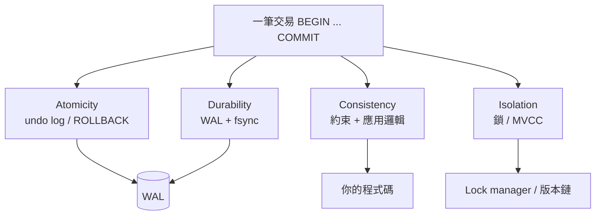
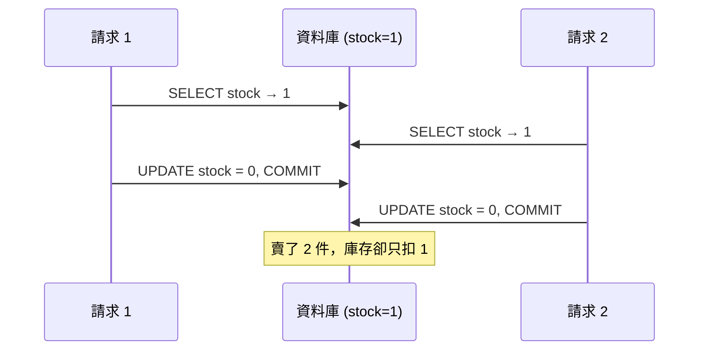

# 第 28 堂：交易 ACID

這堂在「資料庫系統」部分，從「單一頁怎麼存、怎麼恢復」（第 23～27 堂）往上走一層，進入**交易（transaction）**。前面學的 WAL、buffer pool 是零件；ACID 是資料庫拿這些零件對你許下的四個承諾。接下來第 29～31 堂（隔離等級、2PL、MVCC）都是在展開其中的 **I**，第 36 堂的 2PC 則是把同樣的承諾擴大到多台機器。

## 0. 上一堂測驗答案

1. **原因**：全表掃描把 200 GB 的頁一頁頁讀進 buffer pool，若是單純 LRU，每頁都變成「最近使用」，把熱門的使用者表和索引頁擠出去（sequential flooding），早上 API 查詢都變成磁碟 I/O，要等熱資料慢慢讀回來。**InnoDB 的防線**是 midpoint insertion：新頁先進 old 區，要在 old 區待超過 `innodb_old_blocks_time`（預設 1000 ms）後再被存取才升到 young 區。**失效情況**：該參數被設成 0；掃描很慢，同一頁隔超過 1 秒又被讀到；報表反覆掃同一批資料；或掃的其實就是熱門表。**架構解法**：報表改跑在唯讀副本或資料倉儲；用彙總表或增量計算；替 `events` 做時間分區只掃需要的分區；必要時用 `pg_prewarm` 暖回熱表。
2. **比例不同**：PostgreSQL 用 buffered I/O，還依賴 OS page cache 當第二層快取，所以 shared_buffers 建議約 25%，設太大會雙重快取；InnoDB 通常用 O_DIRECT 繞過 page cache，可給 50～80%。**風險**：PG 設 10 GB，剩約 2 GB 給每連線的 work_mem、maintenance_work_mem 和 page cache，很容易被 cgroup OOM killer 殺掉；MySQL 設 10 GB 在 12 GB 容器上也偏緊（每連線 sort/join buffer、redo log buffer、執行緒堆疊）。**建議**：PG 約 3 GB 並限制連線數（PgBouncer）；MySQL 約 7～8 GB；兩者都以**容器上限**而非主機記憶體為準。
3. **(a)** `FetchPage` 之後某條路徑沒有 `UnpinPage`（錯誤提早 return、沒用 defer），pin count 只增不減，等於 **pin 洩漏**，跟忘記 `Dispose` 或忘記關 `resp.Body` 同類。修法：Fetch 後立刻 `defer Unpin`，或用 `WithPage(id, func(p *Frame) error)` 包裝；測試結束時斷言所有 pin = 0。**(b)** 違反 WAL 鐵律 1：髒頁可能比它的日誌先落盤。若此時當機，磁碟上會有未 commit 的修改卻沒有對應日誌，ARIES 無法 undo。修法：放回 `FlushUpTo(pageLSN)`，效能靠 group commit 和背景 writer 預先清理髒頁。

## 1. 交易是什麼？

**交易 = 一組讀寫操作，資料庫保證它們「要嘛全部生效、要嘛全部當沒發生」，而且不會被別人看到做到一半的樣子。**

經典例子：A 轉 100 元給 B。

```sql
BEGIN;
UPDATE accounts SET balance = balance - 100 WHERE id = 'A';
UPDATE accounts SET balance = balance + 100 WHERE id = 'B';
COMMIT;
```

如果第一句做完、第二句之前程序崩潰、斷電、或者第二句違反約束，沒有交易的話 A 的錢就憑空消失了。交易讓你可以把「一連串步驟」當成「一個不可分割的動作」來思考。

## 2. ACID 四個字母，各由誰負責

| 字母 | 承諾 | 白話 | 底層靠什麼 |
|---|---|---|---|
| **A** Atomicity 原子性 | 全有或全無 | 失敗就回到交易開始前，不留半套 | WAL 的 **undo**（第 26 堂 ARIES 的 undo 階段、CLR） |
| **C** Consistency 一致性 | 從一個合法狀態到另一個合法狀態 | 約束、外鍵、唯一性、你的業務規則不被破壞 | 資料庫檢查約束 **＋ 應用程式邏輯** |
| **I** Isolation 隔離性 | 併發交易互不干擾 | 好像一個一個排隊執行 | 鎖（2PL，第 30 堂）或 MVCC（第 31 堂） |
| **D** Durability 持久性 | commit 後就不會丟 | 回你「成功」之後，斷電也還在 | WAL 先寫、commit 時 **fsync**（第 26 堂鐵律 2） |



一個常被說破的小祕密：**C 其實不太算資料庫的性質**。A、I、D 是資料庫的機制；C 是「你定義什麼叫合法」，資料庫只能幫你檢查你有宣告的約束（`CHECK balance >= 0`、外鍵、UNIQUE）。如果你的規則是「一個使用者同時只能有一張有效訂單」卻沒寫成約束，資料庫不會知道。

## 3. A：原子性怎麼做到

交易修改頁的時候，buffer pool 裡的頁會先被改掉（甚至可能因為 steal 策略被寫回磁碟），但每一次修改都先在 WAL 裡寫下「舊值→新值」。

- **使用者 ROLLBACK 或語句出錯**：沿著這筆交易的日誌鏈（prevLSN）往回，把每個修改復原，並寫 CLR。
- **當機**：重啟時 ARIES 的 analysis 找出 loser 交易，redo 重演歷史後再 undo 掉 loser。

所以原子性和持久性其實是**同一份 WAL 的兩面**：redo 保證 D，undo 保證 A。

PostgreSQL 有點不同：它不就地覆寫，而是寫新版本的 tuple，舊版本還在。ROLLBACK 只需要在 commit log（`pg_xact`）把這個交易 ID 標成 aborted，新版本自然變成「看不見」，之後由 VACUUM 清理。這是第 31 堂 MVCC 的伏筆。

## 4. D：持久性的真正邊界

第 26 堂說過：commit 回來之前，WAL 必須 fsync 到磁碟。但「持久」有層次：

| 層級 | 能撐過什麼 | 例子 |
|---|---|---|
| 只在記憶體 | 什麼都撐不過 | Redis 預設沒有開 AOF |
| 寫進 OS page cache | 程序崩潰 | `synchronous_commit = off` |
| fsync 到本機磁碟 | 斷電、核心崩潰 | PostgreSQL / InnoDB 預設 |
| 同步複寫到另一台 | 整台機器或磁碟壞掉 | PG `synchronous_standby_names`、雲端 Multi-AZ |

雲端實務：AWS RDS Multi-AZ、Azure SQL 的 zone-redundant 就是在 D 上多加一層「同步寫到另一個可用區才回 commit」，代價是每次 commit 多一次跨可用區的往返（通常在 1～2 ms 量級）。第 34 堂會細講。

## 5. I：隔離性為什麼最難

如果每筆交易都排隊一個一個跑（**serial execution**），隔離性自然完美，但效能很差。真實資料庫要讓交易併發執行，又要讓結果「看起來像」某種排隊順序，這叫**可序列化（serializable）**。

做不到完美時，會出現各種**異常**。先看一個你一定在程式裡寫過的 bug：

```csharp
// C# + EF Core：庫存扣減
var item = await db.Items.FindAsync(id);   // 讀到 stock = 1
if (item.Stock > 0) {
    item.Stock -= 1;                        // 兩個請求都覺得還有貨
    db.Orders.Add(new Order { ItemId = id });
    await db.SaveChangesAsync();
}
```

兩個請求同時進來，都讀到 `stock = 1`，都扣成 0，結果賣出兩件。這叫 **lost update（遺失更新）**。即使 `SaveChangesAsync` 內部有交易，在預設的 Read Committed 下照樣會發生，因為「讀」和「寫」之間別人插隊了。



三種常見修法，下一堂會講它們分別對應什麼隔離等級：

1. **讓資料庫做原子更新**：`UPDATE items SET stock = stock - 1 WHERE id = @id AND stock > 0`，看影響列數是否為 1。最簡單也最快。
2. **悲觀鎖**：`SELECT ... FOR UPDATE`，第二個交易會等第一個 commit。
3. **樂觀鎖**：加一個 `version` 欄位（EF Core 的 `[ConcurrencyCheck]` / `[Timestamp] RowVersion`），`UPDATE ... WHERE id=@id AND version=@v`，影響 0 列就重試。

## 6. 交易在程式裡長什麼樣

**Go（database/sql）**：

```go
func Transfer(ctx context.Context, db *sql.DB, from, to string, amt int64) error {
    tx, err := db.BeginTx(ctx, &sql.TxOptions{Isolation: sql.LevelSerializable})
    if err != nil {
        return err
    }
    defer tx.Rollback() // commit 成功後再呼叫 Rollback 只會回 ErrTxDone，安全

    res, err := tx.ExecContext(ctx,
        "UPDATE accounts SET balance = balance - $1 WHERE id = $2 AND balance >= $1", amt, from)
    if err != nil {
        return err
    }
    if n, _ := res.RowsAffected(); n != 1 {
        return errors.New("餘額不足")
    }
    if _, err := tx.ExecContext(ctx,
        "UPDATE accounts SET balance = balance + $1 WHERE id = $2", amt, to); err != nil {
        return err
    }
    return tx.Commit()
}
```

重點：

- `defer tx.Rollback()`：任何提早 return 都會自動回滾，跟上一堂 `defer Unpin` 是同一個模式。
- 交易綁在**同一條連線**上。在 `tx` 之外用 `db.Exec` 的語句跑在別的連線、不在交易裡，這是很常見的 bug。
- 用 Serializable 時，資料庫可能回 `40001 serialization_failure`，**呼叫端要準備好整筆重試**。

**C#（EF Core）**：`SaveChanges()` 本身就包一個交易；要跨多次 SaveChanges 才需要 `await using var tx = await db.Database.BeginTransactionAsync();`。也可用 `TransactionScope`，但小心它碰到多條連線時可能升級成分散式交易，那就是第 36 堂 2PC 的世界了。

## 7. 交易的代價與實務陷阱

| 陷阱 | 為什麼糟糕 | 怎麼避免 |
|---|---|---|
| **長交易** | 持有鎖不放、阻擋 VACUUM 清舊版本（PG 表膨脹）、InnoDB undo log 越長越大 | 交易裡不要呼叫外部 API、不要等使用者輸入 |
| **交易裡打 HTTP** | 外部服務慢 3 秒，你的鎖就鎖 3 秒；外部成功、DB rollback 會不一致 | 先 commit 再發，或用 **outbox pattern** |
| **Autocommit 誤解** | 不寫 BEGIN 時每句都是獨立交易，兩句之間可被插隊 | 需要一起成功的操作明確包交易 |
| **以為交易能跨服務** | 微服務 A 的 DB 交易管不到服務 B 的 DB | Saga、outbox、冪等性（第 36 堂） |
| **連線池 + 交易洩漏** | 忘記 commit/rollback，連線帶著開啟的交易卡住 | Go 用 defer，C# 用 using |

**Outbox pattern** 一句話：在同一筆 DB 交易裡同時寫業務資料和一筆「待發送訊息」到 `outbox` 表；另一個背景程序讀 outbox 送到 Kafka/RabbitMQ，送成功再標記。這樣「改資料」和「發事件」靠本地交易的原子性綁在一起，不需要分散式交易。

## 8. 動手看看：用 Docker 觀察原子性與隔離

```bash
docker run --name pg -e POSTGRES_PASSWORD=pw -d postgres:16
# 開兩個終端機，各自進 psql
docker exec -it pg psql -U postgres
```

```sql
-- 準備
CREATE TABLE accounts(id text PRIMARY KEY, balance int CHECK (balance >= 0));
INSERT INTO accounts VALUES ('A', 100), ('B', 0);

-- 實驗 1：原子性 + 一致性（終端機 1）
BEGIN;
UPDATE accounts SET balance = balance + 150 WHERE id = 'B';
UPDATE accounts SET balance = balance - 150 WHERE id = 'A';  -- 違反 CHECK，報錯
COMMIT;                       -- PG 會回 ROLLBACK
SELECT * FROM accounts;       -- B 仍是 0：第一句也被撤銷了

-- 實驗 2：隔離（終端機 1）
BEGIN;
UPDATE accounts SET balance = balance - 10 WHERE id = 'A';
-- 先不要 commit，到終端機 2：
--   SELECT * FROM accounts;        → 看到 A 還是 100（看不到未 commit 的修改）
--   UPDATE accounts SET balance = balance - 20 WHERE id = 'A';  → 卡住等鎖
-- 回到終端機 1：
COMMIT;
-- 終端機 2 的 UPDATE 立刻完成，A 最後 = 70，沒有遺失更新
```

注意實驗 2 中終端機 2 的 `UPDATE` 會**重新讀最新值**再扣，所以結果正確；但如果它是先 `SELECT` 到應用程式、算完再 `UPDATE ... SET balance = 80`，就會是第 5 節的 lost update。差別就在「讀-改-寫」是不是在資料庫裡一句完成。

## 9. 一句話總結

**ACID 是資料庫的四個承諾：A 和 D 靠 WAL 的 undo/redo 與 fsync，I 靠鎖或 MVCC，C 則是資料庫約束加上你的程式邏輯共同守護；交易越短、越不碰外部系統，這些承諾就越便宜。**

## 10. 小測驗

1. 你的 Go 服務在一筆 DB 交易裡做三件事：扣庫存、建立訂單、呼叫金流 API 扣款（約 2 秒），全部成功才 commit。請指出這個設計在 ACID 的哪幾個面向、以及效能上會出問題（至少三點），並提出改進方案。
2. 同事說：「我們用的是 PostgreSQL，有 ACID，所以 EF Core 的『先讀庫存、判斷 > 0、再扣 1』不可能超賣。」這句話錯在哪裡？給出兩種不同的修法，並說明各自的取捨。
3. 公司把資料庫從單機 PostgreSQL 搬到 AWS RDS Multi-AZ，發現每秒寫入交易數（TPS）下降、p99 commit 延遲變高。用這堂對 D 的分層解釋原因；如果某些寫入（例如點擊紀錄）可以接受遺失最近幾百毫秒的資料，你會怎麼調整，而不影響訂單資料？
