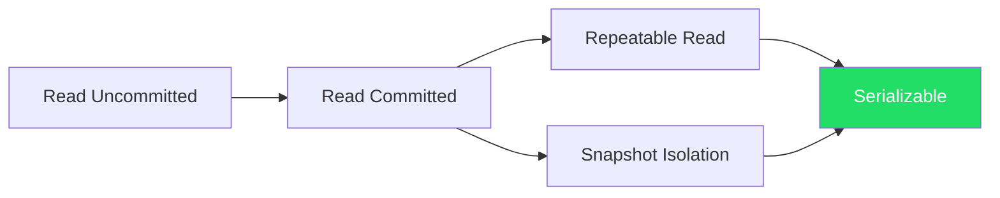

# 第 29 堂：隔離等級與異常現象

這堂在「資料庫系統」部分，把上一堂 ACID 裡最複雜的 **I（Isolation，隔離性）** 拆開來講。完美隔離（Serializable）很貴，所以資料庫提供好幾個「隔離等級」，讓你用一些**異常現象**換效能。第 30 堂（2PL 鎖）和第 31 堂（MVCC）會講這些等級在底層**怎麼做出來**；這堂先搞清楚它們**保證什麼、不保證什麼**。

## 0. 上一堂測驗答案

1. **問題**：(a) **I／鎖拿太久**：扣庫存的 UPDATE 拿了列鎖，要等金流 2 秒後才 commit，同一商品的其他請求全部排隊，熱門商品吞吐量掉到每秒約 0.5 筆；長交易也會擋住 PG 的 VACUUM。(b) **A 只是假象**：金流扣款不在 DB 交易裡。金流成功但 commit 失敗，就會扣了錢卻沒有訂單，rollback 撤不回外部扣款。(c) **連線池耗盡**：每筆請求佔住一條連線 2 秒以上，連無關的 API 也被拖垮。(d) 逾時重試又沒有冪等鍵，可能重複扣款。**改進**：拆成兩段短交易加狀態機：交易 1 預留庫存並建立 `pending` 訂單後 commit；在交易外帶**冪等鍵**呼叫金流；交易 2 把訂單改成 paid 或 cancelled。再搭配 outbox，用背景對帳處理逾時的訂單（Saga 補償）。
2. **錯在**：PG 預設是 **Read Committed**，不是 Serializable。「先讀進應用程式、判斷、再寫回計算後的值」會發生 lost update。**修法一**：原子條件更新 `UPDATE items SET stock = stock - 1 WHERE id=@id AND stock > 0`，再檢查影響列數。最快，但邏輯要能寫成一句 SQL。**修法二**：樂觀鎖（`RowVersion`），EF Core 遇到 `DbUpdateConcurrencyException` 就重試。邏輯可以留在 C#，但熱門商品會大量重試。其他做法還有 `SELECT ... FOR UPDATE`，或改用 Serializable 並重試。
3. **原因**：Multi-AZ 把 D 從「fsync 到本機」升級成「同步寫到另一個可用區」，每次 commit 多一次跨可用區往返，再加上網路磁碟的延遲。連線數固定時，commit 延遲變高就代表 TPS 下降。**調整**：只對點擊紀錄 `SET LOCAL synchronous_commit = off`，訂單維持預設；或批次寫入、先寫 Kafka/Kinesis 再匯入、放另一個資料庫。

## 1. 為什麼要有「等級」？

想像兩個交易同時跑。最安全的保證是：**結果跟它們「一個接一個」執行完全一樣**，這叫 **Serializable（可序列化）**。但要做到這點，資料庫得大量加鎖或中止衝突交易，吞吐量會下降。

所以 SQL 標準定義了四個等級：越往上越寬鬆、越快，但會允許更多「怪事」。這些怪事就叫**異常現象（anomaly）**。

## 2. 異常現象圖鑑

用銀行和庫存的例子，一次認識所有主角。T1、T2 是兩個並行交易。

### (1) Dirty Read 髒讀

讀到別人**還沒 commit**的資料，對方後來 rollback，你就讀到了「從沒存在過」的值。

```
T1: UPDATE A = 0（未 commit）
T2: SELECT A  → 0   ← 讀到髒資料
T1: ROLLBACK        ← A 其實還是 100
```

### (2) Non-repeatable Read 不可重複讀

同一個交易裡讀**同一列**兩次，結果不一樣，因為中間有人改了並 commit。

```
T1: SELECT balance FROM A → 100
T2: UPDATE A = 50; COMMIT
T1: SELECT balance FROM A → 50   ← 同一交易內前後不一致
```

### (3) Phantom 幻讀

同一個**範圍查詢**跑兩次，多出（或少了）幾列，因為有人插入或刪除了符合條件的資料。

```
T1: SELECT count(*) FROM orders WHERE day='today' → 10
T2: INSERT INTO orders(day) VALUES('today'); COMMIT
T1: SELECT count(*) ... → 11   ← 冒出一個「幽靈」
```

和不可重複讀的差別：不可重複讀是**既有的列被改了**；幻讀是**集合的成員變了**。鎖住已經讀過的列擋不了幻讀，因為新列在你讀的時候還不存在。

### (4) Lost Update 遺失更新

上一堂的主角。兩個交易都「讀 → 在應用程式裡算 → 寫回」，後寫的蓋掉先寫的。

```
T1: 讀 stock = 1        T2: 讀 stock = 1
T1: 寫 stock = 0        T2: 寫 stock = 0   ← 賣了兩件，庫存只扣一次
```

### (5) Write Skew 寫入偏斜（最陰險）

兩個交易讀**同一組條件**，各自改**不同的列**，單獨看都沒錯，合起來卻違反規則。

經典例子：醫院規定「至少要有 1 位醫生值班」。Alice 和 Bob 都在值班，兩人同時請假：

```
T1(Alice): SELECT count(*) WHERE on_call → 2，OK，可以請假
T2(Bob):   SELECT count(*) WHERE on_call → 2，OK，可以請假
T1: UPDATE doctors SET on_call=false WHERE name='Alice'; COMMIT
T2: UPDATE doctors SET on_call=false WHERE name='Bob';   COMMIT
→ 0 人值班！
```

兩個交易改的是不同列，所以沒有寫入衝突，列鎖或「先寫贏」的規則都擋不住。只有 Serializable 能擋。

### (6) Read Skew 讀取偏斜

讀到「一半舊、一半新」的組合。例如 A→B 轉帳中，你先讀了轉帳前的 A，再讀轉帳後的 B，總額看起來多了 100。做備份、報表、對帳時特別危險。

## 3. 四個隔離等級 × 異常現象

| 隔離等級 | 髒讀 | 不可重複讀 | 幻讀 | 遺失更新 | 寫入偏斜 |
|---|---|---|---|---|---|
| Read Uncommitted | 可能 | 可能 | 可能 | 可能 | 可能 |
| Read Committed | ✗ | 可能 | 可能 | 可能 | 可能 |
| Repeatable Read（標準定義） | ✗ | ✗ | 可能 | ✗* | 可能 |
| **Snapshot Isolation**（不在 SQL 標準內） | ✗ | ✗ | ✗ | ✗ | **可能** |
| Serializable | ✗ | ✗ | ✗ | ✗ | ✗ |

\* 依實作而定，見下一節。



越往右越安全、越貴。注意 RR 和 SI 是**兩條不同的路**：SI 擋得住幻讀但擋不住寫入偏斜，彼此不是上下級。

## 4. 真實世界：同一個名字，不同的意思

SQL 標準是 1992 年以「鎖」為前提寫的，後來 MVCC 普及，各家的實作就跟名字對不上了。**這是面試和線上事故最常踩的坑。**

| 資料庫 | 預設等級 | 你以為的 | 實際上 |
|---|---|---|---|
| **PostgreSQL** | Read Committed | — | 每**句**一個新快照。RR 其實是 **Snapshot Isolation**（擋幻讀，也會偵測遺失更新並回 40001 錯誤）。Serializable 是 **SSI**（可序列化快照隔離），真的會擋寫入偏斜。 |
| **MySQL InnoDB** | **Repeatable Read** | RR | 一般 SELECT 讀快照；但 `UPDATE`、`SELECT ... FOR UPDATE` 讀的是**最新值**並加 next-key lock（擋幻讀）。所以「快照讀」和「當前讀」混用時，會看到怪結果。遺失更新**不會**自動偵測。 |
| **SQL Server** | Read Committed（鎖版） | — | 開啟 `READ_COMMITTED_SNAPSHOT` 後才變成 MVCC 版（Azure SQL 預設開）；另有 `SNAPSHOT` 等級。 |
| **Oracle** | Read Committed | — | 它的「Serializable」其實是 Snapshot Isolation，擋不住寫入偏斜。 |

一句話：**看到 Repeatable Read，先問「哪一家的？」**

## 5. 連結你的實務

**C# / EF Core**

```csharp
using var tx = await db.Database.BeginTransactionAsync(IsolationLevel.Serializable);
// ... 讀取、判斷、寫入
await db.SaveChangesAsync();
await tx.CommitAsync();
```

`TransactionScope` 的預設是 **Serializable**（不是資料庫的預設），很多 .NET 專案不知不覺就背上了大量鎖等待和死結。用的時候要明確指定 `IsolationLevel`。

**Go / database/sql**

```go
tx, err := db.BeginTx(ctx, &sql.TxOptions{Isolation: sql.LevelSerializable})
// ...
if err := tx.Commit(); err != nil {
    var pgErr *pgconn.PgError
    if errors.As(err, &pgErr) && pgErr.Code == "40001" { // serialization_failure
        // 整個交易重來：重新讀、重新判斷
    }
}
```

**關鍵心法**：開了 Serializable（或 PG 的 RR），就**一定要寫重試迴圈**，而且重試的是「整個交易函式」，不是最後那句 SQL。沒有重試的 Serializable，只會把資料錯誤換成使用者看到的 500。

**擋寫入偏斜的三種做法**（不想全域開 Serializable 時）：

1. 對「條件涉及的列」加鎖：`SELECT ... FROM doctors WHERE on_call FOR UPDATE`
2. **把衝突實體化**：建一張 `shift` 表，每個班次一列，請假時都要 UPDATE 同一列，把寫入偏斜變成普通的寫入衝突
3. 用資料庫約束：exclusion constraint、唯一索引、trigger

## 6. 動手看看：用 Docker 重現寫入偏斜

```bash
docker run --name pg -e POSTGRES_PASSWORD=pw -d postgres:16
docker exec -it pg psql -U postgres   # 開兩個終端機
```

```sql
CREATE TABLE doctors(name text PRIMARY KEY, on_call bool);
INSERT INTO doctors VALUES ('alice', true), ('bob', true);

-- 兩個終端機都執行：
BEGIN ISOLATION LEVEL REPEATABLE READ;
SELECT count(*) FROM doctors WHERE on_call;   -- 都看到 2
-- 終端機 1：
UPDATE doctors SET on_call=false WHERE name='alice';
-- 終端機 2：
UPDATE doctors SET on_call=false WHERE name='bob';
-- 兩邊都 COMMIT → 成功！0 人值班（寫入偏斜）

-- 重置後，把 REPEATABLE READ 改成 SERIALIZABLE 再試一次：
-- 第二個 COMMIT 會得到
-- ERROR: could not serialize access due to read/write dependencies among transactions
```

這就是 PG 的 SSI 在幫你守門：它追蹤「誰讀了誰後來寫的東西」，發現形成危險的循環，就中止其中一個。

## 7. 怎麼選？實務建議

- **預設 Read Committed** 加上**原子 SQL**（`SET x = x - 1 WHERE ...`）或樂觀鎖，可以應付大多數 CRUD。
- **報表、備份、對帳**需要一致的畫面：用 Snapshot/RR 唯讀交易（避免讀取偏斜）。
- **金錢、庫存、排班這類「讀了才決定寫」的業務規則**：用 Serializable 加重試，或用 `FOR UPDATE`、實體化衝突。
- **千萬別用 Read Uncommitted** 來「加速」（SQL Server 的 `WITH (NOLOCK)` 就是它），它甚至可能讀到重複列或漏讀。

## 8. 一句話總結

**隔離等級就是用「允許哪些異常」換效能；名字在各家資料庫意思不同，寫入偏斜只有真正的 Serializable 擋得住，而用了 Serializable 就必須寫整個交易的重試。**

## 9. 小測驗

1. 你在 MySQL（預設 RR）寫了一個 C# 服務：交易裡先 `SELECT stock FROM items WHERE id=1`（得到 5），另一個交易這時把 stock 改成 0 並 commit，接著你的交易執行 `UPDATE items SET stock = stock - 1 WHERE id=1`，再 `SELECT stock`。最後 SELECT 會看到多少？為什麼「RR 保證可重複讀」在這裡好像失效了？
2. 會議室預約系統：交易先查「這間會議室 14:00–15:00 有沒有預約」，沒有就 INSERT 一筆。在 PostgreSQL 的 Read Committed 和 Repeatable Read 下，同時兩個請求會不會重複預約？這屬於哪一種異常？請給出**兩種**不靠全域 Serializable 的解法。
3. 你的團隊決定把 Go 服務的 PG 交易全部改成 Serializable「一勞永逸」。上線後錯誤率上升、p99 變高。請說明可能原因（至少兩點），以及你會怎麼調整程式和設計。

<details><summary>參考答案</summary>

1. **看到 -1**（0 - 1）。InnoDB 的一般 SELECT 是**快照讀**，交易第一次讀時建立 read view，之後都讀同一個舊版本（5），所以前兩次讀看起來可重複。但 `UPDATE` 是**當前讀**：它一定讀最新 commit 的值（0）並加鎖再扣，得到 -1。交易自己寫過的列，之後的快照讀會看到自己的版本，所以最後 SELECT 看到 -1。RR 保證的是「快照讀可重複」，不保證「當前讀和快照讀一致」。PG 的 RR（SI）在這種情況會直接回 40001 錯誤，讓你重試。防守方法：加 `CHECK (stock >= 0)` 約束、用 `WHERE stock > 0` 條件更新並檢查影響列數，或一開始就 `SELECT ... FOR UPDATE`。
2. **會**重複預約，兩個等級都會。這是**幻讀造成的寫入偏斜**：兩個交易查的是同一個「不存在的列」範圍，各自 INSERT 不同的新列，沒有任何列發生寫入衝突。RC 每句新快照擋不住；PG 的 RR 是 SI，同樣擋不住寫入偏斜。**解法**：(a) **排他約束**：`EXCLUDE USING gist (room WITH =, tstzrange(start_at, end_at) WITH &&)`，由資料庫保證時段不重疊，最可靠。(b) **實體化衝突**：預先建好「會議室 × 時段」的 slot 表，預約時 `SELECT ... FOR UPDATE` 或 `UPDATE slots SET booked_by=... WHERE booked_by IS NULL`，把幻讀變成同一列的寫入衝突。(c) 對該會議室那一列先 `SELECT ... FROM rooms WHERE id=? FOR UPDATE` 當作互斥鎖，也可以用 `pg_advisory_xact_lock(room_id)`。
3. **原因**：(a) **沒寫重試**：SSI 會主動中止有危險依賴的交易（40001），沒重試就直接變成 500。(b) **交易太長或範圍太大**：SSI 要追蹤讀過的範圍（predicate lock），全表掃描、長交易會讓誤判衝突變多，中止率上升；重試又增加負載，p99 跟著上升。(c) 混入外部呼叫或很慢的步驟，衝突窗口變大。(d) 少了合適的索引，predicate lock 升級成粗粒度鎖，衝突更多。**調整**：寫一個 `withTx(ctx, fn)` 包裝器，遇到 40001/40P01 就以指數退避加抖動重試整個 fn，並限制重試次數，fn 內不做有副作用的外部呼叫；只讀交易宣告 `READ ONLY`（PG 對只讀 Serializable 有優化，也可以用 `DEFERRABLE`）；交易縮短、補索引；只有真正需要的業務流程（金流、庫存、排班）才用 Serializable，其他維持 RC 加原子 SQL 或樂觀鎖；監控中止率。

</details>
