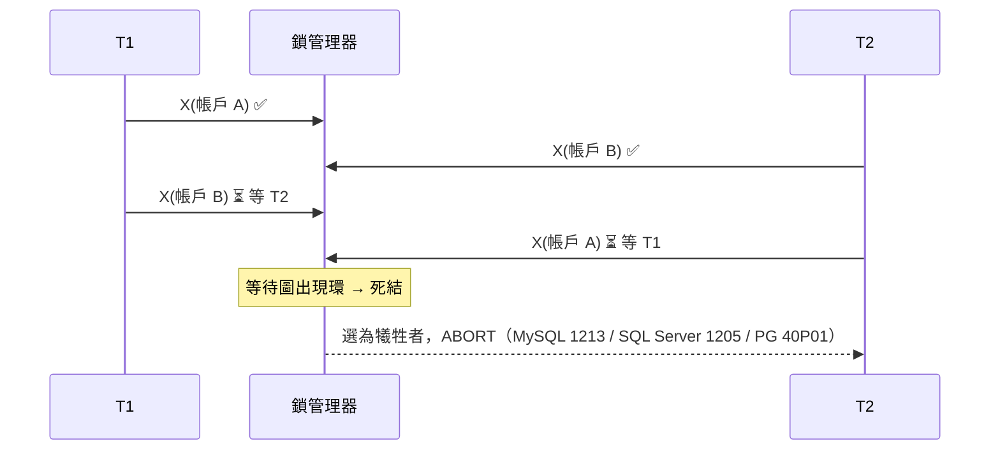

# 第 30 堂：兩階段鎖（2PL）

> **位置**：資料庫系統 → 交易與並行控制。上一堂講「隔離等級要擋哪些異常」，這一堂講第一種**實作手段**：用鎖來排隊。下一堂的 MVCC 是另一條路，兩者在 MySQL InnoDB、SQL Server 裡其實是混著用的。

## 0. 先公布第 29 堂測驗答案

1. **看到 -1**。InnoDB 的一般 SELECT 是**快照讀**（讀交易開始時的版本 5），但 `UPDATE` 是**當前讀**：它讀最新 commit 的值 0 再扣 1。交易寫過的列，之後自己讀會看到自己的版本，所以是 -1。RR 只保證「快照讀可重複」，不保證快照讀和當前讀一致。PG 的 RR 在這裡會直接報 40001 要你重試。防守：`CHECK (stock >= 0)`、`WHERE stock > 0` 並檢查影響列數，或一開始就 `SELECT ... FOR UPDATE`。
2. **會重複預約**，兩種等級都會。這是**幻讀造成的寫入偏斜**：兩邊查的是「不存在的列」，各自 INSERT 不同的新列，沒有任何列衝突。解法：(a) 排他約束 `EXCLUDE USING gist (room WITH =, tstzrange(start_at, end_at) WITH &&)`；(b) 把衝突實體化成「會議室 × 時段」slot 表，用 `FOR UPDATE` 或條件 UPDATE 搶同一列；(c) 先鎖會議室那一列（`SELECT ... FROM rooms WHERE id=? FOR UPDATE`）或用 `pg_advisory_xact_lock(room_id)`。
3. **原因**：沒寫重試，SSI 的 40001 直接變 500；交易太長、掃描範圍太大，predicate lock 誤判變多，重試又加重負載；交易裡混了外部呼叫；缺索引讓鎖變粗。**調整**：寫 `withTx` 包裝器，遇 40001/40P01 用指數退避加抖動重試整個函式；只讀交易宣告 `READ ONLY`；縮短交易、補索引；只有金流、庫存、排班才用 Serializable，其他用 RC 加原子 SQL 或樂觀鎖；監控中止率。

---

## 1. 問題：怎樣才算「排得好」的並行？

上一堂說過，**Serializable** 的意思是：多個交易並行跑完的結果，要等於**某一種**一個接一個跑的結果。資料庫要做的，是在不真的排成一列（那樣太慢）的情況下，保證這件事。

最直覺的做法：**動資料之前先上鎖**。但光是「有上鎖」不夠，看這個例子：

```
T1: lock(A) 讀 A=100 unlock(A)        lock(B) 寫 B=A+... unlock(B)
T2:                    lock(A) 寫 A=0 unlock(A)
```

T1 每次碰資料都有鎖，但它讀 A 之後就放鎖，T2 趁隙改了 A，T1 接著用舊值去寫 B。結果不等於任何序列順序。**問題在於：放了鎖之後又去拿新的鎖。**

## 2. 2PL 的規則：只有一條

> **一個交易一旦釋放了任何一把鎖，就不能再取得新的鎖。**

所以每個交易的生命自然分成兩段：

- **成長階段（growing）**：只拿鎖，不放鎖
- **收縮階段（shrinking）**：只放鎖，不拿鎖

```
持有鎖數
  3 |          ●  ← lock point
  2 |       ●     ●
  1 |    ●           ●
  0 | ●                 ●
    +---------------------→ 時間
      成長階段 | 收縮階段
```

最高點叫 **lock point**。可以證明：遵守 2PL 的交易，依照各自 lock point 的先後排成序列，就是一個等價的序列順序，所以結果**一定可序列化（conflict serializable）**。

直覺版：在 lock point 那一刻，交易需要的東西全部握在手上，別人碰不到，就好像它「在那一瞬間一口氣執行完」。

## 3. 兩種鎖：共享鎖與排他鎖

| | 已有 S（共享/讀） | 已有 X（排他/寫） |
|---|---|---|
| 要 S | ✅ 相容 | ❌ 等待 |
| 要 X | ❌ 等待 | ❌ 等待 |

- 讀用 **S 鎖**：大家可以一起讀
- 寫用 **X 鎖**：獨占
- 讀了之後想寫：**鎖升級** S → X（這裡很容易死結，下面會講）

對照你熟的東西：這就是 C# 的 `ReaderWriterLockSlim`、Go 的 `sync.RWMutex`，只是資料庫的鎖是對「列、頁、表」上的，並由**鎖管理器（lock manager）**用一張雜湊表統一管理：key 是資源 ID，value 是「誰持有、誰在排隊」。

## 4. 基本 2PL 的坑：串連中止（cascading abort）

基本 2PL 允許在收縮階段**提早放鎖**。問題是：

```
T1: X(A) 寫 A=0 → 放鎖 → ……之後 ABORT
T2:                  S(A) 讀到 A=0 → 根據它做事
```

T2 讀到了 T1 **還沒 commit** 的資料（髒讀）。T1 回滾後，T2 也必須跟著回滾；如果有 T3 讀了 T2 的資料，也要回滾……這就是**串連中止**。更糟的是，T2 若已經 commit，就救不回來了。

## 5. Strict 2PL：真實資料庫的做法

> **Strict 2PL**：X 鎖一律握到 **commit 或 abort** 才放。
> **Strong Strict 2PL（Rigorous）**：S 鎖和 X 鎖全部握到交易結束才放。

這樣別人永遠讀不到未 commit 的資料，沒有串連中止，回滾也只要用 undo log（第 26 堂的 WAL）把自己的修改還原就好。

**幾乎所有用鎖的資料庫都是 Strict 2PL**：SQL Server 的預設模式、MySQL InnoDB 的寫入（`UPDATE`/`DELETE`/`SELECT ... FOR UPDATE`）、DB2。這也是為什麼「**交易要短**」是鐵律：你的交易拖多久，鎖就握多久，別人就等多久。

```csharp
// ❌ 鎖握著去打外部 API：別的請求全卡在這列上
using var tx = conn.BeginTransaction();
await conn.ExecuteAsync("UPDATE accounts SET balance = balance - 100 WHERE id = 1", transaction: tx);
await paymentGateway.ChargeAsync(...);   // 可能 3 秒
tx.Commit();                              // 這時才放 X 鎖
```

正確做法是把外部呼叫移到交易外（先記錄「待處理」狀態，用 outbox pattern 或重試佇列處理）。

## 6. 2PL 的代價：死結

2PL 保證正確，但**不保證不卡死**。經典場景（第 9 堂學過死結四條件，這裡全部成立）：



資料庫的兩種處理方式：

1. **偵測**：鎖管理器維護「**等待圖（waits-for graph）**」，背景定期找環，找到就挑一個犧牲者（通常是做最少事、最年輕的交易）回滾。InnoDB、PG、SQL Server 都這樣做。PG 的 `deadlock_timeout`（預設 1 秒）就是「等多久才開始找環」。
2. **預防**：依時間戳決定誰等誰，例如 **Wait-Die**（老的可以等年輕的，年輕的直接死）、**Wound-Wait**（老的直接把年輕的「刺傷」逼它回滾）。永遠不會成環。分散式資料庫（如 Spanner 用 wound-wait）常用，因為跨機器找環很貴。

**應用程式端的對策**：
- **固定加鎖順序**：轉帳時永遠先鎖 id 小的帳戶（`ORDER BY id FOR UPDATE`）
- **一開始就要 X 鎖**：要改的列直接 `SELECT ... FOR UPDATE`，不要先 S 再升級（兩個交易都持 S 想升級 X，必死結）
- **寫重試**：死結錯誤碼和 40001 一樣，整個交易重來

## 7. 幻讀怎麼辦？鎖「不存在的列」

2PL 只鎖**存在的列**。上一堂的會議室問題：查「14:00 有沒有預約」，結果是空的，沒有列可以鎖，別人照樣 INSERT。

解法是鎖**範圍**：

- **Predicate lock**（理論版）：鎖「滿足某條件的所有列，包括未來的」。判斷兩個條件是否相交太貴，很少直接實作。
- **Next-key lock / Gap lock**（InnoDB 的實作）：在 **B+Tree 索引**（第 24 堂）上，不只鎖命中的紀錄，還鎖紀錄之間的「縫隙」。別人想 INSERT 到這個縫隙，就得等。
- **Index-range lock**（SQL Server 在 Serializable 下的 key-range lock）：同樣原理。

```
索引上的值:   10      20      30
next-key 鎖:  (−∞,10] (10,20] (20,30] (30,+∞)
WHERE id BETWEEN 15 AND 25 FOR UPDATE
→ 鎖住 (10,20] 和 (20,30]：插入 18、22 都會被擋
```

**重點：沒有索引就沒有好的範圍鎖**。InnoDB 在沒索引的欄位上 `FOR UPDATE`，會掃全表並把整張表的 next-key 都鎖起來，效果接近鎖表。這是線上「一個 UPDATE 卡住整個服務」的常見原因。

## 8. 鎖的粒度與意向鎖

鎖每一列很精細但管理成本高；鎖整張表便宜但並行差。資料庫用**多粒度鎖**：

- 表 → 頁 → 列，形成一棵樹
- 要鎖某一列之前，先在上層掛**意向鎖**：IS（我底下有人要讀）、IX（我底下有人要寫）
- 有人想鎖整張表（例如 `ALTER TABLE`、`LOCK TABLE`）時，只要看表上有沒有 IX，就不用一列一列檢查

SQL Server 還有**鎖升級（lock escalation）**：單一交易在一張表上拿了超過約 5000 把列鎖，就自動換成一把表鎖，省記憶體但會突然擋住所有人。大批次 UPDATE 要分批（每次 1000 列）就是這個原因。

## 9. 和 Go / C# 的連結

```go
// Go：用固定順序加鎖，避免轉帳死結
func Transfer(ctx context.Context, db *sql.DB, from, to int64, amt int) error {
    return withTx(ctx, db, func(tx *sql.Tx) error {
        lo, hi := min(from, to), max(from, to)
        // 一次以固定順序取得 X 鎖（成長階段）
        if _, err := tx.ExecContext(ctx,
            "SELECT id FROM accounts WHERE id IN ($1,$2) ORDER BY id FOR UPDATE", lo, hi); err != nil {
            return err
        }
        if _, err := tx.ExecContext(ctx, "UPDATE accounts SET balance=balance-$1 WHERE id=$2", amt, from); err != nil {
            return err
        }
        _, err := tx.ExecContext(ctx, "UPDATE accounts SET balance=balance+$1 WHERE id=$2", amt, to)
        return err
    }) // commit 時一次放掉所有鎖（收縮階段，Strict 2PL）
}
```

你在程式裡用 `sync.Mutex` 保護多個物件時，「全部拿到再一起放」其實就是在手寫 2PL；「固定加鎖順序」就是第 9 堂打破循環等待的技巧。

## 10. 2PL vs MVCC 預告

| | 2PL | MVCC（下一堂） |
|---|---|---|
| 讀擋寫？ | 會（S 擋 X） | 不會，讀舊版本 |
| 寫擋讀？ | 會 | 不會 |
| 寫擋寫？ | 會 | 會（仍要鎖或衝突檢查） |
| 代價 | 等待、死結 | 舊版本儲存、清理（vacuum/purge） |

純 2PL 的痛點是「讀寫互卡」：一個長報表查詢會擋住所有寫入。所以現代資料庫大多是「**寫用 2PL 的 X 鎖，讀用 MVCC 快照**」的混合體，這正是第 29 堂第 1 題「快照讀 vs 當前讀」的根源。

## 11. 一句話總結

**2PL 用「拿鎖階段之後只能放鎖」保證可序列化；實務上用 Strict 2PL 把鎖握到 commit 避免髒讀，代價是等待與死結，所以交易要短、加鎖順序要固定、要寫重試，範圍查詢要有索引才鎖得準。**

## 12. 小測驗

1. 以下排程是否遵守 2PL？是否會導致不可序列化的結果？`T1: S(A) 讀A  X(B) 寫B  放A  放B`；`T2: X(A) 寫A  放A  S(B) 讀B  放B`（T2 在 T1 放 A 之後才拿到 A）。如果改成 T1 在拿 X(B) **之前**就放掉 A，又會怎樣？
2. 你的 C# 服務在 MySQL 上偶爾出現 `Deadlock found when trying to get lock`（1213）。程式碼是：交易內先 `SELECT * FROM orders WHERE user_id = ? LOCK IN SHARE MODE`，檢查後再 `UPDATE orders SET status = 'paid' WHERE user_id = ?`，而且 `user_id` 沒有索引。請指出至少兩個造成死結或鎖範圍過大的原因，並提出修正。
3. 為什麼分散式資料庫（例如 Spanner）比較常用 wound-wait 這類**預防**方式，而不是像單機 PostgreSQL 那樣建等待圖**偵測**死結？
